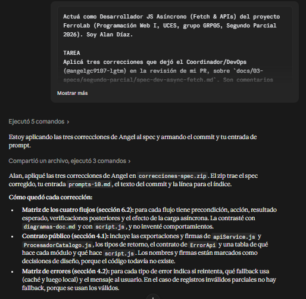

# Prompt 10

**Integrante:** Alan Díaz
**Rol:** Desarrollador JS Asíncrono (Fetch & APIs)
**Modelo de IA:** Claude (Anthropic)
**Método de prompt:** Role prompting
**Fecha y hora:** 26/11/2026, 14:22 (hora de Argentina)
**Spec asociado:** `docs/03-specs/segundo-parcial/spec-dev-async-fetch.md`

## Prompt exacto
```
Actuá como Desarrollador JS Asíncrono (Fetch & APIs) del proyecto FerroLab (Programación Web I, UCES, grupo GRP05, Segundo Parcial 2026). Soy Alan Díaz.

TAREA
Aplicá tres correcciones que dejó el Coordinador/DevOps (@angelgc9107-lgtm) en la revisión de mi PR, sobre `docs/03-specs/segundo-parcial/spec-dev-async-fetch.md`. Son comentarios literales:

1. Sección 6 (Casos de test a coordinar con Tester QA/JS): "Incorporar una matriz mínima con resultado esperado y verificaciones posteriores para los cuatro flujos."
2. Sección 4 (Manejo de errores, validación y sanitización), párrafo "Estructura en `apiService.js`…": "Documentar el contrato público, nombres y exportaciones de las funciones, tipos de retorno y separación de responsabilidades entre `apiService.js` y `script.js`."
3. Sección 4, tabla de casos de error (líneas de "JSON válido pero con estructura inesperada", "Algunos registros inválidos" y "Todos los registros inválidos o lista vacía"): "Completar una matriz por tipo de error con caché/fallback aplicable, reintento y mensaje asociado."

CONTEXTO
- Partí del spec que ya generaste y del estado actual de la rama; las correcciones se aplican en el mismo archivo y se commitean aparte, con un commit descriptivo.
- Los cuatro flujos son los de la aplicación (documentados en `docs/05-diagramas/01-diagrama-de-actividades/diagramas-doc.md`): búsqueda en el catálogo, carrito, pago y confirmación del pedido. Revisá ese archivo y `js/script.js` para nombrarlos y describir su resultado esperado con precisión, sin inventar comportamientos.
- La matriz de la corrección 1 debe indicar, para cada flujo: precondición, acción, resultado esperado inmediato y verificaciones posteriores (por ejemplo, qué queda en el DOM y qué queda guardado en Storage), y cómo cambia con la carga asíncrona del catálogo.
- La corrección 2 debe incluir: nombre de cada función exportada de `apiService.js` y de `ProcesadorCatalogo.js`, parámetros, tipo de retorno (incluidas las promesas), errores que lanza, el contrato de `ErrorApi` (campos `tipo` y `mensaje`) y una tabla de qué hace `apiService.js` y qué hace `script.js` (el módulo de API no toca el DOM; `script.js` decide qué mostrar).
- La corrección 3 debe completar, para CADA tipo de error de la sección (red/tiempo agotado, HTTP 5xx, HTTP 4xx, formato, registros inválidos parciales, datos vacíos), las columnas: ¿reintenta? (cuántas veces), ¿fallback aplicable? (caché → `productosIniciales`, o ninguno y por qué) y mensaje asociado al usuario.

REGLAS
- No cambies lo que no está comentado, salvo para mantener consistencia entre secciones (por ejemplo, si cambiás un mensaje en la tabla, que coincida en el resto del spec).
- No inventes comportamiento del código existente: si algo no se puede confirmar con el repo, marcalo como decisión de diseño.
- No modifiques nada en GitHub: entregame el archivo en local, listo para copiar, y el texto del commit.
```

## Resultado esperado
Las tres correcciones de la revisión aplicadas al spec: matriz de los cuatro flujos, contrato público de `apiService.js` con separación de responsabilidades, y matriz de errores con reintento, fallback y mensaje.

## Resultado obtenido
Spec actualizado (`spec-dev-async-fetch.md`):
- **Sección 6.2:** matriz de los cuatro flujos (precondición, acción, resultado esperado, verificaciones posteriores y efecto de la carga asíncrona), contrastada con `diagramas-doc.md` y `js/script.js`.
- **Sección 4.1:** contrato de `apiService.js` y `ProcesadorCatalogo.js` (exportaciones, firmas, retornos, `ErrorApi`, `ResultadoCarga`) y tabla de responsabilidades entre `apiService.js`, `ProcesadorCatalogo.js` y `script.js`. Los nombres son decisiones de diseño, marcadas como tales.
- **Sección 4.2:** matriz de errores por tipo, con reintento, fallback (caché → local) y mensaje.
- **Consistencia:** en la sección 2, el estado loading usa el tipo `loading` que ya existe en `mostrarMensaje()`.
No hay código nuevo: solo el spec.

## Correcciones manuales
ninguna

## Captura

## Aplicación
Rama `feature/dev-async-fetch-api`, segundo commit (correcciones de la revisión de Angel sobre la PR del spec).
