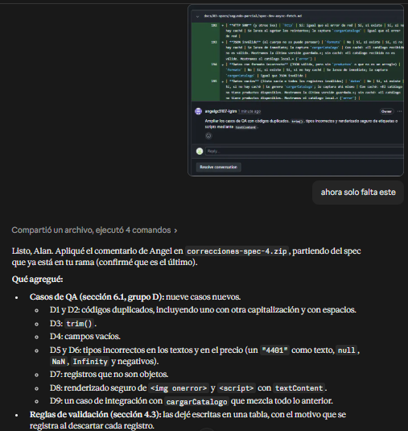

# Prompt 11

**Integrante:** Alan Díaz
**Rol:** Desarrollador JS Asíncrono (Fetch & APIs)
**Modelo de IA:** Claude (Anthropic) — <completar con la versión que muestre la captura>
**Método de prompt:** Conversacional (pedido directo, sin prompt estructurado previo)
**Fecha y hora:** 26/11/2026, 17:49 (hora de Argentina)
**Spec asociado:** `docs/03-specs/segundo-parcial/spec-dev-async-fetch.md`

## Prompt exacto
Mensaje original, con una captura adjunta de un comentario de la revisión de la PR:

**17:49** (con 1 captura adjunta)
```
ahora solo falta este
```

## Comentario recibido (transcripción de la captura)
Línea 192 a 195 (sección 4.2, matriz de errores): «Ampliar los casos de QA con códigos duplicados, trim(), tipos incorrectos y renderizado seguro de etiquetas o scripts mediante textContent.»

## Resultado esperado
Los casos de QA del spec ampliados con los cuatro temas del comentario, con coherencia respecto de lo ya corregido.

## Resultado obtenido
Spec actualizado:
- **Sección 6.1, grupo D** (casos D1 a D9): códigos duplicados (con otra capitalización y con espacios), `trim()`, tipos incorrectos en textos y en el precio, registros que no son objetos, renderizado seguro de etiquetas y scripts con `textContent`, y un caso de integración con `cargarCatalogo`.
- **Sección 4.3:** se vuelven explícitas las reglas de validación (tipos, campos vacíos, `trim()`, precio, duplicados con la misma regla que `Catalogo`) con el motivo que se registra al descartar, y la regla de `textContent`, contrastada con el código actual (`renderizarCatalogo` ya usa `textContent` y `script.js` no usa `innerHTML`).
- **Sección 3 y sección 7:** se ajusta la descripción de `filtrarValidos` y se agrega un criterio de aceptación.
- **Detalle encontrado al revisar:** `Catalogo` lanza `RangeError` si hay códigos repetidos, así que el spec exige validar los duplicados **antes** de armar el catálogo.
No hay código nuevo: solo el spec.

## Correcciones manuales
ninguna

## Captura


## Aplicación
Rama `feature/dev-async-fetch-api`, commit de correcciones de la cuarta revisión de la PR.
