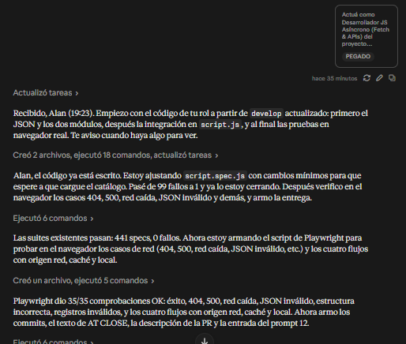

# Prompt 12

**Integrante:** Alan Díaz
**Rol:** Desarrollador JS Asíncrono (Fetch & APIs)
**Modelo de IA:** Claude (Anthropic) — <completar con la versión que muestre la captura>
**Método de prompt:** Prompt estructurado (armado previamente por la IA a pedido del integrante y enviado de vuelta como archivo adjunto)
**Fecha y hora:** 26/11/2026, 19:23 (hora de Argentina)
**Spec asociado:** `docs/03-specs/segundo-parcial/spec-dev-async-fetch.md`

## Prompt exacto
Mensaje original: el texto completo adjunto como archivo `.txt` (con la indicación previa del integrante: «listo ya se mergeo mi parte, ahora segui con el trabajo y dame el prompt, acordate que si hay algo en el trabajo q si o si necesita evidencia de prompt hace el prompt, pasamelo y te lo paso asi lo haces»).

**19:23** (adjunto: archivo de texto)
```
Actuá como Desarrollador JS Asíncrono (Fetch & APIs) del proyecto FerroLab (Programación Web I, UCES, grupo GRP05, Segundo Parcial 2026). Soy Alan Díaz.

TAREA
Implementá el código de mi rol siguiendo al pie de la letra el spec ya mergeado `docs/03-specs/segundo-parcial/spec-dev-async-fetch.md` (secciones 1 a 7). Es la implementación completa: el consumo asíncrono del catálogo con `fetch`, con estados de carga, manejo de errores, fallbacks y procesamiento con `map` / `filter` / `reduce`.

BASE DE TRABAJO
- Partí del estado más reciente de `develop` (incluye el spec de mi rol y el trabajo del Tester QA/JS).
- Rama: `feature/dev-async-fetch-api-implementacion` → `develop`.
- No modifiques lo que hicieron otros roles: `js/models/` (Producto, Catalogo, etc.), `js/utils/storage.js`, `js/services/FachadaStorage.js` ni los specs y documentos del Tester QA/JS.

ARCHIVOS A ENTREGAR
1. `api/productos.json`: los 9 productos de `js/data/productosIniciales.js`, con el formato `{ "version": 1, "productos": [...] }`, sin cambiar códigos, textos ni precios. Verificá con un script que el contenido coincide exactamente con `productosIniciales`.
2. `js/api/apiService.js`: con el contrato del spec (sección 4.1): `ErrorApi`, `obtenerJson`, `obtenerCatalogoRemoto` y `cargarCatalogo`, con sus opciones (`tiempoLimiteMs` 8000, `reintentos` 2, `esperaBaseMs` 500, `fetchFn`, `esperarFn`, `alReintentar`) y el `ResultadoCarga`. Respaldo: caché con `FachadaStorage` y luego `productosIniciales`. No toca el DOM. JSDoc en todo.
3. `js/services/ProcesadorCatalogo.js`: `filtrarValidos`, `construirProductos`, `resumirCatalogo` y `agruparPorCategoria`, como funciones puras, con las reglas de la sección 4.3 (tipos, vacíos, `trim`, precio, códigos duplicados con la misma regla que `Catalogo`, validados antes de armar el catálogo).
4. `js/script.js`: carga inicial asíncrona del catálogo con `await cargarCatalogo()`, mostrando los estados de la sección 2 (loading → success o advertencia de error con botón «Reintentar»), reutilizando `mostrarMensaje()` y los elementos que ya existen en `index.html`. Se distingue la disponibilidad del catálogo del mensaje: con caché o catálogo local el catálogo está disponible y los cuatro flujos funcionan. La búsqueda inicial corre cuando el catálogo queda disponible. `script.js` no llama a `fetch` directamente. Todo texto de la API se inserta con `textContent`.
5. `index.html` y `css/components.css`: solo lo mínimo e indispensable (por ejemplo, `aria-busy` y el botón «Reintentar»), con clases de Bootstrap.

REGLAS DE IMPLEMENTACIÓN
- JavaScript con módulos ES, sin librerías nuevas, sin `alert()`, `confirm()` ni `prompt()`.
- Los mensajes al usuario son exactamente los de la matriz de la sección 4.2 del spec.
- El detalle técnico de los errores va a `console.error`, no a la pantalla.
- Un solo pedido en vuelo: «Reintentar» no inicia otra carga si ya hay una en curso.
- La carga asíncrona no debe empeorar el rendimiento de la página (no bloquear el render; el objetivo de Lighthouse es ≥ 95).
- Si algo del spec no se puede cumplir tal cual con el código real, no lo cambies en silencio: avisame y proponé el ajuste.

PRUEBAS
- Corré las suites existentes (models, storage, services, script) en un navegador real y reportame los resultados: cantidad de specs, fallos y cobertura si se puede medir.
- Si la carga asíncrona rompe tests existentes de `script.spec.js`, hacé solo el cambio mínimo necesario para que esperen a que el catálogo esté disponible, y listame exactamente qué tests tocaste y por qué, para avisarle al Tester QA/JS. No crees `api.spec.js` ni `library.spec.js`: son del Tester QA/JS.
- Verificá el comportamiento real con un navegador (Playwright): éxito, 404, 500, red caída, JSON inválido, estructura incorrecta, registros inválidos, y la búsqueda, el carrito, el pago y la confirmación funcionando con `origen` red, caché y local. Reportame qué se probó y el resultado, sin dar por pasado lo que no se corrió.

ENTREGA
- Los archivos en la estructura del repo, listos para copiar.
- Un commit por tarea lógica, con mensajes descriptivos en español (por ejemplo, `feat: servicio de API con reintentos y fallbacks`).
- La sección «AT CLOSE» del spec completa, como texto aparte para que la pegue yo: resumen de la integración con las clases POO y con Storage, issues respondidas (dejá los campos que dependen de mí como pendientes) y los ajustes manuales (pendientes, los completo yo).
- La descripción de la PR en el formato del template del repo y la línea del `changelog.md` (con el número de PR pendiente).

REGLAS
- No inventes resultados: todo lo que no corras va como no verificado.
- No modifiques nada en GitHub: entregame todo en local.
```

## Resultado esperado
La implementación completa del rol según el spec mergeado: `api/productos.json`, `js/api/apiService.js`, `js/services/ProcesadorCatalogo.js`, la carga asíncrona en `js/script.js` con sus estados, el mínimo de `index.html`, las suites existentes pasando y la verificación real en un navegador.

## Resultado obtenido
Archivos entregados, cada uno en su commit:
- `api/productos.json`: 9 productos idénticos a `productosIniciales` (verificado con un script).
- `js/services/ProcesadorCatalogo.js`: `filtrarValidos`, `construirProductos`, `resumirCatalogo` y `agruparPorCategoria`, con `map`, `filter` y `reduce`.
- `js/api/apiService.js`: `ErrorApi`, `obtenerJson`, `obtenerCatalogoRemoto` y `cargarCatalogo` (tiempo límite, reintentos solo para red y 5xx, respaldo en caché y luego en el catálogo local).
- `js/script.js` e `index.html`: carga asíncrona con estados, botón «Reintentar», un solo pedido en vuelo y controles deshabilitados mientras carga.
- `js/test/script.spec.js`: cambio mínimo para esperar al catálogo (detalle en la descripción de la PR).

Verificación: suites existentes 441 specs, 0 fallos; 35 comprobaciones con Playwright (éxito, 404, 500, red caída, JSON inválido, estructura incorrecta, registros inválidos, y los cuatro flujos con origen red, caché y local), todas coincidieron con lo esperado. No se midió la cobertura ni se corrió Lighthouse.

## Correcciones manuales
ninguna

## Captura


## Aplicación
Rama `feature/dev-async-fetch-api-implementacion`, implementación del rol.
