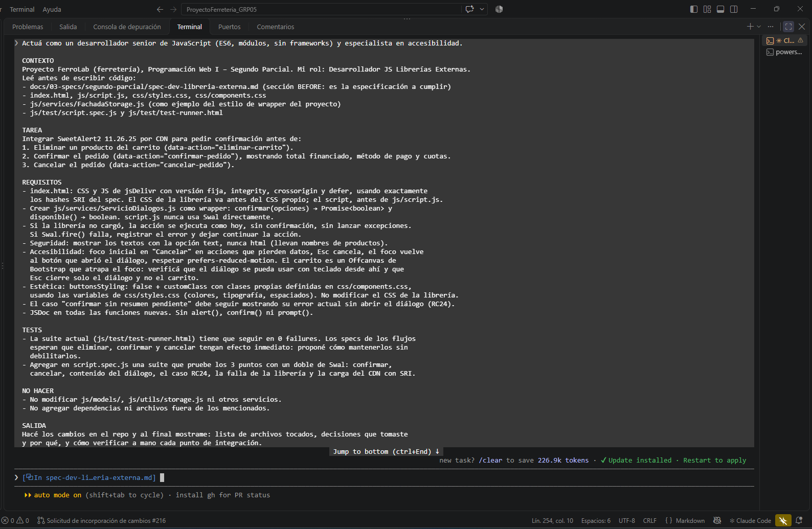

# Prompt 12

**Integrante:** Thiago Piastrellini
**Rol:** Desarrollador JS Librerías Externas
**Modelo de IA:** Claude Code (Anthropic) — Opus 5.5
**Método de prompt:** Role prompting con prompt estructurado (contexto, tarea, requisitos, tests, restricciones y formato de salida)
**Fecha y hora:** 26/11/2026, alrededor de las 11:54 (hora de Argentina); la sesión terminó a las 12:09
**Spec asociado:** `docs/03-specs/segundo-parcial/spec-dev-libreria-externa.md` (sección BEFORE como especificación; el prompt queda registrado en el AT CLOSE)

## Prompt exacto
```
Actuá como un desarrollador senior de JavaScript (ES6, módulos, sin frameworks) y especialista en accesibilidad.

CONTEXTO
Proyecto FerroLab (ferretería), Programación Web I – Segundo Parcial. Mi rol: Desarrollador JS Librerías Externas.
Leé antes de escribir código:
- docs/03-specs/segundo-parcial/spec-dev-libreria-externa.md (sección BEFORE: es la especificación a cumplir)
- index.html, js/script.js, css/styles.css, css/components.css
- js/services/FachadaStorage.js (como ejemplo del estilo de wrapper del proyecto)
- js/test/script.spec.js y js/test/test-runner.html

TAREA
Integrar SweetAlert2 11.26.25 por CDN para pedir confirmación antes de:
1. Eliminar un producto del carrito (data-action="eliminar-carrito").
2. Confirmar el pedido (data-action="confirmar-pedido"), mostrando total financiado, método de pago y cuotas.
3. Cancelar el pedido (data-action="cancelar-pedido").

REQUISITOS
- index.html: CSS y JS de jsDelivr con versión fija, integrity, crossorigin y defer, usando exactamente
  los hashes SRI del spec. El CSS de la librería va antes del CSS propio; el script, antes de js/script.js.
- Crear js/services/ServicioDialogos.js como wrapper: confirmar(opciones) → Promise<boolean> y
  disponible() → boolean. script.js nunca usa Swal directamente.
- Si la librería no cargó, la acción se ejecuta como hoy, sin confirmación, sin lanzar excepciones.
  Si Swal.fire() falla, registrar el error y dejar continuar la acción.
- Seguridad: mostrar los textos con la opción text, nunca html (llevan nombres de productos).
- Accesibilidad: foco inicial en "Cancelar" en acciones que pierden datos, Esc cancela, el foco vuelve
  al botón que abrió el diálogo, respetar prefers-reduced-motion. El carrito es un Offcanvas de
  Bootstrap que atrapa el foco: verificá que el diálogo se pueda usar con teclado desde ahí y que
  Esc cierre solo el diálogo y no el carrito.
- Estética: buttonsStyling: false + customClass con clases propias definidas en css/components.css,
  usando las variables de css/styles.css (colores, tipografía, espaciados). No modificar el CSS de la librería.
- El caso "confirmar sin resumen pendiente" debe seguir mostrando su error actual sin abrir el diálogo (RC24).
- JSDoc en todas las funciones nuevas. Sin alert(), confirm() ni prompt().

TESTS
- La suite actual (js/test/test-runner.html) tiene que seguir en 0 failures. Los specs de los flujos
  esperan que eliminar, confirmar y cancelar tengan efecto inmediato: proponé cómo mantenerlos sin
  debilitarlos.
- Agregar en script.spec.js una suite que pruebe los 3 puntos con un doble de Swal: confirmar,
  cancelar, contenido del diálogo, el caso RC24, la falla de la librería y la carga del CDN con SRI.

NO HACER
- No modificar js/models/, js/utils/storage.js ni otros servicios.
- No agregar dependencias ni archivos fuera de los mencionados.

SALIDA
Hacé los cambios en el repo y al final mostrame: lista de archivos tocados, decisiones que tomaste
y por qué, y cómo verificar a mano cada punto de integración.
```

## Resultado esperado
SweetAlert2 integrada por CDN con un wrapper propio, pidiendo confirmación en los tres puntos (eliminar del carrito, confirmar y cancelar el pedido), con la estética del sitio, accesible con teclado y con la suite de tests en 0 failures.

## Resultado obtenido
Claude Code leyó el spec y los archivos indicados, verificó los hashes SRI contra lo que sirve jsDelivr y modificó cinco archivos:

- `index.html`: CSS y JS de SweetAlert2 11.26.25 con `integrity`, `crossorigin` y `defer`.
- `js/services/ServicioDialogos.js` (nuevo): wrapper con `confirmar()` y `disponible()`.
- `js/script.js`: los tres puntos de integración y protección contra doble clic.
- `css/components.css`: bloque `.dialogo-confirmacion*` con las variables del sitio.
- `js/test/script.spec.js`: los flujos existentes pasan por un doble de `Swal` y se agregó una suite de 27 specs.

Decisiones que tomó por su cuenta y se aceptaron:

- `titleText` en lugar de `title`, porque en SweetAlert2 `title` se interpreta como HTML.
- Insertar el diálogo dentro del Offcanvas del carrito (`target`), porque la trampa de foco de Bootstrap le quitaba el foco.
- `stopKeydownPropagation` para que `Esc` no cierre el carrito.
- Ignorar clics mientras hay un diálogo abierto.
- Cancelar sin preguntar si el formulario está vacío.

También rebasó la rama sobre `origin/develop` porque partía de una base desactualizada.

Resultado: **468 specs, 0 failures** (corrido con 3 semillas y con pruebas de mutación sobre el wrapper).

## Correcciones manuales
Ninguna sobre el código generado. Se revisó el diff, se corrió la suite y se probaron a mano los tres puntos, incluido el uso con teclado desde el carrito y con el CDN bloqueado (detalle en la sección 3 del AT CLOSE del spec).

## Captura


## Aplicación
Rama `feature/dev-libreria-externa-sweetalert2` → `develop` (PR #216). Commit `9a4e456` (integración), posterior a los commits del spec BEFORE.
