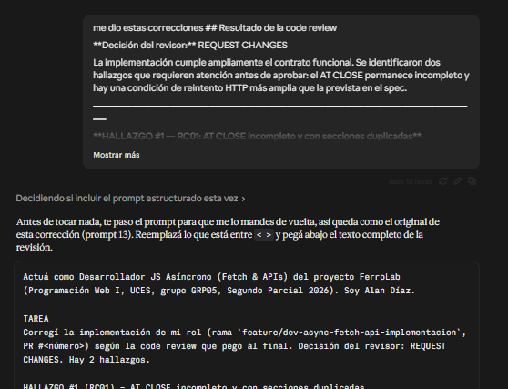

# Prompt 14

**Integrante:** Alan Díaz
**Rol:** Desarrollador JS Asíncrono (Fetch & APIs)
**Modelo de IA:** Claude (Anthropic) — Sonnet 5.5
**Método de prompt:** Prompt estructurado (armado previamente por la IA a pedido del integrante y enviado de vuelta)
**Fecha y hora:** 26/11/2026, 20:51 (hora de Argentina)
**Spec asociado:** `docs/03-specs/segundo-parcial/spec-dev-async-fetch.md`

## Prompt exacto
> **Nota de numeración:** el prompt de abajo pedía guardar esta entrada como `prompts-13.md`. En `develop` ese número ya lo usa otro integrante, por lo que se guardó como `prompts-14.md` y no se cambió el texto del prompt original.

Mensaje original, en dos partes. Primero llegó el texto de la code review de la PR de implementación; después, el prompt estructurado. En el prompt, el número de PR y la respuesta de la issue #210 quedaron sin completar (`<número>` y `<completar…>`), y el texto de la revisión no se pegó a continuación: ya había llegado en el mensaje anterior.

**20:47**
```
me dio estas correcciones ## Resultado de la code review

**Decisión del revisor:** REQUEST CHANGES

La implementación cumple ampliamente el contrato funcional. Se identificaron dos hallazgos que requieren atención antes de aprobar: el AT CLOSE permanece incompleto y hay una condición de reintento HTTP más amplia que la prevista en el spec.

════════════════════════════════════════════════════════════

**HALLAZGO #1 — RC01: AT CLOSE incompleto y con secciones duplicadas**

**Archivo:** `docs/03-specs/segundo-parcial/spec-dev-async-fetch.md`

**Línea:** 379-392

**Tipo de problema:** documentación

**Severidad:** media

**Explicación técnica**

El AT CLOSE conserva marcadores pendientes (`#<NÚMERO>` y `_completar_`) y dos secciones duplicadas de resumen e issues que siguen marcadas como pendientes. Esto impide verificar el cierre documental y la trazabilidad solicitada en los criterios de aceptación.

**Sugerencia de mejora**

Completar la referencia a la PR de implementación y el estado/resolución de la issue #210; eliminar las secciones duplicadas pendientes y dejar un único cierre consistente con la evidencia real.

**Ejemplo de código corregido (si aplica)**

**Antes:**

`Esta implementación la cumple con la PR #<NÚMERO>. _<completar: respuesta en la issue y número de PR>_`

**Después:**

`Esta implementación se entrega en la PR #217. Completar aquí la respuesta y resolución registrada en la issue #210.`

**DECISIÓN DEL REVISOR HUMANO**

- Aceptar sugerencia.
- Rechazar sugerencia.
**Justificación del revisor humano:**

════════════════════════════════════════════════════════════

**HALLAZGO #2 — RC02: Reintento de códigos HTTP fuera del rango 5xx**

**Archivo:** `js/api/apiService.js`

**Línea:** 154

**Tipo de problema:** bug

**Severidad:** baja

**Explicación técnica**

La condición `error.estado >= 500` trata cualquier código igual o superior a 500 como reintentable. El contrato establece reintentos para respuestas HTTP 5xx; por tanto, códigos fuera de ese rango (por ejemplo, 600) también se reintentarían indebidamente.

**Sugerencia de mejora**

Limitar la condición de reintento al rango HTTP 500–599.

**Ejemplo de código corregido (si aplica)**

**Antes:**

```js
const pasajero = error.tipo === "red" || (error.tipo === "http" && error.estado >= 500);
```

**Después:**

```js
const pasajero = error.tipo === "red" ||
    (error.tipo === "http" && error.estado >= 500 && error.estado < 600);
```

**DECISIÓN DEL REVISOR HUMANO**

- Aceptar sugerencia.
- Rechazar sugerencia.
**Justificación del revisor humano:**

════════════════════════════════════════════════════════════

## Recomendaciones no bloqueantes

- Conservar en el AT CLOSE resultados de pruebas ejecutadas con evidencia y distinguirlos de los escenarios no verificados.
- No afirmar validación en otros navegadores ni timeout real de 8 segundos si no se ejecutaron esos casos.

## Validación de esta revisión

- Carga real en Chromium: 9 tarjetas renderizadas, origen `red`, estado accesible `aria-busy="false"` y sin errores de consola.
- Suites Jasmine existentes en Chromium: **441 specs, 0 fallos**.
- Los escenarios de Lighthouse, 404/500, red caída y fallbacks no se ejecutaron de forma independiente en esta revisión.


**20:51**
```
Actuá como Desarrollador JS Asíncrono (Fetch & APIs) del proyecto FerroLab (Programación Web I, UCES, grupo GRP05, Segundo Parcial 2026). Soy Alan Díaz.

TAREA
Corregí la implementación de mi rol (rama `feature/dev-async-fetch-api-implementacion`, PR #<número>) según la code review que pego al final. Decisión del revisor: REQUEST CHANGES. Hay 2 hallazgos.

HALLAZGO #1 (RC01) – AT CLOSE incompleto y con secciones duplicadas
- Archivo: `docs/03-specs/segundo-parcial/spec-dev-async-fetch.md`, sección AT CLOSE.
- Entregame el texto de la sección AT CLOSE completa y consistente, para reemplazar TODA la sección de una vez (sin secciones duplicadas ni `_Pendiente._`).
- Referencia a la PR de implementación: #<número>.
- Issue #210: <completar: lo que respondí o resolví en la issue; si todavía no la respondí, dejalo como pendiente>.
- Los campos que dependen de mí (ajustes manuales) quedan como pendientes marcados claramente.
- Recomendación no bloqueante de la revisión: incluir las pruebas ejecutadas con su evidencia y separarlas de lo no verificado (cobertura, Lighthouse, otros navegadores, tiempo límite real de 8 s). No afirmes nada que no se haya corrido.

HALLAZGO #2 (RC02) – Reintento de códigos HTTP fuera del rango 5xx
- Archivo: `js/api/apiService.js`: la condición `error.estado >= 500` debe limitarse a 500–599.
- Revisá si la misma condición aparece en otros archivos (por ejemplo `js/script.js`) y mantenela coherente.
- Verificá en un navegador real con Playwright: 500 y 599 reintentan (3 pedidos), 404 y 600 no reintentan (1 pedido), y el mensaje al usuario correspondiente. Corré de nuevo las suites existentes y reportame los resultados.

ENTREGA
- Los archivos corregidos listos para copiar, y un commit por hallazgo con mensaje en español.
- Una entrada `prompts-13.md` lista para guardar, con el formato de las anteriores (modelo, captura y correcciones manuales como pendientes), y la línea para `prompts.md`.
- Si en `docs/` aparece algo del spec que cambie por la corrección, avisame.

REGLAS
- No inventes resultados: lo que no corras va como no verificado.
- No modifiques nada en GitHub: entregame todo en local.
- No toques otros roles ni los specs del Tester QA/JS.
```

## Resultado esperado
Los dos hallazgos de la code review resueltos: el cierre documental (AT CLOSE) completo, único y consistente con la evidencia, y los reintentos HTTP limitados al rango 500–599 con la misma regla en todo el código.

## Resultado obtenido
- **RC02 (`apiService.js` y `script.js`):** la condición pasó a `estado >= 500 && estado < 600` en `obtenerJson` y en `describirCarga()`. Verificado en Chromium con Playwright: 500, 503 y 599 reintentan (3 pedidos); 404 y 600 no reintentan (1 pedido). Suites existentes: 441 specs, 0 fallos; escenarios de Playwright: 35 comprobaciones, todas coinciden.
- **RC01 (AT CLOSE):** texto único para reemplazar toda la sección, con las pruebas ejecutadas separadas de lo no verificado. Quedan pendientes, marcados, el número de PR, la respuesta registrada en la issue #210 y los ajustes manuales.
- Nada del resto del spec cambia por la corrección.

## Correcciones manuales
ninguna

## Captura


## Aplicación
Rama `feature/dev-async-fetch-api-implementacion`: commit de corrección de código (RC02) y commit de documentación (RC01 y este registro).
