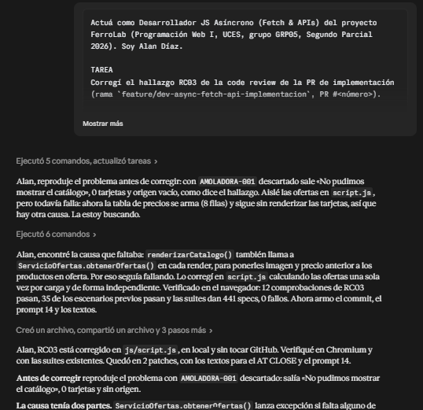

# Prompt 15

**Integrante:** Alan Díaz
**Rol:** Desarrollador JS Asíncrono (Fetch & APIs)
**Modelo de IA:** Claude (Anthropic) — <completar con la versión que muestre la captura>
**Método de prompt:** Prompt estructurado (armado previamente por la IA a pedido del integrante y enviado de vuelta)
**Fecha y hora:** 26/11/2026, 21:40 (hora de Argentina)
**Spec asociado:** `docs/03-specs/segundo-parcial/spec-dev-async-fetch.md`

## Prompt exacto
> **Nota de numeración:** el prompt de abajo pedía guardar esta entrada como `prompts-14.md`. En `develop` ese número ya lo usa otro integrante, por lo que se guardó como `prompts-15.md` y no se cambió el texto del prompt original.

Mensaje original, en dos partes. Primero llegó el hallazgo de la code review; después, el prompt estructurado. En el prompt, el número de PR quedó sin completar (`#<número>`).

**21:39**
```
nueva correccion : RC03 – Una respuesta parcialmente válida puede impedir renderizar todo el catálogo
Severidad: Medio.
Archivo: script.js
Línea o rango: 926.
Requisito incumplido: Spec del rol, §4.2-4.3 y §6.1 D: descartar registros inválidos y conservar/renderizar los productos válidos.
Problema detectado: renderizarOfertas() se ejecuta antes de renderizar el catálogo principal. El servicio de ofertas existente exige que estén presentes sus tres códigos promocionales. Al simular un JSON válido donde AMOLADORA-001 se descarta por precio inválido, ServicioOfertas.obtenerOfertas() lanza una excepción. El controlador termina mostrando “No pudimos mostrar el catálogo” y no renderiza ninguno de los otros ocho productos válidos. El DOM queda marcado como disponible, pero sin origen ni tarjetas.
Corrección solicitada: Asegurar que la renderización de ofertas no interrumpa la carga del catálogo principal cuando falte un producto promocionado; las ofertas ausentes deben omitirse o tratarse de forma independiente.
```

**21:40**
```
Actuá como Desarrollador JS Asíncrono (Fetch & APIs) del proyecto FerroLab (Programación Web I, UCES, grupo GRP05, Segundo Parcial 2026). Soy Alan Díaz.

TAREA
Corregí el hallazgo RC03 de la code review de la PR de implementación (rama `feature/dev-async-fetch-api-implementacion`, PR #<número>).

HALLAZGO RC03 – Una respuesta parcialmente válida puede impedir renderizar todo el catálogo
- Severidad: Medio. Archivo: `js/script.js`, alrededor de la línea 926.
- Requisito incumplido: spec del rol, §4.2-4.3 y §6.1 D: descartar los registros inválidos y conservar/renderizar los productos válidos.
- Problema: `renderizarOfertas()` se ejecuta antes de renderizar el catálogo principal. `ServicioOfertas.obtenerOfertas()` exige que estén sus tres códigos promocionales. Si en un JSON válido `AMOLADORA-001` se descarta por precio inválido, lanza una excepción, el controlador muestra «No pudimos mostrar el catálogo» y no renderiza ninguno de los otros ocho productos. El DOM queda como disponible, pero sin origen ni tarjetas.
- Corrección pedida: que la renderización de ofertas no interrumpa la carga del catálogo principal cuando falte un producto promocionado; las ofertas ausentes deben omitirse o tratarse de forma independiente.

CONDICIONES
- Corregí solo en `js/script.js`. `ServicioOfertas` y los demás archivos de otros roles no se tocan. Si para mostrar las ofertas que sí existen hiciera falta cambiar `ServicioOfertas`, no lo cambies: avisame y proponé el ajuste.
- Tratá las ofertas de forma independiente: si fallan, el detalle técnico va a `console.error`, la sección de ofertas queda sin tarjetas (también si venía con ofertas de una carga anterior) y el resto de la carga sigue normal.
- Revisá si el resto de la carga (categorías, tabla de precios) tiene el mismo riesgo con datos parciales y avisame qué encontraste antes de ampliar el cambio.
- El mensaje al usuario sigue siendo el de la matriz del spec (§4.2) según el origen; no inventes mensajes nuevos. Si hace falta uno para las ofertas, proponémelo.

PRUEBAS
- Reproducí primero el problema con Playwright (descartar `AMOLADORA-001` por precio inválido) para confirmar que falla antes de la corrección.
- Después de corregir, verificá en un navegador real: falta cada uno de los tres códigos promocionales; un código promocional con precio igual o mayor al precio anterior de su oferta; y un caso con los tres presentes. En cada caso: se renderizan todas las tarjetas válidas, el origen es red y el mensaje es el de datos descartados cuando corresponde, y no aparece «No pudimos mostrar el catálogo».
- Verificá también con origen caché y local, y que búsqueda, carrito, pago y confirmación funcionan con el catálogo parcial.
- Corré de nuevo las suites existentes (models, storage, services, script) y los escenarios que ya corriste, y reportame los resultados.
- Si corresponde un test para esto en `script.spec.js` o en el Tester QA/JS, decime cuál; no lo agregues vos a las suites de otros roles.

ENTREGA
- Los archivos corregidos listos para copiar y un commit en español.
- Una entrada `prompts-14.md` lista para guardar, con el formato de las anteriores (modelo, captura y correcciones manuales como pendientes), y la línea para `prompts.md`.
- Las líneas que hay que agregar al AT CLOSE (sección 3, correcciones de la code review) para RC03, y cualquier cambio de pruebas ejecutadas / no verificadas.

REGLAS
- No inventes resultados: lo que no corras va como no verificado.
- No modifiques nada en GitHub: entregame todo en local.
- No toques otros roles ni los specs del Tester QA/JS.
```

## Resultado esperado
Que un catálogo parcialmente válido (por ejemplo, con `AMOLADORA-001` descartado) se muestre igual: todas las tarjetas válidas, el mensaje que corresponde al origen y las ofertas omitidas de forma independiente, sin impedir la carga del catálogo principal.

## Resultado obtenido
- **Reproducción previa:** antes de corregir, con `AMOLADORA-001` descartado por precio inválido, la pantalla mostraba «No pudimos mostrar el catálogo», 0 tarjetas y sin origen.
- **Causa:** `ServicioOfertas.obtenerOfertas()` se llamaba en dos lugares de `script.js`: `renderizarOfertas()` y también `renderizarCatalogo()` (para la imagen y el precio anterior de los productos en oferta). Aislar solo `renderizarOfertas()` no alcanzaba.
- **Corrección (solo `js/script.js`):** las ofertas se calculan una vez por carga en `actualizarOfertasVigentes()`; si fallan, se omiten (sección de ofertas vacía, detalle en `console.error`) y el resto de la carga sigue. No se tocó `ServicioOfertas`.
- **Verificación en Chromium con Playwright (12 comprobaciones, todas coinciden):** `AMOLADORA-001` con precio inválido (8 tarjetas, mensaje «Se cargaron 8 productos (1 descartados por datos inválidos).»); falta cada uno de los tres códigos promocionales; `MARTILLO-001` con precio igual al anterior de su oferta; `AMOLADORA-001` con precio mayor al anterior; tres ofertas presentes con otro producto inválido (3 ofertas); origen caché con catálogo parcial guardado; «Reintentar» de un catálogo completo a uno parcial (las ofertas viejas no quedan); control con catálogo completo. Con el catálogo parcial funcionan búsqueda, carrito, pago y confirmación con origen red y caché.
- **Suites existentes:** 441 specs, 0 fallos. Escenarios previos: 35 comprobaciones, todas coinciden.
- **Limitación conocida:** como `ServicioOfertas` es «todo o nada», cuando falla se pierde la imagen y el precio anterior también de los productos en oferta que sí están presentes (se muestran como productos normales). Mostrar las ofertas restantes requeriría cambiar `ServicioOfertas` (de otro rol); queda como propuesta.
- **No verificado:** origen local con catálogo parcial (el catálogo local siempre trae los tres productos promocionados), otros navegadores, Lighthouse y cobertura.

## Correcciones manuales
ninguna

## Captura


## Aplicación
Rama `feature/dev-async-fetch-api-implementacion`: commit de corrección de RC03 y commit de este registro.
