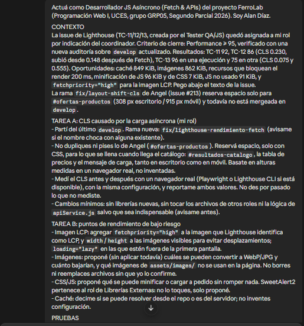
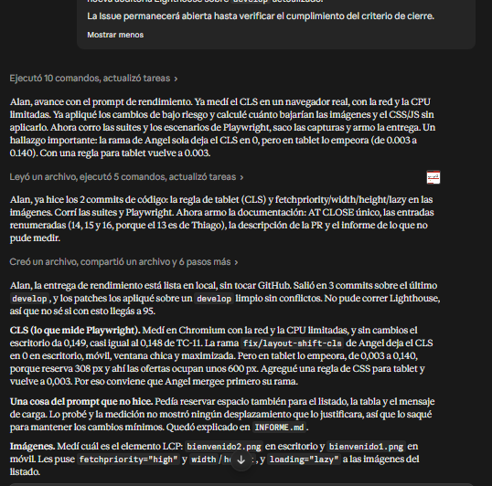

# Prompt 16

**Integrante:** Alan Díaz
**Rol:** Desarrollador JS Asíncrono (Fetch & APIs)
**Modelo de IA:** Claude (Anthropic); la versión exacta no se registró
**Método de prompt:** Prompt estructurado (armado previamente por la IA a pedido del integrante y enviado de vuelta)
**Fecha y hora:** 27/11/2026, 13:15 (hora de Argentina)
**Spec asociado:** `docs/03-specs/segundo-parcial/spec-dev-async-fetch.md`
**Issue asociada:** issue de Lighthouse (TC-11, TC-12 y TC-13) asignada al rol por indicación del coordinador, y issue #213 (CLS).

## Prompt exacto
Mensaje original, en tres partes. Primero llegó la issue de Lighthouse (con las actualizaciones de TC-12 y TC-13) como archivo adjunto de texto y los comentarios del Tester QA/JS; después, la IA analizó `develop` y armó el prompt estructurado; por último, el integrante lo envió de vuelta junto con el mismo archivo adjunto. El texto de la issue aparece al final del prompt tal como se pegó; el archivo adjunto completo (340 líneas, con las actualizaciones de TC-12 y TC-13) se conserva como adjunto de la conversación.

**13:12** (adjunto: archivo de texto con la issue)
```
uno de mis compañero hizo una issue y puso esto y me lo asigno a mi rol  y tambien puso esto :
Actualicé la Issue incorporando los resultados y las evidencias correspondientes a TC-12 — Lighthouse Post Fetch.
La categoría Performance disminuyó de 92 a 86 puntos, manteniéndose por debajo del umbral mínimo de 95 puntos establecido en el SPEC.
También documenté la comparación de métricas y las recomendaciones de optimización identificadas durante ambas auditorías.
Por indicación del coordinador, la corrección queda a cargo de [@alandox1](https://github.com/alandox1).
Desde mi rol de Tester QA/JS, queda pendiente ejecutar TC-13 y verificar el impacto de las correcciones mediante una nueva auditoría Lighthouse.
La Issue permanece abierta hasta verificar el cumplimiento del criterio de cierre.

Actualicé la Issue incorporando los resultados y las evidencias del TC-13 — Lighthouse Post Library.
La categoría Performance aumentó de 86 a 96 puntos, alcanzando el umbral mínimo establecido en el SPEC.
También documenté la primera ejecución, que obtuvo 75 puntos, y las posibles diferencias relacionadas con las condiciones de visualización del navegador.
[@alandox1](https://github.com/alandox1), quedan documentadas las recomendaciones de optimización que todavía persisten.
Desde mi rol de Tester QA/JS, queda pendiente verificar las correcciones mediante una nueva auditoría Lighthouse sobre `develop` actualizado.
La Issue permanecerá abierta hasta verificar el cumplimiento del criterio de cierre.


fijate que es lo que falta en develop para terminar estas correcciones
```

**13:15** (adjunto: el mismo archivo de texto con la issue)
```
Actuá como Desarrollador JS Asíncrono (Fetch & APIs) del proyecto FerroLab (Programación Web I, UCES, grupo GRP05, Segundo Parcial 2026). Soy Alan Díaz.

CONTEXTO
La issue de Lighthouse (TC-11/12/13, creada por el Tester QA/JS) quedó asignada a mi rol por indicación del coordinador. Criterio de cierre: Performance ≥ 95, verificado con una nueva auditoría sobre `develop` actualizado. Resultados: TC-11 92, TC-12 86 (CLS 0.230, subió desde 0.148 después de Fetch), TC-13 96 en una ejecución y 75 en otra (CLS 0.075 y 0.555). Oportunidades: caché 849 KiB, imágenes 862 KiB, recursos que bloquean el render 200 ms, minificación de JS 96 KiB y de CSS 7 KiB, JS no usado 91 KiB, y `fetchpriority="high"` para la imagen LCP. Pego abajo el texto de la issue.
La rama `fix/layout-shift-cls` de Angel (issue #213) reserva espacio solo para `#ofertas-productos` (308 px escritorio / 915 px móvil) y todavía no está mergeada en `develop`.

TAREA A: CLS causado por la carga asíncrona (mi rol)
- Partí del último `develop`. Rama nueva: `fix/lighthouse-rendimiento-fetch` (avisame si el nombre choca con alguna existente).
- No dupliques ni pises lo de Angel (`#ofertas-productos`). Reservá espacio, solo con CSS, para lo que se llena cuando llega el catálogo: `#resultados-catalogo`, la tabla de precios y el mensaje de carga, tanto en escritorio como en móvil. Basate en alturas medidas en un navegador real, no inventadas.
- Medí el CLS antes y después con un navegador real (Playwright o Lighthouse CLI si está disponible), con la misma configuración, y reportame ambos valores. No des por pasado lo que no mediste.
- Cambios mínimos: sin librerías nuevas, sin tocar los archivos de otros roles ni la lógica de `apiService.js` salvo que sea indispensable (avisame antes).

TAREA B: puntos de rendimiento de bajo riesgo
- Imagen LCP: agregar `fetchpriority="high"` a la imagen que Lighthouse identifica como LCP, y `width`/`height` a las imágenes visibles para evitar desplazamientos; `loading="lazy"` en las que estén fuera de la primera pantalla.
- Imágenes: proponé (sin aplicar todavía) cuáles se pueden convertir a WebP/JPG y cuánto bajarían, y qué imágenes de `assets/images/` no se usan en la página. No borres ni reemplaces archivos sin que yo lo confirme.
- CSS/JS: proponé qué se puede minificar o cargar a pedido sin romper nada. SweetAlert2 pertenece al rol de Librerías Externas: no lo toques, solo proponé.
- Caché: decime si se puede resolver desde el repo o es del servidor; no inventes configuración.

PRUEBAS
- Corré las suites existentes (models, storage, services, script, y las nuevas del Tester si están en `develop`) y reportame los resultados.
- Corré los escenarios de Playwright de la carga asíncrona (éxito, 404, 500, red caída, JSON inválido, registros inválidos, caché/local) para verificar que no se rompió nada.
- Verificá visualmente escritorio y móvil con capturas.

TAREA C: documentación pendiente de mi rol (por separado, en commits aparte)
- AT CLOSE del spec: entregame el texto único y completo de la sección, para reemplazar toda la actual (hoy tiene las secciones 2 y 3 duplicadas con `_Pendiente._` y la línea de la issue #210 sin completar). Incluí RC01, RC02 y RC03, las pruebas ejecutadas separadas de las no verificadas, y esta tarea de rendimiento cuando esté terminada. PR de implementación: #217. Respuesta en la issue #210: <completar o dejar pendiente>.
- Prompts: en `develop` `prompts-13.md` es de Thiago y el índice marca «Prompt 12» como SweetAlert2 pero apunta a mi archivo. Proponé una numeración que no pise a nadie (por ejemplo 14 y 15 para mis entradas de las correcciones RC01-RC02 y RC03, y 16 para esta tarea), con los archivos listos y las líneas de `prompts.md`, y decime qué conviene acordar con Thiago. No renombres archivos de otros.
- Entrada de prompt para esta tarea, con modelo, captura y correcciones manuales como pendientes.

ENTREGA
- Archivos listos para copiar, un commit por tarea lógica en español, y descripción de PR en el formato del template.
- Línea de changelog con el número de PR pendiente.
- Lista de lo que NO hice o no pude medir.

REGLAS
- No inventes resultados: lo que no corras va como no verificado.
- No modifiques nada en GitHub: entregame todo en local.
- No toques otros roles ni los specs del Tester QA/JS.

--- TEXTO DE LA ISSUE ---
Como decisión de coordinación, se posterga la resolución de las issues detectadas durante la auditoría Lighthouse Baseline (TC-11) hasta finalizar las implementaciones de Fetch/API y SweetAlert2.

El objetivo es evaluar el impacto de ambas implementaciones mediante las auditorías TC-12 y TC-13, identificar qué problemas persisten y evitar correcciones sobre código que podría modificarse durante el desarrollo.

Las issues permanecerán abiertas y serán reevaluadas una vez integradas ambas funcionalidades en develop. Posteriormente, se asignarán los responsables de las correcciones pendientes y se verificará su resolución mediante una nueva auditoría Lighthouse.

Esta decisión no implica desestimar los hallazgos, sino establecer un orden de trabajo que permita mantener la trazabilidad, evitar conflictos y garantizar la comparabilidad de las auditorías.


Actualicé la Issue incorporando los resultados y las evidencias del **TC-13 — Lighthouse Post Library**.

La categoría Performance aumentó de 86 a 96 puntos, alcanzando el umbral mínimo establecido en el SPEC.

También documenté la primera ejecución, que obtuvo 75 puntos, y las posibles diferencias relacionadas con las condiciones de visualización del navegador.

@alandox1, quedan documentadas las recomendaciones de optimización que todavía persisten.

Desde mi rol de Tester QA/JS, queda pendiente verificar las correcciones mediante una nueva auditoría Lighthouse sobre `develop` actualizado.

La Issue permanecerá abierta hasta verificar el cumplimiento del criterio de cierre.
```

## Resultado esperado
Corregir lo que corresponde a mi rol de la issue de Lighthouse: el CLS causado por la carga asíncrona y los puntos de rendimiento de bajo riesgo, con propuestas (sin aplicar) para el resto; dejar la documentación pendiente del rol cerrada; y reportar con honestidad lo que no se pudo medir.

## Resultado obtenido
- **Medición (Chromium con Playwright; red 1,6 Mbps / 150 ms y CPU 4× más lenta, aproximación a Lighthouse; 3 corridas por perfil):** `develop` sin cambios: escritorio 0,149 (coincide con el 0,148 de TC-11), móvil 0,666, ventana chica 0,178, maximizada 0,077, tablet 0,462 (dato corregido, ver «Actualización posterior»). `develop` + rama `fix/layout-shift-cls` de Angel: 0 en escritorio, móvil, ventana chica y maximizada, pero **0,140 en tablet** (la reserva de 308 px no alcanza para las 2 columnas de tablet, ~600 px).
- **Corrección de CLS (solo CSS):** una regla para tablet (768 a 991 px) que reserva 600 px en `#ofertas-productos`. Con ella, tablet vuelve a 0,003 y el resto queda en 0. Se probó también reservar espacio para `#resultados-catalogo`, la tabla de precios y el mensaje de carga, pero la medición no mostró ningún desplazamiento que lo justificara (quedan debajo de la primera pantalla), así que **no se incluyó**.
- **Imagen LCP (medida con `PerformanceObserver`):** `bienvenido2.png` en escritorio y `bienvenido1.png` en móvil. Se agregó `fetchpriority="high"` y `width`/`height` a ambas, y `loading="lazy"` a las imágenes de las tarjetas del listado.
- **Propuestas sin aplicar:** convertir las imágenes usadas a WebP (de 925.602 a 113.466 bytes, unos 812 KB menos), minificar CSS y JS (ver `PROPUESTAS-RENDIMIENTO.md`), carga a pedido de SweetAlert2 (a cargo del rol de Librerías Externas) y qué hacer con las imágenes que la página no usa (están referenciadas desde documentos de `docs/`, no se pueden borrar sin romper esos enlaces). La caché depende del servidor, no se resuelve desde el repo.
- **Pruebas:** suites 501 specs, 1 fallo (idéntico en `develop` sin cambios: la prueba con SweetAlert2 real necesita el CDN, que no está accesible desde el entorno de pruebas); escenarios de carga asíncrona 34 de 35 coinciden (el que difiere es por mensajes de consola de los recursos del CDN reemplazados por archivos vacíos en la prueba); RC03 12 de 12; reintentos por código HTTP según lo esperado.
- **No verificado:** el puntaje de Performance de Lighthouse (no se corrió; el CDN no es accesible desde el entorno y no se instaló Lighthouse), el efecto de las propuestas, otros navegadores y la cobertura.

## Actualización posterior (27/11/2026)
Este registro se corrige y completa después de la revisión técnica de la PR #224 (ver `prompts-17.md`):
- **Corrección de un dato:** la medición de CLS en tablet de `develop` sin cambios se informó como 0,003 y es incorrecta. Al repetirla comprobando qué versión servía el servidor de prueba, dio **0,462** (800×1024). La rama de Angel (#213) sola lo baja a 0,140, esta rama sola a 0,003 y la combinación de ambas a 0,003. Los demás perfiles no cambian (ver `docs/03-specs/segundo-parcial/evidencia-dev-async/pruebas-de-regresion-pr224.md`).
- **Lighthouse:** el integrante corrió una auditoría sobre esta rama sola (sin #213): Performance 86, Accessibility 100, Best Practices 100, SEO 100. No alcanza el umbral de 95. Los datos de esa ejecución y lo que falta registrar están en `docs/03-specs/segundo-parcial/evidencia-dev-async/auditoria-lighthouse-pr224.md`. La auditoría de la combinación con #213 sigue pendiente.
- **Pruebas de regresión:** las salidas completas y los commits probados están en la carpeta `evidencia-dev-async/`.

## Correcciones manuales
ninguna

## Captura



## Aplicación
Rama `fix/lighthouse-rendimiento-fetch` → `develop`: commits de CLS en tablet, de imágenes (LCP, dimensiones, carga diferida) y de documentación.
