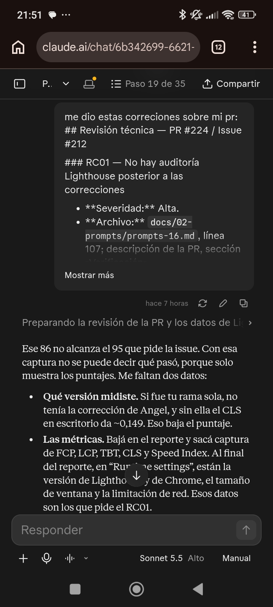
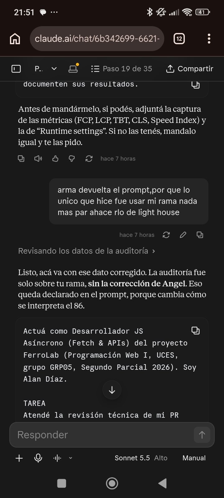
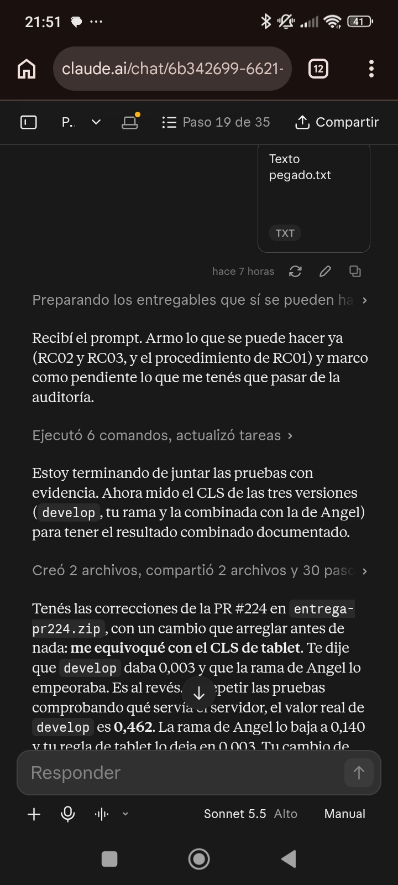

# Prompt 17

**Integrante:** Alan Díaz
**Rol:** Desarrollador JS Asíncrono (Fetch & APIs)
**Modelo de IA:** Claude (Anthropic) — Sonnet 5.5
**Método de prompt:** Prompt estructurado (armado previamente por la IA a pedido del integrante y enviado de vuelta)
**Fecha y hora:** 27/11/2026, 15:11 (hora de Argentina)
**Spec asociado:** `docs/03-specs/segundo-parcial/spec-dev-async-fetch.md`
**Issue y PR asociadas:** issue #212 (Performance, Lighthouse) y PR #224 (`fix/lighthouse-rendimiento-fetch` → `develop`).

## Prompt exacto
Mensaje original, en tres partes. Primero llegó la revisión técnica de la PR #224 junto con la captura de Lighthouse; después, la IA armó el prompt estructurado; el integrante pidió armarlo de nuevo porque la auditoría se había hecho solo sobre su rama; por último, envió de vuelta el prompt (archivo de texto adjunto). El texto de la revisión del primer mensaje es el mismo que figura al final del prompt de las 15:11, por eso no se repite en la primera parte.

**15:07** (adjunto: captura de Lighthouse con Performance 86, Accessibility 100, Best Practices 100 y SEO 100)
```
me dio estas correciones sobre mi pr:
[revisión técnica de la PR #224 / issue #212: el texto completo está al final del prompt de las 15:11]
te dejo la captura del lighthouse
```

**15:09**
```
arma devuelta el prompt,por que lo unico que hice fue usar mi rama nada mas par ahace rlo de light house
```

**15:11** (adjunto: archivo de texto con el prompt)
```
Actuá como Desarrollador JS Asíncrono (Fetch & APIs) del proyecto FerroLab (Programación Web I, UCES, grupo GRP05, Segundo Parcial 2026). Soy Alan Díaz.

TAREA
Atendé la revisión técnica de mi PR #224 (rama `fix/lighthouse-rendimiento-fetch` → `develop`), asociada a la issue #212 (Performance, Lighthouse). La revisión está pegada al final. Hay 3 hallazgos (RC01 alta, RC02 y RC03 medias).

DATOS DE LA AUDITORÍA QUE YA TENGO
- Lighthouse en Chrome DevTools, 27/11/2026, alrededor de las 15:01: Performance 86, Accessibility 100, Best Practices 100, SEO 100 (captura adjunta).
- La auditoría se hizo SOLO sobre mi rama `fix/lighthouse-rendimiento-fetch`, sin la rama `fix/layout-shift-cls` de Angel (#213) y sin combinarlas. Es decir, no incluye su reserva de espacio para `#ofertas-productos`.
- NO tengo todavía: el commit exacto que medí, las versiones de Lighthouse y Chrome, el servidor, el tamaño de ventana, ni FCP/LCP/TBT/CLS/Speed Index. Pedime lo que falte antes de documentarlo. No lo inventes.

RC01 – Auditoría Lighthouse posterior a las correcciones
- Armá el informe de la auditoría listo para guardar, con commit, navegador y versiones, servidor, condiciones, resultados y comparación con TC-11, TC-12 y TC-13 (con sus limitaciones de comparabilidad). Dejá explícito que esta auditoría corresponde a mi rama sola, sin #213, y que la auditoría de la combinación queda pendiente. Decime dónde guardarlo sin tocar archivos del Tester QA/JS (`docs/04-testing/`).
- Interpretá el 86 con honestidad: no afirmes ≥95 ni cierres la issue, y no atribuyas la causa del puntaje hasta ver las métricas. Si el puntaje no alcanza, decime qué falta y proponé (sin aplicar) qué hacer. No conviertas ni borres imágenes sin que yo lo confirme.
- Indicame cómo repetir la auditoría con mi rama más la de Angel combinadas en una rama local de prueba, sin pushear, y cómo registrar esa segunda corrida.
- Lighthouse no se puede correr en tu entorno: no lo simules ni lo estimes.

RC02 – Trazabilidad con #212 y changelog
- Corregí el texto de la descripción de la PR: vinculá #212 (reemplazar `#<número de la issue de Lighthouse>`), con "Relacionada con #212" y no "Closes". La PR es la #224.
- Dame la línea para `changelog.md` con los enlaces (PR #224, issue #212, #213), y los ítems del checklist que corresponde marcar. Avisame si conviene corregir en el mismo cambio el error del nombre de rama de #211 en el changelog.

RC03 – Pruebas de regresión con evidencia
- Volvé a correr las suites (models, storage, services, script, y las del Tester si están en `develop`), los escenarios de carga asíncrona y RC03, y guardá las salidas completas en archivos para adjuntar.
- Identificá el commit exacto probado y precisá cuál es el único fallo y que ocurre también en `develop` sin cambios.
- Repetí las pruebas sobre la combinación local con `fix/layout-shift-cls` y documentá el resultado combinado.

ENTREGA
- Archivos listos para copiar, un commit por tarea lógica en español, y la descripción de la PR corregida.
- Una entrada `prompts-17.md` lista para guardar, con el formato de las anteriores (modelo, captura y correcciones manuales como pendientes), y la línea para `prompts.md`.
- Lista de lo que NO hice o no pude medir.

REGLAS
- No inventes resultados: lo que no corras va como no verificado.
- No modifiques nada en GitHub: entregame todo en local.
- No toques otros roles ni los specs o documentos del Tester QA/JS.

--- REVISIÓN RECIBIDA ---
## Revisión técnica — PR #224 / Issue #212

### RC01 — No hay auditoría Lighthouse posterior a las correcciones
- Severidad: Alta.
- Archivo: `docs/02-prompts/prompts-16.md`, línea 107; descripción de la PR, sección «Verificación».
- Problema: La PR indica que no ejecutó Lighthouse. Por eso no acredita Performance ≥95 ni aporta resultados post-corrección de FCP, LCP, TBT, CLS y Speed Index. Los 96 puntos de TC-13 son históricos y no verifican esta versión. Tampoco hay informe/capturas ni condiciones de una nueva auditoría.
- Corrección solicitada: Ejecutar Lighthouse sobre la versión corregida, registrar commit, navegador y versiones, servidor y condiciones relevantes, adjuntar las evidencias y comparar con TC-11, TC-12 y TC-13. Mantener #212 abierta hasta verificar el criterio de cierre.

### RC02 — Falta trazabilidad completa con #212 y changelog
- Severidad: Media.
- Archivo: Descripción de la PR, secciones «Descripción del trabajo realizado» y «Checklist»; `changelog.md` no está actualizado en el diff.
- Problema: La descripción conserva `#<número de la issue de Lighthouse>` en lugar de vincular #212. Además, el changelog figura entre los archivos/documentación, pero no fue actualizado y su checklist continúa sin marcar.
- Corrección solicitada: Vincular explícitamente la PR con #212 y registrar la contribución en `changelog.md`, con los enlaces correspondientes.

### RC03 — Pruebas de regresión reportadas sin evidencia verificable
- Severidad: Media.
- Archivo: `docs/02-prompts/prompts-16.md`, línea 106; descripción de la PR, sección «Verificación».
- Problema: Se reportan 501 specs con 1 fallo, 34/35 escenarios de carga asíncrona y RC03 12/12, pero no se incluyen salidas del runner o capturas que permitan contrastar esos resultados. Tampoco se identifica el commit exacto de la combinación probada con la rama/PR #213, que sigue separada.
- Corrección solicitada: Adjuntar las salidas o capturas, identificar el commit probado y precisar el fallo respecto de `develop` sin cambios. Tras integrar #213 según el orden previsto, volver a validar y documentar el resultado combinado.

### Checklist de cumplimiento de #212
- Optimizaciones de imágenes/LCP y reserva de espacio para CLS: parcial; los cambios están en el diff, pero su impacto no fue medido con Lighthouse.
- Performance ≥95 mediante una nueva auditoría: no verificado.
- Comparación posterior de puntajes y métricas con TC-11/TC-12/TC-13: pendiente.
- Accessibility, Best Practices y SEO ≥95 en la versión corregida: no verificado.
- Regresiones funcionales, Fetch, SweetAlert2 y correcciones relacionadas: reportadas, pero no verificables con las evidencias adjuntas.
- Trazabilidad de #212 y changelog: pendiente.

Conclusión: Evidencias insuficientes para validar el cierre de #212. La PR reconoce que la auditoría pendiente corresponde a QA; no debe considerarse resuelta la issue hasta que una nueva auditoría sobre la versión corregida demuestre Performance ≥95 y se documenten sus resultados.
```

## Resultado esperado
Atender los tres hallazgos de la revisión de la PR #224: documentar la auditoría de Lighthouse con sus condiciones y datos pendientes, vincular la PR con la issue #212 y registrar el changelog, y adjuntar las salidas de las pruebas de regresión con el commit probado y el resultado combinado con la rama de Angel (#213).

## Resultado obtenido
- **RC03 (pruebas con evidencia):** se volvieron a ejecutar las suites, los escenarios de carga asíncrona, RC03 y RC02 sobre `develop` (`5d578a9`), sobre la rama y sobre la combinación local con `fix/layout-shift-cls`, y se guardaron las salidas completas en `docs/03-specs/segundo-parcial/evidencia-dev-async/`. Resultado igual en las tres versiones: 501 specs con 1 fallo (SweetAlert2 real, necesita el CDN, que el entorno de pruebas no alcanza; ocurre también en `develop` sin cambios) y 3 pendientes; 34 de 35 escenarios (el que difiere es por mensajes de consola de la integridad de SweetAlert2); RC03 12 de 12; reintentos según lo esperado.
- **Error propio detectado y corregido:** en una primera repetición, los resultados salieron idénticos en las tres versiones porque el servidor de la primera siguió respondiendo para las demás. Se repitió comprobando el contenido servido. Al repetir, apareció que el CLS de tablet de `develop` es **0,462** y no 0,003 como se había informado: la rama de Angel (#213) lo mejora a 0,140 (no lo empeora), y la regla de tablet de esta PR lo deja en 0,003. Se corrigieron `prompts-16.md`, la descripción de la PR, el AT CLOSE y la revisión que se había hecho de la PR #223.
- **RC01 (Lighthouse):** Claude no puede ejecutar Lighthouse en su entorno. Se documentó la auditoría del integrante (Performance 86, sobre su rama sola, sin #213) con los datos que faltan marcados como pendientes (commit, versiones, servidor, ventana y métricas) y el procedimiento para la auditoría de la combinación con #213. No se afirma que se cumpla el 95 ni se cierra la issue.
- **RC02 (trazabilidad):** descripción de la PR con la vinculación a #212 («Relacionada con», no «Closes») y línea de `changelog.md` con los enlaces.
- **No verificado:** el puntaje de Lighthouse de la versión combinada, otros navegadores, cobertura, y que la prueba de SweetAlert2 real pase en un equipo con internet.

## Correcciones manuales
No informadas por el integrante.

## Captura






## Aplicación
Rama `fix/lighthouse-rendimiento-fetch` (PR #224): commits de corrección de `prompts-16.md`, de evidencia (pruebas de regresión y auditoría), de `changelog.md` y de este registro.
