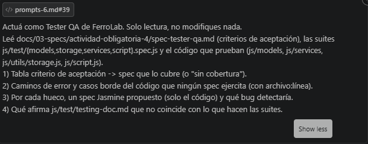
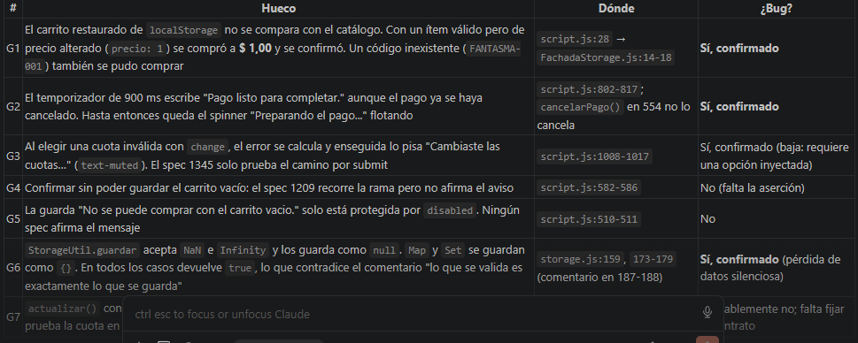
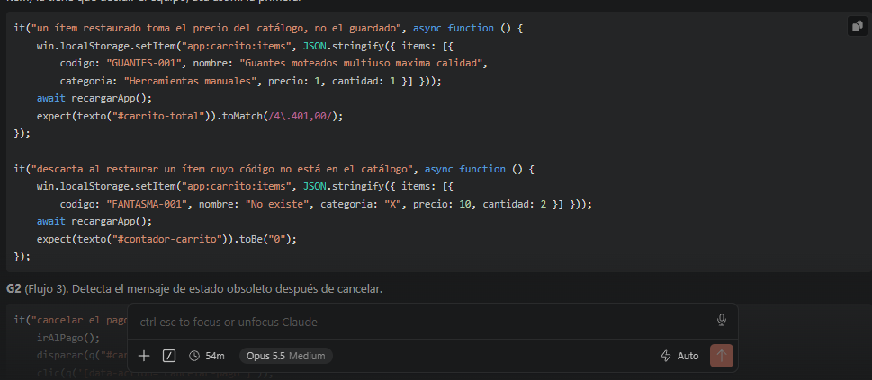

# Prompt 6

- **Integrante:** Alan Díaz
- **Rol:** Tester QA
- **Modelo de IA:** Claude Code (Claude Sonnet 5.5, Anthropic)
- **Método de prompt:** Role prompting

## Prompt exacto

⚠ Aviso: estos NO son los prompts originales
```
Los prompts con los que se generaron las suites (models.spec.js, storage.spec.js, services.spec.js y script.spec.js) se perdieron: no se guardaron el texto, las capturas ni las respuestas de esas conversaciones. Los textos de abajo fueron reconstruidos a partir de lo que las suites hacen hoy y de lo que se le pidió a la IA. Son una aproximación al pedido original, no una copia. No hay captura del prompt ni del resultado original, y no se afirma que estos textos, ejecutados de nuevo, produzcan exactamente los mismos specs. Lo que sí es verificable es el resultado: las suites están en el repositorio, con su historial de commits y con la corrida actual.
```

```
Actuá como Tester QA de FerroLab. Solo lectura, no modifiques nada.
Leé docs/03-specs/actividad-obligatoria-4/spec-tester-qa.md (criterios de aceptación), las suites
js/test/{models,storage,services,script}.spec.js y el código que prueban (js/models, js/services,
js/utils/storage.js, js/script.js).
1) Tabla criterio de aceptación -> spec que lo cubre (o "sin cobertura").
2) Caminos de error y casos borde del código que ningún spec ejercita (con archivo:línea).
3) Por cada hueco, un spec Jasmine propuesto (solo el código) y qué bug detectaría.
4) Qué afirma js/test/testing-doc.md que no coincide con lo que hacen las suites.
```

**Captura de pantalla del prompt solicitado:**


## Resultado esperado

Una tabla que relacione cada criterio de aceptación del spec del Tester QA con los specs que lo cubren, la lista de caminos de error y casos borde que la suite no ejercita, un spec Jasmine propuesto por cada hueco y las afirmaciones de `testing-doc.md` que no coincidan con las suites.

## Resultado obtenido

Fecha de la ejecución: 2026-11-24, sobre `release/cuarta-entrega` (`db683c2`) más la rama `fix/qa-cobertura`.

- **Criterios → specs:** de los 12 criterios de aceptación, 9 quedaron cubiertos por specs existentes; uno (Playwright MCP) no está cumplido, uno (issues en GitHub) está pendiente de abrir y uno (rama, PR y changelog) es de proceso y no se verifica con código.
- **Huecos:** la cobertura V8 mostró solo 2 ramas y 5 líneas sin ejecutar, inalcanzables sin modificar producción. Para ver qué no verifican los specs se corrió además una barrida de 40 mutantes aleatorios sobre `js/models/` y `js/services/`: 33 detectados y 7 sobrevivientes.
- **Specs propuestos:** 4 (fecha 0 en el número de pedido, total con un bit de diferencia, total con un centavo de diferencia y mensaje de validación de los ítems de `Carrito`). Con ellos, 37 de 40 mutantes quedan detectados; los 3 restantes son equivalentes o inalcanzables.
- **Discrepancia con la documentación:** el spec «acepta diferencias que son sólo ruido de coma flotante» sumaba `Number.EPSILON` a un total de miles, lo que no cambia el valor, y no probaba la tolerancia.

Detalle completo en [`resultado-entrada-3.md`](./resultado-entrada-3.md).

**Captura de pantalla del resultado obtenido:**



## Correcciones manuales realizadas

- Ninguna sobre el texto del resultado.
- Los 4 specs propuestos se agregaron a `js/test/models.spec.js` y se validó con la suite completa (425 specs, 0 failures). Quedan sujetos a la revisión de otro integrante en la PR.

## Aplicación en el proyecto

Segunda corrección de QA a la revisión del docente (RC2, RC21, RC24, RC52): `js/test/models.spec.js` y la sección de mutación de `js/test/testing-doc.md`, en la PR `fix/qa-cobertura`.
