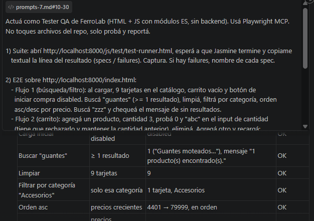
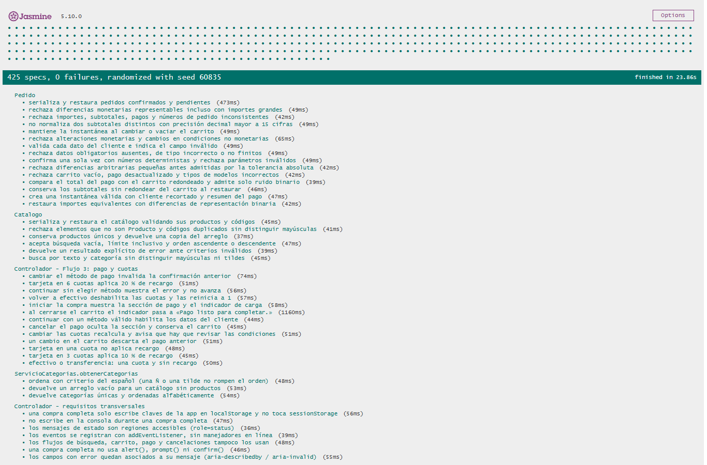

# Prompt 7

**Integrante:** Alan Díaz
**Rol:** Tester QA
**Modelo de IA:** Claude Code
**Método de prompt:** Role prompting

## Prompt exacto
```
Actuá como Tester QA de FerroLab (HTML + JS con módulos ES, sin backend). Usá Playwright MCP.
No toques archivos del repo, solo probá y reportá.

1) Suite: abrí http://localhost:8000/js/test/test-runner.html, esperá a que Jasmine termine y copiame
   textual la línea del resultado (specs / failures). Captura. Si hay failures, nombre de cada spec.

2) E2E sobre http://localhost:8000/index.html:
   - Flujo 1 (búsqueda/filtro): al cargar, 9 tarjetas en el catálogo, carrito vacío y botón de
     iniciar compra disabled. Buscá "guantes" (>= 1 resultado), limpiá, filtrá por categoría, orden
     asc/desc por precio. Buscá "zzz" y chequeá el mensaje de sin resultados.
   - Flujo 2 (carrito): agregá un producto, cantidad 3, probá 0 y "abc" en el input de cantidad
     (tiene que rechazarlo y mantener la cantidad anterior), eliminá. Agregá otro y recargá:
     el carrito se restaura desde localStorage (app:carrito:items).
   - Flujo 3 (pago): iniciar compra, método efectivo/transferencia (cuotas disabled en 1), después
     tarjeta: 3 cuotas = 10 % de recargo, 6 cuotas = 20 %. Enviar #form-pago sin método -> error.
   - Flujo 4 (pedido): enviar #form-pedido con campos vacíos y con correo inválido -> mensajes de
     error del modelo. Con datos válidos generá el resumen, confirmá y chequeá "Pedido confirmado:
     FL-<ts>-0001". En otra compra probá cancelar el pedido.

Por cada paso: acción, esperado, observado y OK / NO COINCIDE. Captura por flujo como mínimo.
Cerrá con una tabla resumen y la lista de lo que no coincide (sin arreglarlo).
```

**Captura de pantalla del prompt solicitado:**


## Resultado esperado

Resultado de Jasmine del runner completo y una tabla por flujo (búsqueda, carrito, pago y confirmación) con acción, esperado, observado y OK / NO COINCIDE, con capturas de cada flujo hechas por el servidor Playwright MCP en un navegador real.

## Resultado obtenido

**Herramienta realmente usada:** Claude Code (modelo Claude Opus 5.5) en VS Code.
**No se usó `@playwright/mcp`:** el servidor Playwright MCP no estaba conectado en la sesión.
En su lugar, la IA instaló la librería `playwright` 1.65.1 fuera del repo y ejecutó un script
que maneja Google Chrome 158.0.8127.88 (headless). No se modificó ningún archivo del repo.

**Captura de pantalla del resultado obtenido:**


## Correcciones manuales realizadas

no se modifico nada

## Aplicación en el proyecto

Cumplimiento del criterio «Todos los tests se ejecutan con Playwright MCP en un navegador real» de `docs/03-specs/actividad-obligatoria-4/spec-tester-qa.md`, desde la fecha de esta ejecución (las corridas anteriores fueron con Playwright por script).
