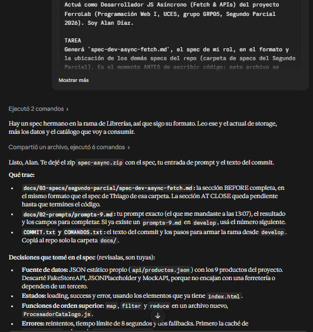

# Prompt 9

**Integrante:** Alan Díaz
**Rol:** Desarrollador JS Asíncrono (Fetch & APIs)
**Modelo de IA:** Claude (Anthropic) — <completar con la versión que muestre la captura>
**Método de prompt:** Role prompting
**Fecha y hora:** 26/11/2026, 13:07 (hora de Argentina)
**Spec asociado:** `docs/03-specs/segundo-parcial/spec-dev-async-fetch.md` (sección BEFORE)

## Prompt exacto
```
Actuá como Desarrollador JS Asíncrono (Fetch & APIs) del proyecto FerroLab (Programación Web I, UCES, grupo GRP05, Segundo Parcial 2026). Soy Alan Díaz.

TAREA
Generá `spec-dev-async-fetch.md`, el spec de mi rol, en el formato y la ubicación de los demás specs del repo (carpeta de specs del Segundo Parcial). Es el momento ANTES de escribir código: este archivo se commitea primero.

CONTEXTO
- Proyecto: tienda online de una ferretería (HTML + JS con módulos ES, sin backend).
- Arquitectura actual: `js/script.js` (solo eventos y DOM), `js/models/` (clases POO), `js/utils/storage.js` (Storage), `js/services/`, tests Jasmine en `js/test/`.
- Mi PR será `feature/dev-async-fetch-api` → `develop`, con `js/api/apiService.js` (módulo dedicado de fetch, con JSDoc).
- Usá el estado más reciente de `develop` como base y no modifiques nada de lo que ya hicieron mis compañeros.

QUÉ DEBE CONTENER (sección 4.1 del enunciado)
1. Selección y justificación de la API o del JSON estático (`api/productos.json`). Compará al menos dos opciones (por ejemplo JSON estático propio vs. FakeStoreAPI o MockAPI) con ventajas y riesgos, y recomendá una según el contexto de la ferretería.
2. Diseño de los estados de carga (loading / success / error): qué ve el usuario en cada uno y en qué elemento del DOM.
3. Diseño de las funciones de orden superior (`map`, `filter`, `reduce`): qué colección procesa cada una y para qué.
4. Manejo de errores: `try/catch`, mensajes amigables, reintentos o fallbacks, validación y sanitización de lo que llega de la API.
5. Integración con las clases POO de `js/models/` y con `js/utils/storage.js`.
6. Casos de test a coordinar con Tester QA/JS: éxito, error HTTP, error de red, procesamiento map/filter/reduce, integración con el DOM.
7. Criterios de aceptación en checklist: fetch con manejo de errores implementado, datos integrados al DOM, casos de test coordinados con Tester QA.
8. Sección "AL CERRAR la tarea" con los campos vacíos para completar como evidencia: prompt exacto utilizado y ajustes manuales, resumen de la integración con POO y Storage, issues respondidas y su resolución.

REGLAS
- No inventes datos ni resultados. Todo lo que aún no existe va como pendiente.
- No modifiques nada en GitHub: entregame el archivo en local, listo para copiar, y el texto del commit.
```

## Resultado esperado
El archivo `spec-dev-async-fetch.md` con la sección BEFORE completa y la sección AT CLOSE con campos pendientes, listo para commitear antes de escribir código.

## Resultado obtenido
Spec en `docs/03-specs/segundo-parcial/spec-dev-async-fetch.md`, con el formato del spec de Librerías Externas de la misma carpeta. Decisiones principales: fuente de datos = JSON estático propio (`api/productos.json`) frente a FakeStoreAPI, JSONPlaceholder y MockAPI; estados loading / success / error sobre `#catalogo-mensaje` y `#resultados-catalogo`; `map` / `filter` / `reduce` en `js/services/ProcesadorCatalogo.js`; reintentos (máx. 2) y tiempo límite de 8 s; fallbacks a la caché de `localStorage` y a `productosIniciales`; 10 casos de test para Tester QA/JS; checklist de aceptación. Todavía no hay código ni tests: solo el spec.

## Correcciones manuales
Ninguna correccion

## Captura


## Aplicación
Rama `feature/dev-async-fetch-api` → `develop`. Primer commit de la rama (antes del código).
