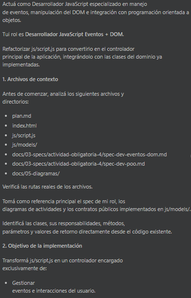

# Spec: Implementación de Eventos y Manipulación del DOM

**Rol:** Desarrollador JavaScript Eventos + DOM  
**Se traza contra:** `plan.md` — RF4-RF5, RF9-RF24; RNF3, RNF5, RNF7-RNF11, RNF13-RNF15.  
**Entrega:** Actividad Obligatoria N.º 4 — FerroLab

## BEFORE

## Qué se va a hacer

Se refactorizará `js/script.js` para que actúe como controlador de la aplicación: registrará y atenderá eventos, leerá datos de formularios y controles HTML, coordinará las llamadas a las clases del dominio de `js/models/` y actualizará el DOM. La lógica de búsqueda, carrito, pagos, validaciones y pedidos quedará a cargo del dominio, no se duplicará en el controlador. Las funciones de interacción actuales basadas en `prompt()` y `alert()` serán reemplazadas por formularios, controles, mensajes y regiones de resumen visibles en la página.

Se actualizará `index.html` solo en lo necesario para identificar acciones y productos, completar los controles que faltan para búsqueda, pago y confirmación, y disponer regiones para resultados, errores y estados. El HTML actual ya contiene el formulario de búsqueda, filtros de orden y precio, botones Comprar, un offcanvas de carrito de muestra y un formulario de contacto; este último conservará su propósito y no se reutilizará como formulario del pedido.

## Por qué

La entrega anterior resuelve los cuatro flujos mediante diálogos modales y estado JavaScript, pero no permite operar el proceso desde los controles de la página. La refactorización convierte esa simulación en una experiencia web interactiva, mostrando resultados, carrito, condiciones de financiación y confirmación en el DOM, con validación y respuesta visual durante la interacción.

La tarea conecta búsqueda y filtrado (RF4-RF5), carrito y cálculos (RF9-RF13 y RF20), selección y visualización del pago (RF14-RF19), y validación, resumen y confirmación (RF21-RF24). También contribuye a la accesibilidad y usabilidad (RNF3, RNF5), mantenibilidad, legibilidad y separación de responsabilidades (RNF7-RNF9), escalabilidad y extensibilidad (RNF10-RNF11), compatibilidad (RNF13), precisión de cálculos (RNF14) y claridad financiera (RNF15). La lógica de negocio seguirá siendo responsabilidad de las clases de dominio del rol POO; la persistencia futura corresponderá a Storage.

## Eventos y controles por flujo

### 1. Búsqueda y filtrado del catálogo

- **Existentes:** formulario form[role="search"], campo `#busqueda`, selector `#orden`, rango `#precio-hasta` e indicador `#precio-hasta-valor`. La categoría se ofrece actualmente como enlaces de navegación, sin un valor de filtro identificado.

- **A incorporar o adecuar:** checkbox `#activar-filtro-precio` para habilitar o deshabilitar el filtro de precio máximo; controles de categoría con valores identificables; una región de resultados que pueda actualizarse dinámicamente y botones de compra vinculados al código del producto. Los controles de ordenamiento, categoría y precio deberán formar parte de los criterios enviados al dominio.

- **Eventos:** submit en el formulario de búsqueda para impedir la navegación y mostrar los resultados; input en el campo de texto y el rango de precio para actualizar los resultados cuando corresponda y mostrar el valor seleccionado; change en el checkbox, la categoría y el selector de ordenamiento para aplicar los criterios seleccionados.

- **Comportamiento:** los filtros de texto y categoría vacíos se omitirán. El filtro de precio máximo estará desactivado por defecto, mostrando el texto «Sin límite» en `#precio-hasta-valor` y manteniendo deshabilitado el rango `#precio-hasta`. Al activar el checkbox, se habilitará el rango y se aplicará el precio máximo seleccionado, que deberá ser un valor numérico mayor o igual a cero. Al desactivarlo, se eliminará la restricción de precio y se actualizarán los resultados del catálogo.

### 2. Gestión del carrito de compras

- **Existentes:** botón que abre el offcanvas `#carrito`, artículos de muestra, campos de cantidad, botones Eliminar, importes estáticos y botón Iniciar compra.
- **A incorporar o adecuar:** identificadores de producto en las tarjetas y controles de compra, una región dinámica para los ítems y el estado vacío, contador, subtotales y total. Las acciones de agregar, cambiar cantidad, eliminar y continuar deberán poder identificarse a partir del producto correspondiente.
- **Eventos:** `click` para agregar, eliminar y continuar a pago; `change` en cantidades para validar y actualizar el carrito. Se usará delegación en los contenedores estables de catálogo/ofertas y carrito para las acciones repetidas de elementos creados o actualizados dinámicamente.
- Cada operación válida actualizará visualmente cantidades, subtotales y total. Un cambio en el total invalida las condiciones de pago; una entrada inválida conserva el estado anterior. El botón de compra informará si el carrito está vacío o iniciará el flujo de pago cuando haya productos.

### 3. Pago y cálculo de cuotas

- **Existentes:** texto informativo general sobre tarjeta; no hay controles para elegir el método ni las cuotas.
- **A incorporar:** controles de método de pago, cuotas disponibles, región de condiciones calculadas y acciones para continuar o cancelar. Las cuotas se habilitarán cuando corresponda al método seleccionado.
- **Eventos:** `change` en método y cuotas para actualizar las opciones y la vista de condiciones; `submit` del formulario de pago para validar y solicitar el cálculo al dominio sin recargar la página; `click` para cancelar o volver.
- La interfaz mostrará total original, cuotas, interés/recargo, total financiado y valor por cuota a partir del resultado del dominio. Si no hay productos, informará que no se puede pagar. Cancelar conservará los productos y descartará las condiciones de pago anteriores, según el flujo definido.

### 4. Resumen y confirmación del pedido

- **Existentes:** formulario `#contacto`, destinado a consultas y no al pedido.
- **A incorporar:** formulario de datos del cliente con nombre, correo y dirección de envío; región de resumen del pedido y condiciones de pago; acciones separadas para confirmar o cancelar.
- **Eventos:** `input` y/o `blur` para validar los campos y presentar feedback; `submit` para validar y actualizar el resumen sin navegación; `click` para confirmar o cancelar el pedido.
- La interfaz indicará los errores de nombre vacío o solo numérico, correo inválido y dirección vacía. Si se cancela la carga o se rechaza la confirmación, conservará carrito y pago; al confirmar, mostrará el identificador y resumen y reflejará el vaciado del carrito y las condiciones de pago.

Los cuatro flujos actualizarán regiones identificables del DOM. Los mensajes de estado y resultados se anunciarán de forma accesible. Las reglas detalladas de validación, cuotas, recargos y conservación del estado se mantendrán alineadas con los diagramas y el dominio.

## Decisiones de arquitectura

- **Registro homogéneo:** centralizar el alta de listeners en la inicialización de la aplicación, una vez que el DOM esté disponible, usando `addEventListener()`. Eliminar el arranque automático del menú con `prompt()` asociado a `data-iniciar-menu` y el listener inline del rango; su comportamiento pasará al controlador.
- **Listeners directos y delegación:** registrar directamente los eventos de formularios y controles únicos. Delegar `click` y `change` desde contenedores estables para tarjetas de producto e ítems del carrito; identificar acciones y productos mediante atributos semánticos y comprobar que el elemento activado pertenezca al contenedor. Evitar listeners duplicados al renderizar.
- **Separación controlador/dominio:** `js/script.js` será exclusivamente responsable de eventos, DOM y coordinación. `js/models/` contendrá las clases y reglas de negocio bajo responsabilidad del Desarrollador JS POO. Antes de integrar, se acordará con ese rol el contrato real de entrada y salida; no se presuponen nombres de clases ni métodos. El controlador no volverá a calcular totales, cuotas ni validaciones que correspondan al dominio.
- **Storage futuro:** se mantendrá una frontera para la futura integración con `js/utils/storage.js`, responsabilidad del Desarrollador JS Storage. Esta tarea no implementará persistencia ni decidirá un contrato todavía no definido.
- **Funciones de interfaz:** organizar funciones reutilizables para renderizar o actualizar regiones del DOM, mostrar mensajes, limpiar formularios y reflejar estados. El estado visual se derivará de los resultados del dominio y no se usará el HTML renderizado como fuente de datos.
- **Validación y estados:** validar durante la edición o al salir de cada campo y volver a validar al enviar. Asociar el error al control y actualizar sus estados visuales; habilitar o deshabilitar cuotas, acciones y botones según el método de pago, validez de los datos y estado del carrito. Mostrar u ocultar las secciones de pago y confirmación según el avance del flujo.
- **Seguridad y accesibilidad:** insertar contenido textual con APIs de texto del DOM, sin interpretar como HTML los valores de productos o usuario. Mantener etiquetas y nombres accesibles, foco visible, errores asociados a sus campos y anuncios de cambios relevantes.
- **Bootstrap:** conservar el control del offcanvas mediante sus atributos y comportamiento existentes; el controlador no duplicará listeners que ya gestione Bootstrap.

## Criterios de aceptación

- [X] Dado que se carga la interfaz de la Actividad 4, cuando se usan los cuatro flujos, entonces `js/script.js` no invoca `prompt()` ni `alert()` y la interacción ocurre mediante controles HTML y mensajes en el DOM.
- [X] Dado cada formulario y control interactivo de los cuatro flujos, cuando se inicializa la aplicación, entonces su evento relevante queda atendido mediante `addEventListener()` sin listeners duplicados.
- [X] Dada una búsqueda, cuando se envía el formulario o se cambia un filtro, entonces el controlador captura los valores de inputs y selects y muestra los resultados sin recargar la página.
- [X] Dado un filtro inválido, cuando se valida, entonces el usuario ve el error junto al control correspondiente y los resultados/estado no se actualizan con datos inválidos.
- [X] Dado un campo del formulario de pedido, cuando el usuario lo edita o abandona, entonces la validación muestra feedback visual y accesible sin esperar al envío final.
- [X] Dada una acción sobre un producto o ítem del carrito, cuando se agrega, actualiza o elimina, entonces los elementos, subtotales, total y contador correspondientes se crean, actualizan o eliminan dinámicamente del DOM.
- [X] Dado un resultado de validación o una operación exitosa, cuando cambia su estado, entonces el control y mensaje aplican las clases visuales de error o éxito definidas para la interfaz.
- [X] Dado un cambio de flujo, cuando corresponde continuar, volver o finalizar, entonces las regiones de búsqueda, pago y confirmación pertinentes se muestran u ocultan sin perder estado que deba conservarse.
- [X] Dado un carrito vacío, datos incompletos o un método de pago que no admite cuotas, cuando se actualiza la interfaz, entonces las acciones no disponibles quedan deshabilitadas y las disponibles reflejan el estado actual.
- [X] Dado el catálogo, cuando se busca o filtra desde la interfaz, entonces se muestran resultados acordes a los criterios y reglas del dominio.
- [X] Dado el carrito, cuando se modifican productos o cantidades desde la interfaz, entonces se actualizan los importes y se invalida el pago si cambió el total.
- [X] Dado un carrito con productos, cuando se eligen método y cuotas, entonces se ven las condiciones calculadas antes de confirmar la compra.
- [X] Dado un carrito con condiciones de pago, cuando se completan y confirman los datos del pedido, entonces la interfaz muestra el resultado del pedido y refleja el vaciado del carrito y del pago.
- [X] Dado que el usuario cancela el pago o rechaza/cancela el pedido, cuando vuelve al flujo correspondiente, entonces se conserva el estado que establecen los diagramas.
- [X] Dado el controlador, cuando se revisa su responsabilidad, entonces solo coordina eventos, entradas, llamadas al dominio y actualizaciones del DOM; los cálculos y reglas de negocio pertenecen a `js/models/`.
- [X] Dada la integración con el dominio, cuando el controlador procesa una acción, entonces utiliza únicamente clases y operaciones efectivamente definidas y acordadas con el Desarrollador JS POO.


## AT CLOSE — Evidencia de implementación
**Prompt exacto de GitHub Copilot Agent Mode para refactorizar el archivo Js/script.js :**
```
Actuá como Desarrollador JavaScript especializado en manejo de eventos, manipulación del DOM e integración con programación orientada a objetos.
Tui rol es Desarrollador JavaScript Eventos + DOM.
Refactorizar js/script.js para convertirlo en el controlador principal de la aplicación, integrándolo con las clases del dominio ya implementadas.
1. Archivos de contexto
Antes de comenzar, analizá los siguientes archivos y directorios:
•	plan.md
•	index.html
•	js/script.js
•	js/models/
•	docs/03-specs/actividad-obligatoria-4/spec-dev-eventos-dom.md
•	docs/03-specs/actividad-obligatoria-4/spec-dev-poo.md
•	docs/05-diagramas/
Verificá las rutas reales de los archivos.
Tomá como referencia principal el spec de mi rol, los diagramas de actividades y los contratos públicos implementados en js/models/.
Identificá las clases, sus responsabilidades, métodos, parámetros y valores de retorno directamente desde el código existente.
2. Objetivo de la implementación
Transformá js/script.js en un controlador encargado exclusivamente de:
•	Gestionar eventos e interacciones del usuario.
•	Capturar entradas desde formularios y controles HTML.
•	Invocar los métodos correspondientes de las clases del dominio.
•	Coordinar los cuatro flujos de la aplicación.
•	Actualizar dinámicamente el DOM.
•	Gestionar estados de interfaz, validaciones visuales y mensajes.
Eliminá toda lógica de negocio que corresponda a las clases del dominio.
No dupliques reglas de negocio, validaciones, cálculos ni operaciones que ya estén implementadas en js/models/.
3. Sistema de eventos
Implementá un sistema homogéneo de manejo de eventos que incluya:
•	Event listeners para todos los controles relevantes.
•	Eventos click, submit, input y change, según corresponda.
•	Delegación de eventos cuando los elementos se generen dinámicamente.
•	Prevención de comportamientos predeterminados cuando sea necesario.
•	Organización del código para evitar duplicaciones y facilitar el mantenimiento.
4. Manipulación del DOM
Implementá las funcionalidades necesarias para:
•	Capturar entradas del usuario.
•	Mostrar validaciones en tiempo real con feedback visual.
•	Mostrar resultados dinámicamente.
•	Crear, actualizar y eliminar elementos HTML según cada flujo.
•	Mostrar y ocultar secciones según el contexto.
•	Habilitar y deshabilitar controles.
•	Mostrar mensajes de error y éxito.
•	Aplicar clases CSS para representar estados como loading, error y success, respetando los estilos existentes.
5. Implementación de los cuatro flujos
Implementá las interacciones necesarias para los cuatro flujos definidos en el proyecto:
1.	Búsqueda y filtrado del catálogo.
2.	Gestión del carrito de compras.
3.	Selección de pago y cuotas.
4.	Resumen y confirmación del pedido.
Respetá las decisiones, condiciones, validaciones y ciclos establecidos en los diagramas de actividades.
Utilizá exclusivamente los métodos públicos disponibles en las clases del dominio para ejecutar las operaciones de negocio.
El controlador debe encargarse de la interacción con el usuario y la representación visual de los resultados.
6. Eliminación de prompt() y alert()
Eliminá las llamadas a prompt() y alert() utilizadas en los flujos de la aplicación.
Reemplazalas por interacciones mediante formularios, inputs, botones y mensajes HTML.
Los cuatro flujos deben poder ejecutarse desde la interfaz de la página.
7. Integración con HTML
Verificá que index.html contenga los controles necesarios para ejecutar los cuatro flujos.
Si faltan controles indispensables, incorporá únicamente los elementos HTML necesarios para la implementación.
Respetá la estructura existente, los componentes Bootstrap y los estilos CSS del proyecto.
No modifiques el diseño visual ni las reglas responsive correspondientes a otros roles.
8. Separación de responsabilidades
Respetá estrictamente las responsabilidades del proyecto:
•	JS POO: lógica de negocio y clases del dominio.
•	Eventos + DOM: eventos, interacción con el usuario, manipulación del DOM y coordinación de los flujos.
•	Storage: persistencia y recuperación de información.
•	Responsive Design y Frontend: estilos, diseño visual y adaptación a dispositivos.
No modifiques las clases del dominio ni implementes funcionalidades correspondientes a otros roles.
Si detectás dependencias pendientes, informalas sin inventar implementaciones alternativas.
9. Criterios de aceptación
Verificá que:
•	js/script.js funcione exclusivamente como controlador.
•	No exista lógica de negocio duplicada.
•	Se utilicen correctamente las clases existentes en js/models/.
•	Los cuatro flujos funcionen mediante controles HTML.
•	No existan llamadas a prompt() ni alert().
•	Todos los eventos relevantes tengan sus listeners.
•	Se aplique delegación de eventos cuando corresponda.
•	Las validaciones proporcionen feedback visual.
•	Los resultados se actualicen dinámicamente en el DOM.
•	Los estados de interfaz se gestionen correctamente.
•	Se respeten los contratos públicos de las clases del dominio.
10. Resultado esperado
Realizá la implementación respetando el spec del rol y los archivos de contexto.
Al finalizar, presentá:
1.	Archivos creados o modificados.
2.	Resumen de los cambios realizados.
3.	Eventos implementados.
4.	Funciones de manipulación del DOM incorporadas.
5.	Integración realizada con las clases del dominio.
6.	Pruebas efectuadas y resultados.
7.	Dependencias o problemas pendientes.
Restricciones
•	No modificar js/models/.
•	No implementar lógica de negocio dentro de js/script.js.
•	No modificar los specs ni los diagramas de actividades.
•	No completar la sección AT CLOSE.
•	No realizar commits, push ni pull requests.
•	No modificar estilos CSS ni responsabilidades de otros roles.
•	No inventar métodos o contratos inexistentes.
Antes de modificar archivos, analizá el contexto disponible e identificá posibles incompatibilidades. Si encontrás un impedimento bloqueante, informalo antes de continuar.
Implementá únicamente lo correspondiente al rol Desarrollador JavaScript Eventos + DOM.
```
**Respuesta exacta de GitHub Copilot Agent Mode:**
```
Implementación
1.	Archivos modificados: js/script.js y index.html. No modifiqué modelos, specs, diagramas ni CSS.
2.	Cambios: script.js ahora coordina eventos, estado de interfaz y llamadas al dominio. Se agregaron controles para filtros, carrito, pago y confirmación; también se quitaron el menú automático y el listener inline.
3.	Eventos: submit e input para búsqueda; change para filtros, cantidades, método y cuotas; input y submit para los datos del pedido. Las acciones de productos, carrito y pedido usan delegación de clics.
4.	DOM: renderizado de carrito, subtotales, totales, condiciones de pago y resumen; filtros y orden de productos; estados visuales y mensajes accesibles; secciones y controles habilitados según el flujo.
5.	Dominio: se integraron Producto, Catalogo, Carrito, Pago y Pedido mediante sus contratos públicos. El controlador no reproduce sus cálculos ni validaciones.
Verificación y pendientes
•	Probé en navegador los filtros, agregar y cambiar cantidades, feedback de cantidad inválida, pago en cuotas, confirmación y vaciado del carrito. También verifiqué cancelaciones, invalidación del pago al cambiar el total y el inicio de una compra sucesiva.
•	No hubo errores de consola; git diff --check pasó y no hay llamadas a prompt() ni alert() en el controlador.
•	npm run test:qa terminó con código 0, pero solo imprime instrucciones: no ejecuta pruebas. El runner Jasmine existente carga el script como clásico y prueba funciones de negocio retiradas; necesitará adaptación por QA.
•	Los archivos de js/models/ ya estaban presentes pero figuran sin seguimiento en Git; no los modifiqué. La persistencia sigue pendiente para el rol Storage.
No realicé commits ni operaciones remotas.
```
**Capturas de prompt:**

**Prompt a Copilot en modo agente para refactorizar js/script.js**



**Respuesta del prompt a copilot en modo agente para refacturizar el js/script.js**


**Archivos adjuntados como contexto:** `plan.md`, `index.html`, `js/script.js`, los cuatro diagramas de actividades `.puml`, las clases que existan en `js/models/` y el `spec-dev-eventos-dom.md`.
**Fragmento generado por Copilot (versión original):**
```
  function inicializarEventos() {
    buscarYMostrarCatalogo();
    renderizarCarrito();

    elementos.formBusqueda.addEventListener("submit", (evento) => {
        evento.preventDefault();
        buscarYMostrarCatalogo();
        elemento("#catalogo").scrollIntoView({ behavior: "smooth", block: "start" });
    });
    elementos.busqueda.addEventListener("input", buscarYMostrarCatalogo);
    elementos.categoria.addEventListener("change", buscarYMostrarCatalogo);
    elementos.orden.addEventListener("change", buscarYMostrarCatalogo);
    elementos.activarPrecio.addEventListener("change", () => {
        elementos.precio.disabled = !elementos.activarPrecio.checked;
        elementos.precioValor.textContent = elementos.activarPrecio.checked
            ? formatearMoneda(Number(elementos.precio.value))
            : "Sin limite";
        buscarYMostrarCatalogo();
    });
    elementos.precio.addEventListener("input", () => {
        elementos.precioValor.textContent = formatearMoneda(Number(elementos.precio.value));
        buscarYMostrarCatalogo();
    });

    document.addEventListener("click", (evento) => {
        const accion = evento.target.closest("[data-action]");
        if (!accion) {
            const filtroCategoria = evento.target.closest("[data-categoria]");
            if (filtroCategoria) {
            evento.preventDefault();
            elementos.busqueda.value = "";
            elementos.categoria.value = filtroCategoria.dataset.categoria;
            elementos.activarPrecio.checked = false;
            elementos.precio.disabled = true;
            elementos.precio.value = elementos.precio.max;
            elementos.precioValor.textContent = "Sin limite";
            buscarYMostrarCatalogo();
            elemento("#catalogo").scrollIntoView({
                behavior: "smooth",
                block: "start"
            });
        }
            return;
        }
        const codigo = accion.dataset.productCode;
        switch (accion.dataset.action) {
            case "agregar-carrito":
                procesarOperacionCarrito(() => carrito.agregar(catalogo, codigo, 1));
                break;
            case "eliminar-carrito":
                procesarOperacionCarrito(() => carrito.eliminar(codigo));
                break;
            case "iniciar-compra":
                iniciarPago();
                break;
            case "cancelar-pago":
                cancelarPago();
                break;
            case "cancelar-pedido":
                cancelarPedido();
                break;
            case "confirmar-pedido":
                confirmarPedido();
                break;
            default:
                break;
        }
    });
    elementos.carritoItems.addEventListener("input", (evento) => {
        const control = evento.target.closest('[data-action="cambiar-cantidad"]');
        if (!control) return;
        const valor = control.value.trim();
        const valido =
        valor !== "" &&
        control.validity.valid &&
        Number.isSafeInteger(Number(valor));
        if (valido) {
            marcarControl(control, true);
        } else {
            marcarControl(
                control,
                false,
                "La cantidad debe ser un número entero mayor o igual a 1."
            );
        }
    });

    elementos.carritoItems.addEventListener("change", (evento) => {
        const control = evento.target.closest('[data-action="cambiar-cantidad"]');
        if (!control) return;
        procesarOperacionCarrito(
            () => carrito.cambiarCantidad(control.dataset.productCode, control.value),
            control.dataset.productCode
        );
    });

    elementos.metodoPago.addEventListener("change", () => {
        const tarjeta = elementos.metodoPago.value === "tarjeta";
        elementos.cuotas.disabled = !tarjeta;
        if (!tarjeta) elementos.cuotas.value = "1";
        elementos.condicionesPago.replaceChildren();
        pagoActual = null;
        pedidoPendiente = null;
        elementos.seccionConfirmacion.hidden = true;
        elementos.resumenPedido.replaceChildren();
        if (elementos.metodoPago.value) obtenerCondicionesPago();
    });
    elementos.cuotas.addEventListener("change", () => {

    pedidoPendiente = null;

    elementos.resumenPedido.replaceChildren();

    elementos.seccionConfirmacion.hidden = true;

    obtenerCondicionesPago();

    mostrarMensaje(
        elementos.pagoMensaje,
        "Cambiaste las cuotas. Revisá las condiciones y continuá nuevamente.",
        "info"
    );
});
    elementos.formPago.addEventListener("submit", (evento) => {
        evento.preventDefault();
        if (!obtenerCondicionesPago()) return;
        elementos.seccionConfirmacion.hidden = false;
        elementos.resumenPedido.replaceChildren();
        pedidoPendiente = null;
        mostrarMensaje(elementos.pedidoMensaje, "Completa tus datos para revisar el pedido.", "info");
        elementos.seccionConfirmacion.scrollIntoView({ behavior: "smooth", block: "start" });
    });
    elementos.formPedido.addEventListener("input", (evento) => {
    const control = evento.target.closest("input");
    if (!control) return;

    if (pedidoPendiente !== null) {
        pedidoPendiente = null;

        elementos.resumenPedido.replaceChildren();

        mostrarMensaje(
            elementos.pedidoMensaje,
            "Los datos del cliente cambiaron. Revisá nuevamente el resumen antes de confirmar.",
            "info"
        );
    }
    validarCampoPedido(control);
});
    elementos.formPedido.addEventListener("submit", (evento) => {
        evento.preventDefault();
        elementos.formPedido.querySelectorAll("input").forEach(validarCampoPedido);
        try {
            pedidoPendiente = new Pedido(carrito, pagoActual, clienteDesdeFormulario());
            const resumen = pedidoPendiente.resumir();
            elementos.resumenPedido.replaceChildren();
            agregarDatosResumen(elementos.resumenPedido, resumen);
            mostrarMensaje(elementos.pedidoMensaje, "Revisa el resumen y confirma o cancela el pedido.", "success");
        } catch (error) {
            if (!(error instanceof TypeError || error instanceof RangeError)) throw error;
            pedidoPendiente = null;
            const campo = error.campo && elementos.formPedido.elements[error.campo];
            if (campo) {
                marcarControl(campo, false, error.message);
                campo.focus();
            }
            mostrarMensaje(elementos.pedidoMensaje, error.message, "error");
        }
    });
}
```

**Ajustes manuales:**

1. **index.html — Navegación del catálogo**
- Problema: La opción «Catálogo» solamente desplazaba la página hacia los productos, sin mostrar opciones de navegación.
- Corrección: Se reemplazó el enlace por un menú desplegable de Bootstrap con las distintas categorías y la opción «Todos los productos».
-	Mejora adicional: Se eliminó el menú «Categorías» duplicado, unificando la navegación.
-	Resultado obtenido: El usuario puede seleccionar una categoría desde el menú principal y acceder directamente a sus productos.
2. **css/components.css — Organización de filtros**
-	Problema: Los controles «Ordenar por» y «Categorías» se superponían dentro del panel de filtros.
-	Corrección: Se reemplazó la distribución basada en Grid por Flexbox, organizando los controles verticalmente.
-	Mejora adicional: Se ajustó la alineación del checkbox «Aplicar precio máximo».
-	Resultado obtenido: Los filtros se muestran separados, ordenados y correctamente identificados.
3. **js/script.js — Eventos y lógica de interfaz**

- **3.1. Navegación por categorías**
-	Problema: Al seleccionar una categoría podían mantenerse búsquedas y filtros anteriores, generando resultados inesperados.
-	Corrección: Se actualizó el evento de selección para limpiar la búsqueda anterior, restablecer el filtro de precio y mostrar los productos correspondientes.
-	Resultado obtenido: La navegación por categorías funciona correctamente.

- **3.2. Actualización de datos del cliente**
-	Problema: Al modificar nombre, correo o dirección después de generar el resumen, el pedido conservaba los datos anteriores.
-	Corrección: Se modificó el evento input para invalidar el pedido pendiente y eliminar el resumen anterior.
-	Resultado obtenido: El usuario debe revisar nuevamente los datos antes de confirmar.

- **3.3. Actualización de cuotas**
-	Problema: Al cambiar las cuotas podían conservarse condiciones de financiación anteriores.
-	Corrección: Se actualizó el evento change para invalidar el pedido pendiente, recalcular las cuotas y ocultar la confirmación anterior.
-	Resultado obtenido: El usuario debe continuar nuevamente con las condiciones actualizadas.

- **3.4. Modificaciones del carrito**
-	Problema: El pago se invalidaba únicamente cuando cambiaba el importe total, aunque se modificaran los productos.
-	Corrección: Se reemplazó invalidarPagoSiCambioTotal() por invalidarPagoPorCambioCarrito(), invalidando el pago y el pedido ante modificaciones exitosas del carrito.
-	Resultado obtenido: Cualquier cambio de productos o cantidades exige revisar nuevamente el pago.

- **3.5. Desplazamiento al iniciar la compra**
-	Problema: Al seleccionar «Iniciar compra», la página bajaba hacia el pago y luego volvía a subir.
-	Corrección: Se incorporó el evento hidden.bs.offcanvas para esperar el cierre del carrito antes de ejecutar scrollIntoView().
-	Resultado obtenido: La página permanece posicionada en «Método de pago y cuotas».

4. **Validación de cantidades en tiempo real**
-	Problema detectado: Las cantidades inválidas del carrito solamente mostraban errores cuando el usuario abandonaba el campo.
-	Corrección realizada: Se incorporó un evento input para validar inmediatamente los valores y mostrar feedback visual mediante marcarControl().
-	Archivo modificado: js/script.js.
-	Resultado obtenido: El usuario recibe mensajes de error mientras escribe, sin necesidad de salir del campo. El evento change continúa actualizando las cantidades y los totales.

5. **Incorporación del estado `loading` al iniciar la compra**
- Problema detectado: El controlador no contemplaba un estado visual `loading` para informar al usuario cuando se estaba procesando una transición de la interfaz.
- Corrección realizada: Se modificó `mostrarMensaje()` para admitir el estado `loading`, incorporando un spinner de Bootstrap y el mensaje «Preparando el pago...». Además, se actualizó `iniciarPago()` para mostrar el indicador durante el cierre del carrito y eliminarlo mediante `renderizarCarrito()` al finalizar el evento `hidden.bs.offcanvas`.
- Archivo modificado: `js/script.js`.
- Resultado obtenido: Al seleccionar «Iniciar compra», se muestra brevemente un indicador de procesamiento que desaparece cuando termina de cerrarse el carrito, permitiendo continuar hacia la sección de pago.

6. **Centralización y validación de elementos del DOM**
- Problema detectado: La obtención de elementos HTML no contemplaba una diferenciación clara entre elementos obligatorios y opcionales, lo que podía generar errores durante la ejecución.
- Corrección realizada: Se implementó la función `elemento()` con un parámetro para identificar controles obligatorios y opcionales. Se centralizaron las referencias en el objeto `elementos` y se incorporó una verificación de elementos obligatorios antes de inicializar los eventos.
- Archivo modificado: `js/script.js`.
- Resultado obtenido: El controlador identifica los elementos faltantes y permite manejar controles opcionales sin detener innecesariamente la aplicación.

7. **Validación de campos del formulario con datos reales**
- Problema detectado: La función `validarCampoPedido()` utilizaba datos ficticios para validar individualmente los campos del cliente.
- Corrección realizada: Se modificó `validarCampoPedido()` para construir el cliente completo mediante `clienteDesdeFormulario()` y delegar la validación a la clase `Pedido`, procesando únicamente los errores asociados al campo evaluado.
- Archivo modificado: `js/script.js`.
- Resultado obtenido: La validación utiliza los datos reales ingresados por el usuario y mantiene las reglas de negocio dentro de la clase `Pedido`.

8. **Limpieza de estados y mensajes de validación**
- Problema detectado: La función `limpiarEstadoControl()` eliminaba las clases visuales de validación, pero podía conservar mensajes de error anteriores.
- Corrección realizada: Se amplió `limpiarEstadoControl()` para eliminar las clases `is-valid` e `is-invalid`, restablecer el atributo `aria-invalid` y limpiar los mensajes de error asociados mediante `aria-describedby`.
- Archivo modificado: `js/script.js`.
- Resultado obtenido: Los campos recuperan correctamente su estado visual inicial, evitando que permanezcan mensajes de error desactualizados.

9. **Delegación de eventos dentro de contenedores específicos**
- Problema detectado: El controlador utilizaba un único listener global sobre `document` para gestionar las acciones del catálogo, carrito, pago y confirmación, concentrando eventos de diferentes secciones.
- Corrección realizada: Se eliminó el listener global de eventos `click` y se implementaron listeners específicos para catálogo, ofertas, navegación principal, carrito, pago y confirmación. Se incorporaron las referencias `seccionOfertas` y `navegacionPrincipal` al objeto `elementos`, conservando las funciones existentes de cada flujo.
- Archivo modificado: `js/script.js`.
- Resultado obtenido: Los eventos se gestionan dentro de sus respectivos contenedores, mejorando la organización del controlador. Se verificó manualmente el funcionamiento de los cuatro flujos después de la modificación.

10. **Ajuste de visibilidad del indicador de carga**
- Problema detectado: El mensaje «Preparando el pago...» se reemplazaba demasiado rápido por «Pago listo para completar», impidiendo que el usuario visualizara correctamente el spinner.
- Corrección realizada: Se ajustó el evento `hidden.bs.offcanvas` dentro de `iniciarPago()` para mantener visible el indicador durante 900 milisegundos adicionales antes de reemplazarlo por el mensaje de éxito, sin retrasar la preparación del pago.
- Archivo modificado: `js/script.js`.
- Resultado obtenido: Se comprobó que el mensaje «Preparando el pago...» y el spinner de Bootstrap se visualizan correctamente durante la transición hacia el pago.

11. **Validación del formulario de pedido**
- Problema detectado: Los campos del formulario de pedido no contaban con todas las restricciones necesarias para identificar individualmente los datos inválidos.
- Corrección realizada: Se incorporaron restricciones HTML mediante el atributo `pattern` para validar el nombre y el formato del correo electrónico, conservando `required` y `aria-describedby` para mantener la obligatoriedad de los campos y la asociación con sus mensajes de error.
- Archivo modificado: `index.html`.
- Resultado obtenido: Los controles permiten comprobar individualmente los datos ingresados y mostrar los mensajes de validación correspondientes.

12. **Validación individual de los campos del pedido**
- Problema detectado: La función `validarCampoPedido()` construía un objeto `Pedido` completo y recibía únicamente el primer error detectado, impidiendo validar correctamente los demás campos de manera independiente.
- Corrección realizada: Se modificó `validarCampoPedido()` para utilizar `checkValidity()` y comprobar cada control individualmente. Se incorporó el evento `focusout` y se ajustó `submit` para validar todos los campos antes de generar el resumen.
- Archivo modificado: `js/script.js`.
- Resultado obtenido: Los campos muestran sus errores independientemente mediante los eventos `input` y `focusout`. Además, se restablecen correctamente los estados visuales al iniciar o cancelar un pedido, manteniendo la validación definitiva mediante la clase `Pedido`.

13. **Corrección de los estilos visuales de validación**
- Problema detectado: Los controles de los formularios de pedido y pago no mostraban correctamente los bordes de validación, aunque JavaScript aplicaba las clases `is-valid` e `is-invalid`.
- Corrección realizada: Se incorporaron las clases `form-control` y `form-select` de Bootstrap en los campos correspondientes para habilitar los estilos visuales de validación.
- Archivo modificado: `index.html`.
- Resultado obtenido: Se comprobó mediante pruebas manuales que los controles muestran correctamente los bordes verdes para valores válidos y rojos para valores inválidos.

14. **Corrección de listeners duplicados al iniciar la compra**
- Problema detectado: La función `iniciarPago()` registraba un nuevo listener `hidden.bs.offcanvas` en cada ejecución, permitiendo acumular eventos y provocar transiciones duplicadas ante clics repetidos.
- Corrección realizada: Se trasladó el listener a `inicializarEventos()` para registrarlo una sola vez y se incorporó la bandera `esperandoCierreCarrito` para controlar la transición y prevenir ejecuciones duplicadas.
- Archivo modificado: `js/script.js`.
- Resultado obtenido: Se verificó mediante pruebas manuales que el inicio de compra, el doble clic, el cierre manual y la reapertura del carrito funcionan correctamente, conservando el indicador de carga durante la transición y el desplazamiento hacia la sección de pago.

15. **Eliminación del menú de categorías duplicado**
- Problema detectado: En `index.html` existían dos menús desplegables, «Catálogo» y «Categorías», que permitían filtrar por las mismas categorías, generando redundancia en la navegación y contradiciendo lo documentado en el AT CLOSE de `spec-dev-eventos-dom.md`.
- Corrección realizada: Se eliminó el menú «Categorías» (`id="categorias-dropdown"`), conservando el menú «Catálogo» (`id="catalogo-dropdown"`), que contiene las cinco categorías y la opción «Todos los productos».
- Archivo modificado: `index.html`.
- Resultado obtenido: Se unificó la navegación en un único menú desplegable, manteniendo las opciones de filtrado y la delegación de eventos mediante `data-categoria`, sin necesidad de modificar `js/script.js` ni los archivos CSS.

16. **Corrección de validación del correo electrónico en el formulario de pedido**
- Problema detectado: El campo de correo electrónico utilizaba `type="email"`, que aplicaba restricciones adicionales del navegador y rechazaba direcciones con caracteres como `ñ`, aunque fueran aceptadas por la clase `Pedido`, generando una inconsistencia entre la interfaz y la lógica de negocio.
- Corrección realizada: Se reemplazó `type="email"` por `type="text"` y se incorporaron los atributos `inputmode="email"` y `autocomplete="email"`, conservando `required` y `pattern` para mantener la validación del formato. La duplicación de reglas entre el HTML y el dominio queda documentada como limitación conocida.
- Archivo modificado: `index.html`.
- Resultado obtenido: Se eliminó la restricción adicional de `type="email"`, manteniendo la validación visual mediante Bootstrap y la validación definitiva mediante la clase `Pedido`, sin modificar la lógica de negocio. Queda pendiente comprobar el comportamiento mediante pruebas manuales.


**Justificación:**

- [Commit - Primer commit con el contenido del spec rol Desarrollador JavaScript Eventos + DOM, falta detallar las clases y el contenido de la sección At CLose](199981e6ad13d8cd373030089c73b30e34c5fec4)
- [Commit - Corrección al spec solicitada por el coordinador](https://github.com/angelgc9107-lgtm/ProyectoFerreteria_GRP05/pull/140/changes/73f4c9474fe4f392cd38ea447cde25991cf639cd)
- [[A4] Spec Desarrollador JavaScript Eventos + DOM](https://github.com/angelgc9107-lgtm/ProyectoFerreteria_GRP05/pull/140)
- [[A4][Eventos + DOM] Implementación de eventos y manipulación del DOM](https://github.com/angelgc9107-lgtm/ProyectoFerreteria_GRP05/pull/156)
- [[A4][Eventos + DOM] Análisis de integración con las clases del dominio POO](https://github.com/angelgc9107-lgtm/ProyectoFerreteria_GRP05/issues/147)


**Decisiones finales sobre el controlador y su integración con las clases del dominio:**
- Catálogo: Se utiliza Catalogo.buscar() para realizar búsquedas, filtrar por categorías y precio máximo, y ordenar los productos. Cuando el filtro de precio está desactivado, el controlador envía null.
- Producto: Las tarjetas de productos están definidas en index.html. El controlador js/script.js utiliza los resultados de Catalogo.buscar() para mostrar, ocultar y reordenar las tarjetas existentes, manteniendo separada la representación visual de la lógica de negocio. Como limitación conocida, los datos de los productos se encuentran duplicados entre productosIniciales y index.html, por lo que deben mantenerse sincronizados para evitar inconsistencias.
- Carrito: El controlador invoca los métodos de Carrito para agregar, eliminar y modificar cantidades. Utiliza resumir() para actualizar la información visual y muestra los errores devueltos por las operaciones.
- Pago: El controlador captura el método de pago y las cuotas seleccionadas, delegando el cálculo de recargos y condiciones de financiación a la clase Pago. Los resultados y errores se muestran en la interfaz.
- Pedido: El controlador captura y valida visualmente los datos del cliente, utiliza la clase Pedido para generar y confirmar el pedido e invalida el resumen cuando se modifican los datos, el carrito o las condiciones de pago.
- Integración: Se utilizan módulos ES6 para importar las clases de js/models/. El archivo js/script.js funciona como controlador principal, centralizando los eventos, la manipulación del DOM y la comunicación con las clases del dominio, sin duplicar sus reglas de negocio.
- Estructura de eventos: Se centralizó el registro de eventos en inicializarEventos(), utilizando addEventListener(), delegación de eventos y funciones reutilizables para actualizar la interfaz, mostrar mensajes y gestionar estados visuales.
