# Test Case 6 — Testing responsive de la migración a Bootstrap (rol Desarrollador Frontend/Bootstrap)

## Objetivo

Verificar con Playwright MCP que, tras la migración a Bootstrap 5.3.8, la página responde correctamente en iPhone 14 Pro, Samsung Galaxy S23, iPad Air y escritorio, sin scroll horizontal, sin elementos superpuestos/cortados/fuera de pantalla y sin que Bootstrap haya roto los estilos existentes del proyecto.

## Entorno

| Dato | Valor |
|------|-------|
| URL | http://localhost:3000 (título: "FerroLab \| Ferreteria") |
| Herramienta | Playwright MCP (navegador controlado: navegación, `resize`, `evaluate`, capturas) |
| Hojas de estilo cargadas | Bootstrap 5.3.8 (CDN jsDelivr), `styles.css`, `components.css`, `responsive.css`, `bootstrap-overrides.css` |
| Fecha | 2026-10-06 |
| Código modificado | Ninguno (no se tocaron `index.html`, CSS ni spec) |

**Alcance del emulador:** los dispositivos se emularon con el tamaño de viewport (`browser_resize`) y recarga de la página en cada tamaño. No se emularon user-agent, touch ni DPR (DPR = 1). El ancho útil (`clientWidth`) es 15 px menor al viewport por la barra de scroll vertical.

## Dispositivos probados

| Dispositivo | Viewport (CSS px) |
|-------------|-------------------|
| iPhone 14 Pro | 393 × 852 |
| Samsung Galaxy S23 | 360 × 780 |
| iPad Air | 820 × 1180 |
| Escritorio | 1440 × 900 |

## Verificaciones realizadas

En cada dispositivo se ejecutó un script de auditoría (`browser_evaluate`) que midió: `scrollWidth` vs `clientWidth`, elementos con `right > clientWidth` o `left < 0`, contenedores con `overflow` que recortan contenido, carga de las 16 imágenes ``, geometría de secciones, solapamiento de cajas entre elementos hoja (h1–h3, p, a, button, label, input, img, summary, li), geometría del carrito (incluidas las imágenes `::before` de cada producto) y estado de la navegación. Además se tomaron capturas de elementos (header, ofertas, catálogo, carrito, footer) y se revisaron visualmente.

Nota: las imágenes de los productos del carrito (`cart-item--grinder` y `cart-item--hammer`) se renderizan como `::before` con `background-image` (`amoladora.png` y `martillo-galponero.png`), por lo que se verificó su tamaño, `display`, `visibility` y la carga real de cada archivo (`new Image()`).

## Resultados reales obtenidos

### Resumen por dispositivo

| Verificación | iPhone 14 Pro (393) | Galaxy S23 (360) | iPad Air (820) | Escritorio (1440) |
|--------------|---------------------|------------------|----------------|-------------------|
| Sin scroll horizontal | ✅ scrollW 378 = clientW 378 | ✅ 345 = 345 | ✅ 805 = 805 | ✅ 1425 = 1425 |
| Elementos fuera de pantalla (`right`/`left`) | ✅ 0 | ✅ 0 | ✅ 0 | ✅ 0 |
| Ofertas | ✅ 3 tarjetas en 1 columna (297 px) | ✅ 1 columna (297 px) | ✅ 2 columnas (3.ª tarjeta en 2.ª fila) | ✅ 3 columnas (275 px) |
| Servicios | ✅ cajas apiladas, sin desborde | ✅ sección 345 px, sin desborde ni solapes | ✅ sin desborde ni solapes | ✅ 3 columnas (275 px) |
| Bienvenida | ✅ 2 imágenes apiladas (297×208) | ✅ apiladas (297×208) | ✅ 2 imágenes lado a lado (379×208) | ✅ lado a lado (552×208) |
| Catálogo (9 productos) | ✅ 1 columna | ✅ 1 columna | ✅ sidebar de filtros + 2 columnas | ✅ sidebar + 3 columnas |
| Footer | ✅ redes en 3 columnas, contacto y mapa apilados | ✅ ancho completo | ✅ redes en fila, mapa a ancho completo | ✅ contacto y ubicación en 2 columnas |
| Carrito visible | ✅ 378 px, panel completo | ✅ 345 px | ✅ 483 px, junto a "Precios destacados" | ✅ 403 px, a la derecha |
| 2 imágenes del carrito visibles | ✅ ambas 72×70 px, `display:block`, `visibility:visible`, archivos cargan | ✅ ambas 72×99 / 72×84 px | ✅ ambas 72×64 px | ✅ ambas 72×64 px |
| Imágenes `` (16) | ✅ 0 rotas, 0 desbordadas | ✅ 0 / 0 | ✅ 0 / 0 | ✅ 0 / 0 |
| Textos/imágenes superpuestos (visual) | ✅ no se observan | ✅ no se observan | ✅ no se observan | ✅ no se observan |
| Elementos cortados | ✅ ninguno visible* | ✅ ninguno visible* | ✅ ninguno visible* | ✅ ninguno visible* |
| Navegación utilizable | ✅ Catálogo, Ofertas, Dónde estamos, Categorías en una línea | ✅ los 3 enlaces en una línea y "Categorías" baja a 2.ª línea (wrap) | ✅ 5 elementos en una línea | ✅ 5 elementos en una línea |
| Estilos existentes no rotos | ✅ | ✅ | ✅ | ✅ |

\* El único elemento con `overflow:hidden` y contenido mayor que su caja es un `<label>` de 1×1 px (clase de texto oculto para accesibilidad, patrón sr-only), presente en los 4 tamaños; no es un defecto.

### Detalle relevante

- **Carrito (imágenes):** en los 4 tamaños, `amoladora.png` (85×50) y `martillo-galponero.png` (58×59) cargaron correctamente y se ven en la captura de cada tamaño junto al título, cantidad, subtotal y botón "Eliminar".
- **Navegación:** el enlace "Inicio" del nav tiene `display:none` en móvil (360 y 393 px) por la regla `nav a[href="#inicio"]` de `responsive.css` (línea 69); es decisión de diseño existente (el logo enlaza a `#inicio`). Aparece en iPad y escritorio.
- **Estilos del proyecto:** tipografía `Inter, Arial…` aplicada, colores rojos de marca, tarjetas, botones "COMPRAR", tabla "Precios destacados", formulario y footer mantienen su aspecto; no se observaron estilos pisados por Bootstrap.
- **Solapamiento de cajas (no visual):** el script detectó intersecciones de cajas delimitadoras entre `h2 "Carrito de compras"` y el botón "Cerrar" (28×28 px), entre cada `h3` de producto y el botón "Eliminar" (20×20 px) y, solo en iPad, `p "Precio unitario"` del martillo con "Eliminar" (20×3 px). Visualmente en las capturas el texto no se pisa con los botones; son cajas contiguas/ancho completo del título bajo el botón posicionado. Se registra como observación, no como fallo.
- **Consola:** 1 error, `404` en `/favicon.ico` (no afecta al responsive).

## Problemas encontrados

No se encontraron fallos bloqueantes de responsive. Observaciones menores (pendientes de evaluación; no bloquean la entrega):

| # | Observación | Dispositivo | Sección | Pasos | Obtenido | Esperado |
|---|-------------|-------------|---------|-------|----------|----------|
| O-1 | Panel del carrito con mucho espacio vacío | Todos (en móvil ~400 px de rojo vacío bajo "Iniciar compra"; en escritorio además un bloque gris vacío de ~460×768 px a la izquierda del carrito) | Carrito | 1. Abrir http://localhost:3000. 2. Hacer scroll hasta "Carrito de compras" (o capturar `#carrito`). | El `<aside id="carrito">` mide 768 px de alto aunque el contenido ocupa ~300 px; en escritorio queda un área gris vacía a su izquierda. | Altura ajustada al contenido y sin bloque vacío (a confirmar con el mockup/spec si el alto fijo es intencional). |
| O-2 | Error 404 de favicon | Todos | Global | Cargar la página y revisar la consola. | `GET /favicon.ico 404`. | Sin errores en consola (añadir favicon o `<link rel="icon">`). |
| O-3 | Texto "Carrito (0)" en el encabezado con 2 productos en el carrito | iPad Air (820 px) | Header | Cargar la página a 820 px y observar el header. | Muestra "Carrito (0)" mientras el carrito contiene 2 artículos. | Contador coherente con el contenido (es HTML estático; relevante para la futura lógica JS). |

## Estado final de la prueba
**APROBADA con observaciones menores (O-1, O-2, O-3).** Las observaciones se reportan.

### O-1 — Altura del carrito

**Estado:** No requiere corrección.

La observación inicial indicaba que el carrito presentaba espacio vacío
debajo de su contenido.

Posteriormente se verificó el componente mediante Figma MCP utilizando
el frame `CarritoCompra`. Se confirmó que el carrito está diseñado como
un panel lateral derecho extendido verticalmente y que el espacio
observado forma parte de la composición definida en el mockup.

Por este motivo, no se realizaron modificaciones sobre la altura,
el overlay ni la estructura visual del carrito.

### O-2 — Favicon 404

**Estado:** Corregido.

Se agregó en `index.html` la referencia al recurso existente
`assets/images/logo.png` mediante `link rel="icon"`.

La verificación con Playwright confirmó que el recurso responde
correctamente y que ya no se genera la petición fallida `/favicon.ico`.

### O-3 — Contador del carrito

**Estado:** Corregido.

El contador del encabezado mostraba `Carrito (0)`, mientras que el
carrito contiene dos productos representativos estáticos.

Se actualizó el contador a `Carrito (2)` para mantener coherencia con
el contenido actual.

Playwright confirmó que el contador muestra 2 y que existen dos
elementos `article` dentro de `#carrito`.

## Retest posterior a la PR #111 — RC17 — 2026-10-20

Retest de las correcciones RC4 a RC9 de la PR #111 (Issue #110), ejecutado con Playwright MCP (Chromium, viewports emulados con `setViewportSize`, sin user-agent ni touch) contra la rama `fix/recuperatorio-primer-parcial` servida en `http://localhost:3000`. No se modificó HTML, CSS ni JavaScript. La verificación del hover del botón de cierre del carrito se registra en [test-case-8.md](test-case-8.md).

| Dispositivo | Viewport |
|-------------|----------|
| Escritorio | 1280 × 800 |
| iPad Air | 820 × 1180 |
| iPhone 14 Pro | 390 × 844 |
| Samsung Galaxy S23 | 360 × 780 |

### Resultados

| Verificación (RC) | Escritorio | iPad Air | iPhone 14 Pro | Galaxy S23 |
|-------------------|------------|----------|---------------|------------|
| Sin scroll horizontal | PASS (1265 = 1265) | PASS (805 = 805) | PASS (375 = 375) | PASS (345 = 345) |
| RC4 — Ofertas: tarjetas alineadas | PASS — 3 tarjetas en 1 fila: misma altura (287 px) y mismo `top` de título, descripción y botón | PASS — fila de 2 + 1 tarjeta; en cada fila los `top` coinciden | PASS — 3 filas, 287 px cada una | PASS — 3 filas, 287 px cada una |
| RC4 — Separación título–descripción | PASS — 12 px en todas (`min-height` 30 px, `margin-bottom` 12 px) | PASS — 12 px | PASS — 12 px | PASS — 12 px |
| RC5 — Bienvenida: imágenes → título → párrafo | PASS — 16 px / 16 px; `margin-bottom` del título 0 px | PASS — 16 px / 16 px | PASS — 16 px / 16 px | PASS — 16 px / 16 px |
| RC6 — Formulario: `required` en los 4 campos | PASS | PASS | PASS | PASS |
| RC6 — Envío vacío bloqueado | PASS — 0 eventos `submit`, foco en `#nombre`, mensaje "Completa este campo" | PASS (igual) | PASS (igual) | PASS (igual) |
| RC6 — Cada campo faltante bloquea el envío | PASS — el foco avanza `#correo` → `#motivo` → `#mensaje` | PASS | PASS | PASS |
| RC6 — Formulario completo válido (`checkValidity()`) | PASS | PASS | PASS | PASS |
| RC8 — Productos del carrito | PASS — imagen 72 px, separación imagen–título 8 px (`column-gap`), `padding-right` 4 px, sin overflow | PASS (igual) | PASS (igual) | PASS (igual) |
| RC9 — Logo vs. navegación | PASS — logo 56×56 en y 8–64; nav desde y 64; 0 solapes | PASS — logo 48×48 en y 16–64; nav desde y 76; 0 solapes | PASS — logo 44×44 en y 12–56; nav desde y 128; 0 solapes | PASS — logo 44×44 en y 12–56; nav desde y 128 (2 líneas); 0 solapes |

- **Navegación (RC9):** en escritorio y tablet se ven los 5 elementos; en iPhone 14 Pro, 4 (el enlace "Inicio" se oculta en móvil por diseño, como en la ejecución original); en Galaxy S23, 4 elementos con "Categorías" en una segunda línea.
- **Carrito (RC8):** en los 4 viewports las imágenes de `amoladora.png` y `martillo-galponero.png` se renderizan (`display:block`) y el texto del título arranca 8 px a la derecha de la imagen. Se mantiene la observación ya documentada arriba: la caja del `h3` se intersecta con el botón "Eliminar" (20×20 px), pero visualmente el texto no se pisa.
- **Validación (RC6):** el globo nativo de validación del navegador no aparece en las capturas (el navegador controlado no lo renderiza); la evidencia es el foco, `validationMessage` y la ausencia de eventos `submit`.

### Capturas del retest
| Verificación | Escritorio | iPad Air | iPhone 14 Pro | Galaxy S23 |
|--------------|------------|----------|---------------|------------|
| Encabezado (RC9) |  | 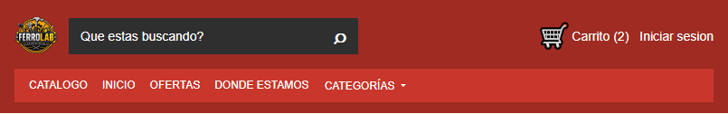 |  | 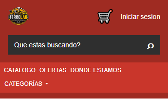 |
| Ofertas (RC4) | 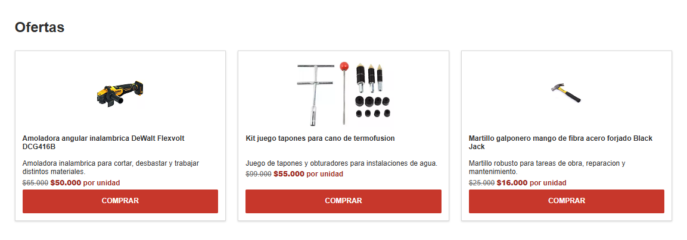 | 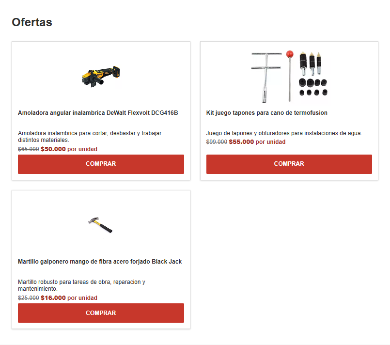 | 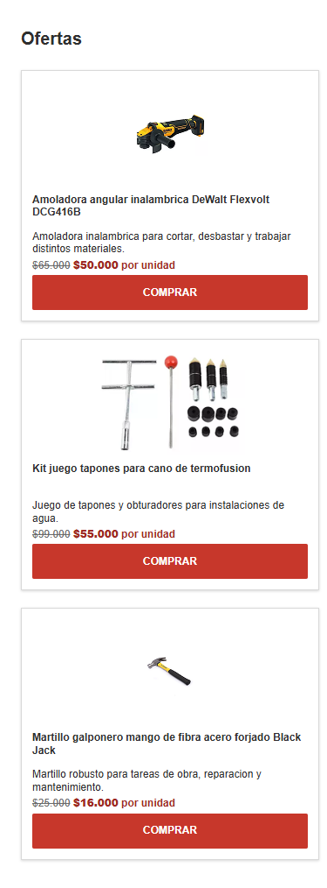 | 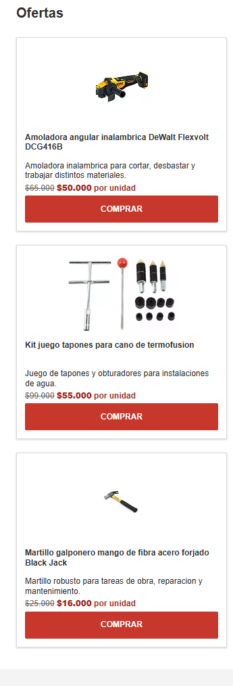 |
| Bienvenida (RC5) | 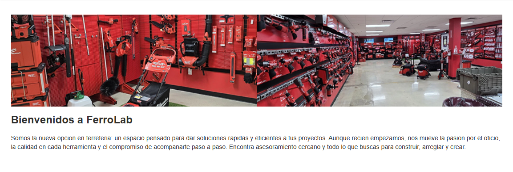 | 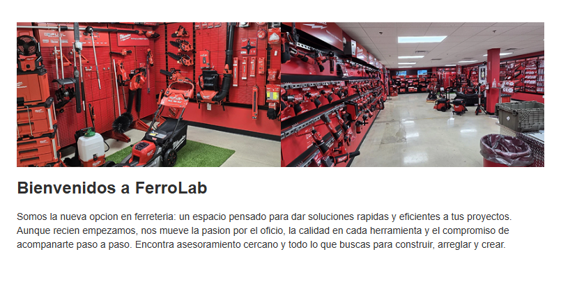 | 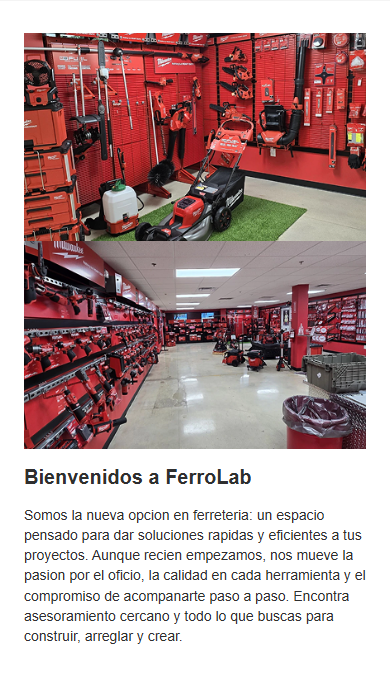 | 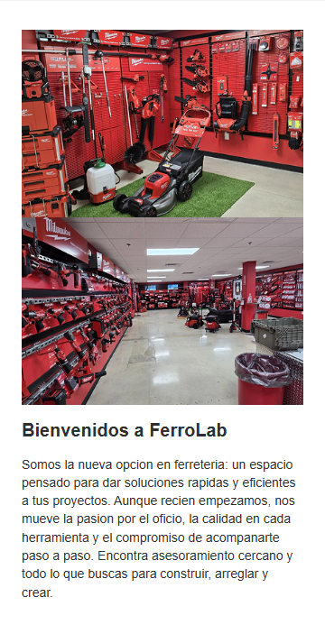 |
| Formulario vacío (RC6) | 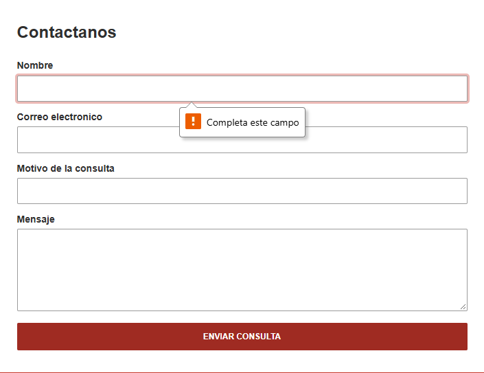 |  | 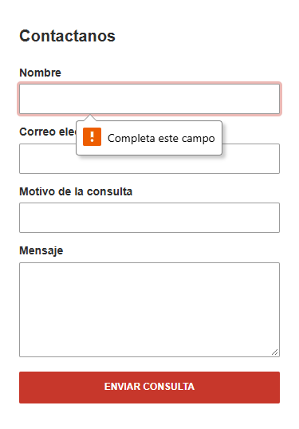 | 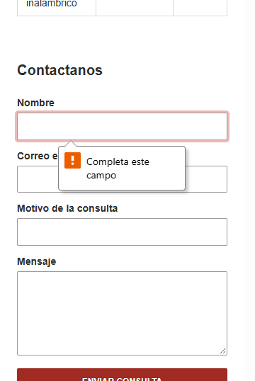 |
| Carrito abierto (RC8) | 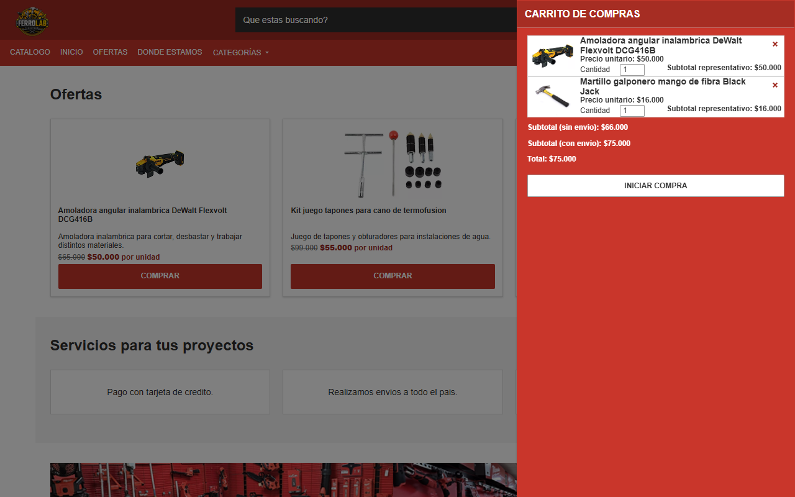 | 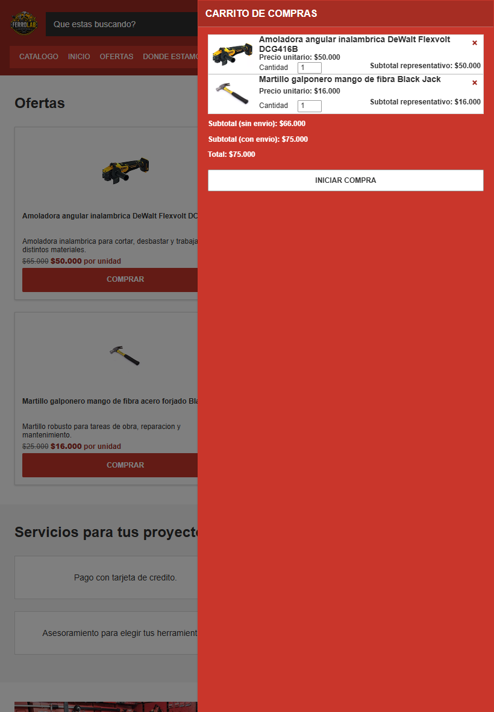 | 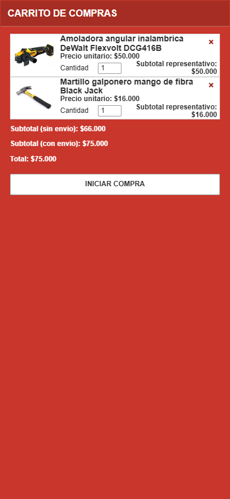 | 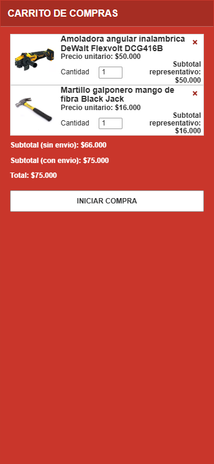 |

Las capturas del carrito se tomaron con el mouse sobre el botón de cierre, por lo que la X no se ve en ellas (ver el hallazgo en [test-case-8.md](test-case-8.md)).

**Resultado del retest de RC4, RC5, RC6, RC8 y RC9: PASS en los 4 viewports.** Esta verificación no actualiza el estado de la Issue #110 ni de la PR #111 en GitHub.

### Pendiente
- Verificación en dispositivos físicos y en navegadores distintos de Chromium (solo se emularon viewports).
- Visualización del globo nativo de validación del formulario.
- Approve/LGTM del profesor (criterio abierto de la Issue #110).
