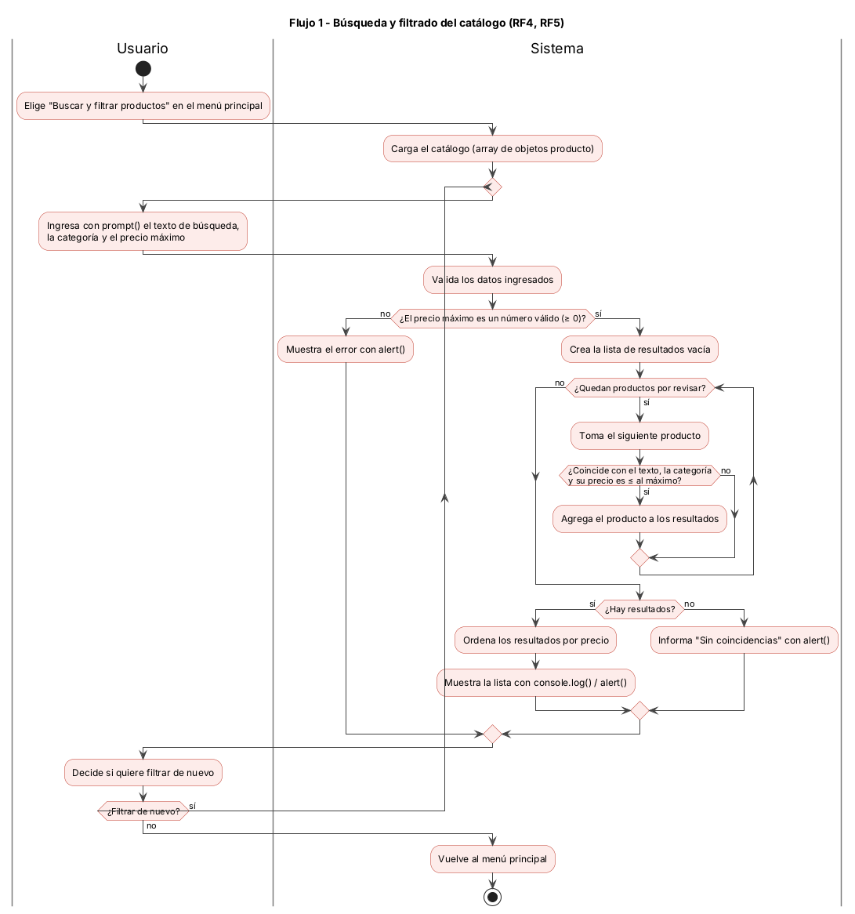
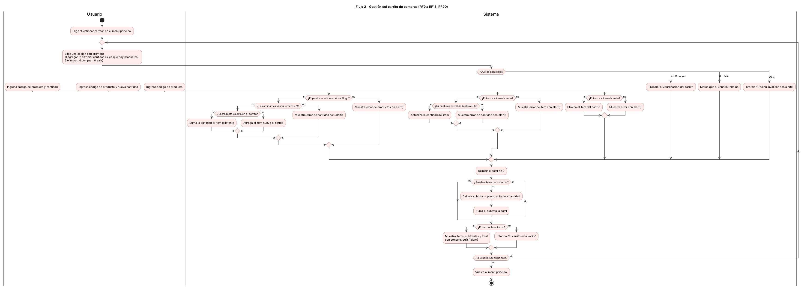
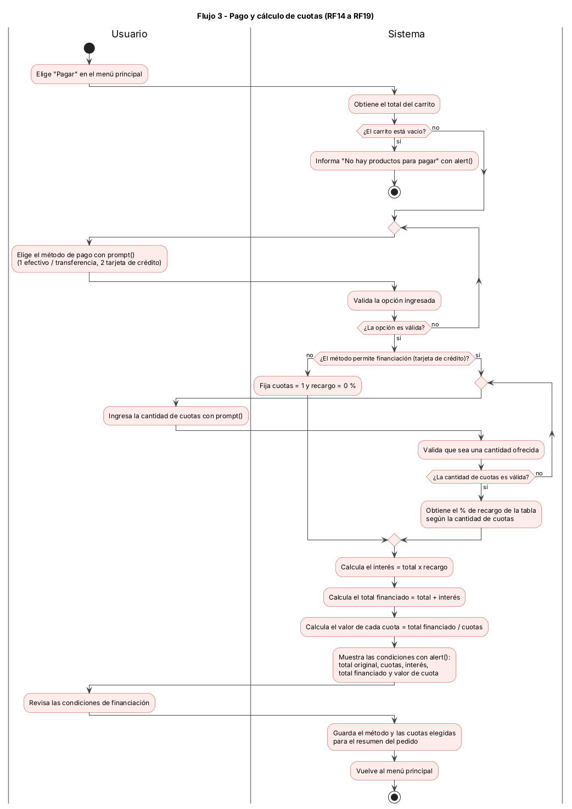
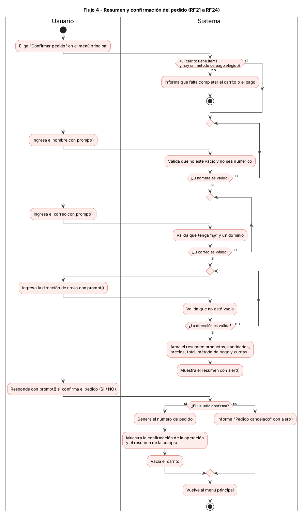

# Diagramas de actividades — FerroLab

Diagramas de actividades en PlantUML de los 4 flujos principales del
proyecto. Son el punto de partida de la implementación en `js/script.js`:
el código debe reflejar estos flujos, decisiones y ciclos.

Proceso y decisiones de diseño:
[spec-arq-diagramas.md](../../03-specs/actividad-obligatoria-3/spec-arq-diagramas.md)

## Índice

| # | Flujo | Requisitos | Editable | Imagen |
|---|---|---|---|---|
| 1 | [Búsqueda y filtrado del catálogo](#flujo-1--búsqueda-y-filtrado-del-catálogo) | RF4, RF5 | [.puml](actividad-flujo-1-busqueda-filtrado.puml) | [.png](actividad-flujo-1-busqueda-filtrado.png) |
| 2 | [Gestión del carrito](#flujo-2--gestión-del-carrito) | RF9 a RF13, RF20 | [.puml](actividad-flujo-2-carrito.puml) | [.png](actividad-flujo-2-carrito.png) |
| 3 | [Pago y cálculo de cuotas](#flujo-3--pago-y-cálculo-de-cuotas) | RF14 a RF19 | [.puml](actividad-flujo-3-pago-cuotas.puml) | [.png](actividad-flujo-3-pago-cuotas.png) |
| 4 | [Resumen y confirmación del pedido](#flujo-4--resumen-y-confirmación-del-pedido) | RF21 a RF24 | [.puml](actividad-flujo-4-confirmacion-pedido.puml) | [.png](actividad-flujo-4-confirmacion-pedido.png) |

Todos usan swimlanes: **Usuario** (ingresa datos con `prompt()` y decide) y
**Sistema** (valida, calcula y muestra resultados con `alert()` /
`console.log()`).

## Flujo 1 — Búsqueda y filtrado del catálogo

El usuario ingresa texto, categoría y precio máximo. El sistema valida el
precio, recorre el catálogo, arma la lista de coincidencias, la ordena por
precio y la muestra. El ciclo se repite mientras el usuario quiera filtrar
de nuevo.

## Flujo 2 — Gestión del carrito

Menú con `prompt()` para agregar, cambiar cantidad, eliminar, comprar o salir.
Cada acción valida producto y cantidad. Después de cada acción el sistema
recorre los ítems, recalcula subtotales y total, y muestra el carrito.

## Flujo 3 — Pago y cálculo de cuotas

El usuario elige el método de pago. Si permite financiación, ingresa la
cantidad de cuotas (se repite hasta que sea válida). El sistema calcula
interés, total financiado y valor de cada cuota, y muestra las condiciones.

## Flujo 4 — Resumen y confirmación del pedido

El sistema verifica que haya carrito y pago elegido. El usuario ingresa
nombre, correo y dirección (cada dato se repite hasta ser válido). Se
muestra el resumen y el usuario confirma o cancela; si confirma, se genera
el número de pedido y se vacía el carrito.

## Cómo editar los diagramas

1. Abrí el archivo `.puml` en VS Code con la extensión **PlantUML** (requiere
   Java) y usá `Alt + D` para la vista previa; o pegá el contenido en
   [plantumleditor.com](https://www.plantumleditor.com/).
2. Modificá el texto. Sintaxis usada: `start` / `stop`, `:Actividad;`,
   `if (...) then (sí) ... else (no) ... endif`, `while` / `repeat`
   para ciclos y `|Usuario|` / `|Sistema|` para los swimlanes.
3. Exportá a PNG (en VS Code: *PlantUML: Export Current Diagram*) y
   reemplazá el `.png` con el mismo nombre.
