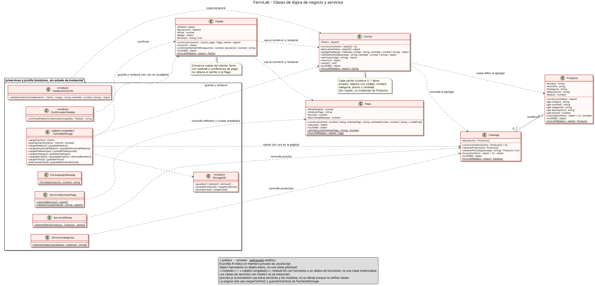

# Diagrama de clases — FerroLab

El diagrama describe las cinco clases implementadas en `js/models/`, los servicios de
`js/services/` y `js/utils/storage.js` que las usan, y sus dependencias. Los miembros
de cada clase se contrastaron con el código actual (incluido `Pago.admiteCuotas()`) y con el
[spec de POO](../../03-specs/actividad-obligatoria-4/spec-dev-poo.md).

- [Fuente PlantUML](diagrama-clases.puml)
- [Imagen PNG](diagrama-clases.png)



## Lectura del diagrama

`+` indica un miembro público y `-` uno privado. El prefijo `#` es parte de
la sintaxis de campos y métodos privados de JavaScript. Los métodos
estáticos aparecen subrayados. Los getters de `Producto` son de solo lectura.
`object` y `object[]` representan objetos planos y arreglos, no clases nuevas.

## Clases

### Producto

Representa código, nombre, categoría, descripción y precio. Su constructor
valida los datos; los getters y `toJSON()` permiten consultarlos. `coincide()`
comprueba criterios que el catálogo ya normalizó y validó. `fromJSON()`
reconstruye el producto pasando por el constructor.

### Catalogo

Mantiene una colección de instancias de `Producto` con códigos únicos.
`obtenerProductos()` devuelve una copia del arreglo y `obtenerPorCodigo()`
busca ignorando mayúsculas y espacios exteriores. `buscar()` filtra por
texto, categoría y precio máximo y ordena por precio con `asc` o `desc`.
Devuelve `{ valido, error, resultados }`; un precio omitido, `null` o vacío
no impone límite, mientras que `0` sí lo impone.

### Carrito

Administra instantáneas de productos, no referencias vivas a ellos.
`agregar()`, `cambiarCantidad()` y `eliminar()` devuelven `{ exito, error }`;
una operación inválida no modifica el carrito. `resumir()` devuelve copias
de los ítems con subtotales, `total`, `cantidadItems` —productos distintos—
y `cantidadUnidades` —unidades totales—. La suma de unidades debe ser un
entero seguro. `vaciar()` elimina los ítems y no devuelve un resultado.

### Pago

Valida un total y calcula las condiciones sin realizar una transacción.
`calcular()` devuelve el total original redondeado, el recargo, el interés,
el total financiado y el valor de cuota. Efectivo o transferencia usa una
cuota sin recargo; tarjeta admite 1, 3 o 6 cuotas, con 0 %, 10 % o 20 %.
`toJSON()` conserva las entradas, incluido el total sin redondear. El método
estático `admiteCuotas(metodoPago)` indica si un método permite elegir cuotas
(sólo tarjeta); lo usan la interfaz y `ServicioOpcionesPago`.

### Pedido

Valida el carrito, el pago y los datos del cliente y conserva una copia del
resumen. `resumir()` devuelve copias sin confirmar; `confirmar()` recibe
una marca temporal y una secuencia y genera una sola vez el identificador.
Los errores de validación de campos del cliente indican `campo`. Al
reconstruir un pedido se verifican sus importes y condiciones de pago.

Todas las clases implementan `toJSON()` y `static fromJSON()` para producir
datos serializables y reconstruirlos con validación. Los constructores y
restauraciones rechazan datos inválidos con `TypeError` o `RangeError`.

## Relaciones y multiplicidades

- **Agregación `Catalogo`–`Producto`:** un catálogo contiene de cero a
  muchos productos. Un producto puede existir sin catálogo o estar en varios;
  el catálogo guarda las instancias, pero devuelve una copia del arreglo.
- **Dependencia `Carrito` → `Catalogo`:** `agregar()` recibe un catálogo
  por llamada para buscar el producto; no lo conserva.
- **Dependencia `Carrito` → `Producto`:** al agregar, obtiene sus datos y
  guarda una instantánea. Cada carrito contiene de cero a muchos ítems
  propios, representados por objetos de valor, no por una clase de ítem.
- **Dependencias `Pedido` → `Carrito` y `Pedido` → `Pago`:** el constructor
  recibe una instancia de cada uno y `fromJSON()` los utiliza para validar
  la reconstrucción. El pedido conserva copias del resumen y del resultado
  de pago, no referencias a esas instancias. Por tratarse de dependencias de
  uso, no se asignan multiplicidades de asociación en esas flechas.

No hay herencia. El cliente y los ítems son objetos de valor, no entidades o
clases adicionales.

## Servicios y storage

Los módulos de `js/services/` y `js/utils/storage.js` conectan el controlador con el
dominio. `FachadaStorage` y `ConfirmadorPedidos` son módulos (objeto de funciones o
funciones sueltas); los demás servicios son clases con métodos estáticos.

| Módulo | Responsabilidad | Usa |
|---|---|---|
| `FachadaStorage` | Objeto congelado con un par `cargar…`/`guardar…` por cada dato persistible. **La página sólo usa `cargarCarrito()` y `guardarCarrito()`**; los otros 15 métodos están disponibles y probados pero ningún flujo los llama | `Carrito`, `Pedido`, `Catalogo`, `StorageUtil` |
| `ConfirmadorPedidos` | `confirmarPedidoConNumeracion()` genera fecha y secuencia (en memoria) y confirma el pedido | `Pedido` |
| `ValidacionCarrito` | Valida un cambio de cantidad sobre una copia temporal, sin modificar el carrito | `Carrito` |
| `FormateadorMoneda` | Formatea importes en pesos argentinos | — |
| `ServicioOfertas` | Devuelve las ofertas con nombre y precio actual tomados del catálogo; valida que el precio anterior sea mayor | `Catalogo` |
| `ServicioCategorias` | Categorías únicas y ordenadas de un catálogo | `Catalogo` |
| `ServicioOpcionesPago` | Métodos y cuotas aceptados, consultando a `Pago` | `Pago` |
| `StorageUtil` | Capa de abstracción de `localStorage`/`sessionStorage`; no conoce el dominio, sólo exige `toJSON()` / `fromJSON()` | — |

El controlador `js/script.js` usa los modelos y estos servicios, y sólo él toca el DOM; no
se dibuja porque no define clases. Los modelos no manipulan el DOM ni acceden a Storage.

## Generación local del PNG

Con Java y PlantUML instalados, desde la raíz del repositorio:

```powershell
java -jar C:\ruta\a\plantuml.jar -charset UTF-8 -tpng docs\05-diagramas\02-diagrama-de-clases\diagrama-clases.puml
```

El comando genera `diagrama-clases.png` junto al archivo fuente. La
disposición del diagrama de clases requiere Graphviz o un motor compatible
disponible para PlantUML.
