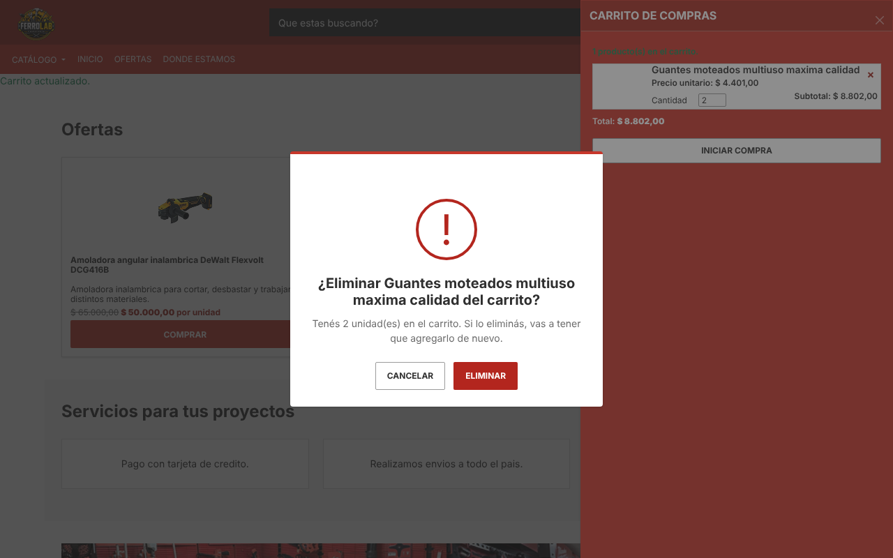
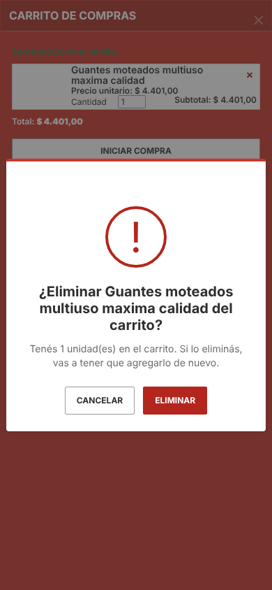
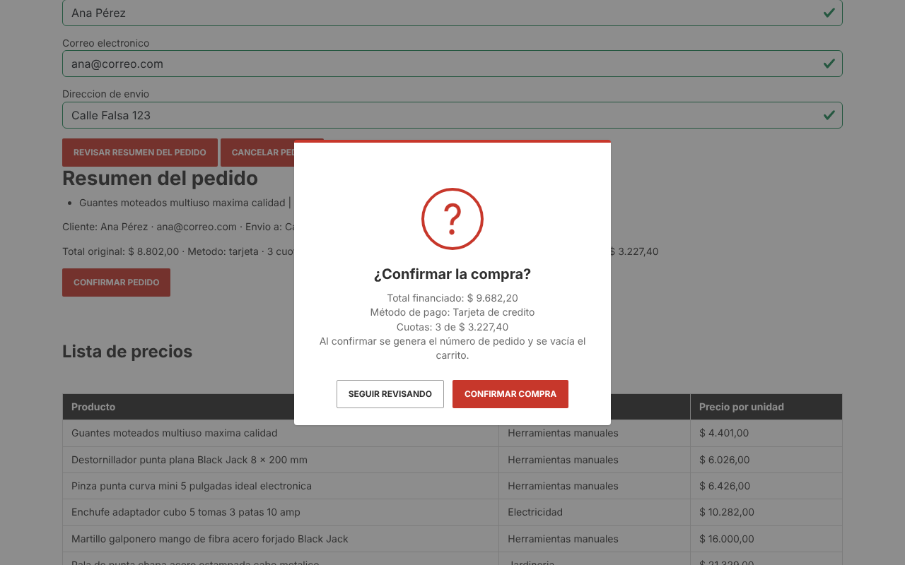
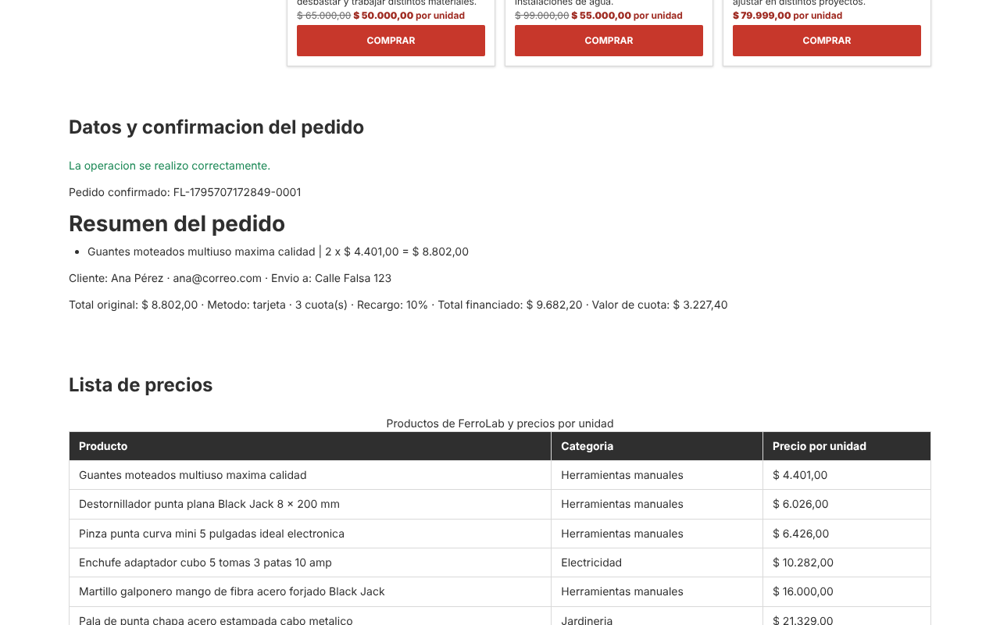
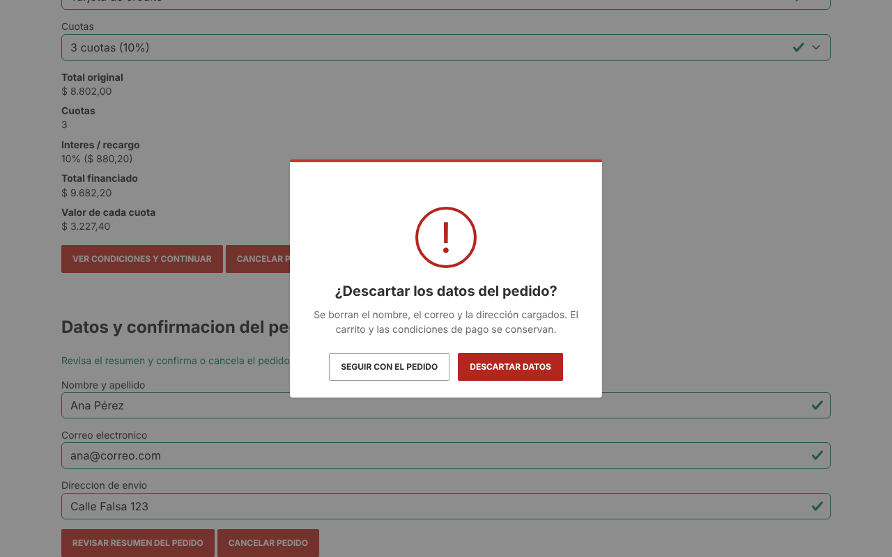

# Librería externa: SweetAlert2

**Segundo Parcial — Programación Web I (UCES)** · Grupo GRP05 · Proyecto FerroLab
**Responsable:** Thiago Piastrellini (@Piastrellini) — Desarrollador JS Librerías Externas
**Spec:** [`docs/03-specs/segundo-parcial/spec-dev-libreria-externa.md`](../03-specs/segundo-parcial/spec-dev-libreria-externa.md) · **Issue:** [#209](https://github.com/angelgc9107-lgtm/ProyectoFerreteria_GRP05/issues/209)

## 1. Datos de la librería

| Dato | Valor |
|---|---|
| Nombre | SweetAlert2 |
| Versión | **11.26.25** (fijada en la URL del CDN) |
| Licencia | MIT |
| Documentación oficial | https://sweetalert2.github.io/ |
| Repositorio | https://github.com/sweetalert2/sweetalert2 |
| Paquete | https://www.npmjs.com/package/sweetalert2 |
| Peso | `sweetalert2.min.js` ≈ 15,5 KB y `sweetalert2.min.css` ≈ 5,1 KB comprimidos con gzip; sin dependencias |

## 2. Propósito

Pedir confirmación antes de las acciones que tienen consecuencias que el usuario no puede deshacer desde la interfaz. Antes de esta integración, esas acciones se ejecutaban con un solo clic:

| Acción | Consecuencia sin confirmación |
|---|---|
| Eliminar un producto del carrito | Se pierde el ítem con su cantidad; hay que volver a buscarlo en el catálogo. |
| Confirmar el pedido | Es irreversible: consume un número de pedido, vacía el carrito y cierra el pago. |
| Cancelar el pedido | Se borran los datos del cliente cargados en el formulario. |

## 3. Beneficios

- **Evita errores del usuario:** un clic accidental en «Eliminar» o «Confirmar pedido» ya no tiene efecto inmediato, y un doble clic no ejecuta la acción dos veces.
- **Decisión informada:** el diálogo de compra muestra el total financiado, el método de pago y las cuotas justo antes de confirmar.
- **Accesibilidad sin código propio:** el diálogo tiene `role="dialog"` y `aria-modal="true"`, atrapa el foco, se cierra con `Esc` (equivale a cancelar) y devuelve el foco al botón que lo abrió.
- **Diseño consistente:** botones, colores y tipografía del sitio (sección 7).

## 4. Justificación técnica

- **No duplica código propio:** la aplicación no tenía ningún paso de confirmación. `mostrarMensaje()` informa el resultado **después** de cada acción; los diálogos piden conformidad **antes**.
- **`window.confirm()` no es una opción:** las consignas prohíben `prompt()`/`alert()`/`confirm()` y la suite verifica que la aplicación no los llama. Además, no se puede estilizar ni mostrar contenido con formato.
- **Bootstrap `Modal`** (ya cargado) necesita marcado HTML fijo para cada diálogo y conectar a mano sus eventos con una promesa. SweetAlert2 genera el diálogo con el contenido de cada caso y devuelve una promesa (`await Swal.fire(...)`), que encaja con el flujo asíncrono del controlador.
- **Rendimiento:** una sola librería liviana, con versión fija y `defer`; el diálogo solo se construye cuando el usuario hace clic.

## 5. Instalación e integración

### 5.1 CDN en `index.html`

Se carga desde jsDelivr con versión fija, integridad SRI y `crossorigin`, con el mismo criterio que Bootstrap. La hoja de estilos va **antes** del CSS propio, para que `css/components.css` pueda ajustar la estética. El script va con `defer`, antes de `js/script.js` (que es un módulo y se ejecuta después de los scripts diferidos):

```html
<link rel="stylesheet" href="https://cdn.jsdelivr.net/npm/sweetalert2@11.26.25/dist/sweetalert2.min.css"
      integrity="sha384-dCW5imOdApH6OwpFau8cZNKjqVbJYnCA5q+8YsMYP3XwXKsV6Jfz1u6MZLnXaBsS" crossorigin="anonymous">
<link rel="stylesheet" href="css/styles.css">
<!-- ... -->
<script src="https://cdn.jsdelivr.net/npm/sweetalert2@11.26.25/dist/sweetalert2.min.js"
        integrity="sha384-hW8ZCQHtRH+nVOAkHZ4amZvYsAtKn1ZOvMV6dNag1Rb1thWmLZMBKTRxFV0cOxiK" crossorigin="anonymous" defer></script>
```

Los hashes SRI se calcularon sobre los archivos `dist/` del paquete `sweetalert2@11.26.25` de npm y se comprobaron contra lo que sirve jsDelivr (un spec de la suite lo verifica).

### 5.2 Módulo wrapper: `js/services/ServicioDialogos.js`

`script.js` **no usa `Swal` directamente**: pide las confirmaciones a `ServicioDialogos`, igual que usa `FachadaStorage` para el storage. Así la configuración queda en un solo lugar, un cambio de librería solo toca el wrapper y los tests pueden reemplazar `globalThis.Swal` por un doble.

| Función | Descripción | Retorno |
|---|---|---|
| `confirmar({ titulo, texto, textoConfirmar, textoCancelar, peligroso, origen })` | Muestra el diálogo. `peligroso` deja el foco inicial en «Cancelar» y usa el estilo de peligro. `origen` es el botón que abrió el diálogo: recibe el foco al cancelar y define dónde se inserta el diálogo. | `Promise<boolean>`: `true` si el usuario confirmó; `false` si canceló, cerró o apretó `Esc` |
| `disponible()` | Indica si SweetAlert2 está cargada. | `boolean` |

Configuración aplicada a `Swal.fire()`, según la [documentación oficial de opciones](https://sweetalert2.github.io/#configuration):

| Opción | Valor | Motivo |
|---|---|---|
| `titleText` y `text` | Textos del diálogo | En SweetAlert2, `title` y `html` se interpretan como HTML. Los diálogos muestran nombres de productos, así que se pasan siempre como texto plano |
| `icon` | `warning` o `question` | Advertencia en acciones que pierden datos; pregunta en la compra |
| `showCancelButton`, `reverseButtons` | `true` | «Cancelar» a la izquierda y la acción a la derecha |
| `focusCancel` | `true` si es peligrosa | Un Enter apresurado no borra nada |
| `buttonsStyling: false` + `customClass` | Clases `dialogo-confirmacion*` | Botones y contenedor con el estilo del sitio |
| `target` | El Offcanvas del carrito si el botón está ahí; si no, `body` | Bootstrap atrapa el foco dentro del carrito; insertado ahí, el foco puede entrar al diálogo |
| `stopKeydownPropagation` | `true` | `Esc` cierra solo el diálogo y no también el carrito |
| `returnFocus` | `true` | Al cerrar, el foco vuelve al botón que abrió el diálogo |
| `showClass` / `hideClass` | Sin animación del popup si hay `prefers-reduced-motion` | Respeta la preferencia de menos movimiento |

**Si la librería falla:** si no cargó (CDN caído o bloqueado), las tres acciones funcionan como antes de la integración, sin confirmación, y queda el error en consola. Si `Swal.fire()` rechaza o lanza una excepción, también se registra y la acción continúa. El wrapper nunca lanza excepciones hacia el controlador.

### 5.3 Uso en `js/script.js`

```javascript
import { ServicioDialogos } from "./services/ServicioDialogos.js";

async function ejecutarConConfirmacion(opciones, accion) {
    if (confirmacionEnCurso) return false; // evita que un doble clic repita la acción
    confirmacionEnCurso = true;

    try {
        if (!(await ServicioDialogos.confirmar(opciones))) return false;
        accion();
        return true;
    } finally {
        confirmacionEnCurso = false;
    }
}
```

## 6. Ejemplos de uso (puntos de integración)

### Punto 1 — Carrito: eliminar un producto

```javascript
const eliminado = await ejecutarConConfirmacion({
    titulo: `¿Eliminar ${item.nombre} del carrito?`,
    texto: `Tenés ${item.cantidad} unidad(es) en el carrito. Si lo eliminás, vas a tener que agregarlo de nuevo.`,
    textoConfirmar: "Eliminar",
    textoCancelar: "Cancelar",
    peligroso: true,
    origen: boton
}, eliminar);
```


*El diálogo se inserta dentro del carrito y el foco arranca en «Cancelar».*


*La misma confirmación en un ancho de 390 px.*

### Punto 2 — Confirmación del pedido: confirmar la compra

Sin resumen pendiente no se abre el diálogo y se mantiene el error de RC24.

```javascript
await ejecutarConConfirmacion({
    titulo: "¿Confirmar la compra?",
    texto: [
        `Total financiado: ${FormateadorMoneda.formatear(pago.totalFinanciado)}`,
        `Método de pago: ${metodo}`,
        `Cuotas: ${pago.cuotas} de ${FormateadorMoneda.formatear(pago.valorCuota)}`,
        "Al confirmar se genera el número de pedido y se vacía el carrito."
    ].join("\n"),
    textoConfirmar: "Confirmar compra",
    textoCancelar: "Seguir revisando",
    origen: boton
}, confirmarPedido);
```


*Tarjeta en 3 cuotas: el diálogo muestra el total con recargo y el valor de cada cuota.*


*Al confirmar, el flujo sigue como antes: número de pedido, carrito vacío y pago cerrado.*

### Punto 3 — Confirmación del pedido: cancelar el pedido

Si el formulario está vacío y no hay resumen, no hay datos que perder y cancela sin preguntar.

```javascript
await ejecutarConConfirmacion({
    titulo: "¿Descartar los datos del pedido?",
    texto: "Se borran el nombre, el correo y la dirección cargados. El carrito y las condiciones de pago se conservan.",
    textoConfirmar: "Descartar datos",
    textoCancelar: "Seguir con el pedido",
    peligroso: true,
    origen: boton
}, cancelarPedido);
```


*«Seguir con el pedido» conserva el formulario y el resumen.*

## 7. Consistencia visual

Los ajustes están en `css/components.css` (bloque «Diálogos de confirmación»), con las variables `--swal2-*` que expone la librería y las de `css/styles.css`, sin modificar el CSS de la librería:

- Tipografía `--font-family-base` (Inter), colores `--color-ink` y `--color-text-secondary`.
- Borde superior en `--color-red`, radio `--radius-md` y sombra `--shadow-card`, como las tarjetas del sitio.
- Botón de acción con el estilo de los botones del sitio (rojo, mayúsculas); en acciones que pierden datos, `--color-danger`. Botón de cancelar blanco con borde, como botón secundario.
- Íconos con los colores del sitio en lugar de los de la librería.
- El texto conserva los saltos de línea (`white-space: pre-line`) para listar total, método y cuotas.

## 8. Pruebas

En `js/test/script.spec.js`:

- **Flujos existentes:** en cada test se reemplaza `Swal` por un doble que confirma y registra cada llamada (`instalarDobleSwal()`), y las acciones con diálogo se esperan con `clicYEsperar()`. Así todos los flujos pasan por el diálogo, con las mismas comprobaciones de antes.
- **Suite nueva «Controlador - diálogos de confirmación (SweetAlert2)»** (27 specs):
  - Punto 1: contenido del diálogo, cancelar y `Esc` no cambian el carrito ni el storage, foco y estilo de peligro, doble clic, producto inexistente, inserción en el Offcanvas o en `body`.
  - Punto 2: total, método y cuotas; cancelar no consume número de pedido; foco en «Confirmar»; RC24 sin diálogo.
  - Punto 3: con datos pregunta y respeta la respuesta; con el formulario vacío cancela directo.
  - Seguridad, accesibilidad y fallas: texto plano en los tres diálogos, `prefers-reduced-motion`, librería ausente, `Swal.fire()` que rechaza o lanza, y que `script.js` no usa `Swal`.
  - Carga por CDN: versión fija, `integrity`, `crossorigin`, `defer`, orden de carga y hashes SRI.
  - Con la librería real: texto plano frente a HTML malicioso, clases y colores, y el recorrido con teclado desde el carrito.

Corrida completa de `js/test/test-runner.html`: **468 specs, 0 failures**. Como el resto de la suite, necesita internet (los specs con la librería real y el de los hashes SRI usan el CDN).

## 9. Enlaces

- Documentación oficial: https://sweetalert2.github.io/
- Opciones de configuración: https://sweetalert2.github.io/#configuration
- Repositorio y versiones: https://github.com/sweetalert2/sweetalert2/releases
- Archivos en el CDN: https://cdn.jsdelivr.net/npm/sweetalert2@11.26.25/dist/
