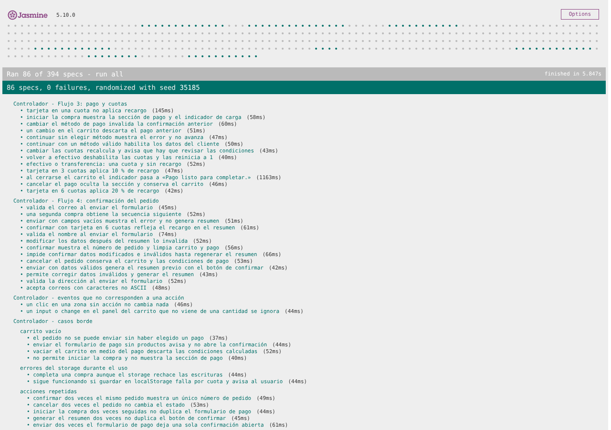

# Documentación de Testing - Suite Jasmine

Proyecto FerroLab - Actividad Obligatoria N°4 - Programación Web I
Módulos testeados: `js/models/*.js`, `js/utils/storage.js` y `js/script.js` | Framework: Jasmine 5.10.0 (CDN)

## Índice
1. [Estructura de la suite](#estructura-de-la-suite)
2. [Ejecución de Tests](#ejecución-de-tests)
3. [Suites de Tests](#suites-de-tests)
4. [Métricas de Cobertura](#métricas-de-cobertura)
5. [Capturas de Pantalla](#capturas-de-pantalla)
6. [Hallazgos e Issues](#hallazgos-e-issues)
7. [Limitaciones del Testing](#limitaciones-del-testing)
8. [Historial: tercera entrega](#historial-tercera-entrega)

---

## Estructura de la suite

En la tercera entrega `js/script.js` tenía la lógica y usaba `prompt()`/`alert()`. En la cuarta entrega se separó en tres capas y hay un archivo spec por cada una:

| Módulo | Qué contiene | Spec | Specs |
|---|---|---|---|
| `js/models/` (`Producto`, `Catalogo`, `Carrito`, `Pago`, `Pedido`) | Lógica de negocio con clases, sin DOM ni Storage | `js/test/models.spec.js` | 42 |
| `js/utils/storage.js` (`StorageUtil`) | Capa de abstracción de `localStorage`/`sessionStorage` | `js/test/storage.spec.js` | 113 |
| `js/script.js` | Controlador: eventos y DOM | `js/test/script.spec.js` | 65 |
| | | **Total** | **220** |

`js/test/test-runner.html` carga los tres specs como módulos ES. `js/test/models-test-runner.html` es el runner independiente que armó el Desarrollador JS POO para sus modelos y se conserva.

## Ejecución de Tests

### Pasos para Ejecutar
1. Servir el proyecto por HTTP **desde la raíz del repo**. Los specs usan módulos ES, que el navegador bloquea al abrir el archivo con doble clic (`file://`):
   ```bash
   python -m http.server 8000
   ```
   También sirven `npx serve .` o la extensión Live Preview de VS Code.
2. Abrir el runner:
   ```text
   http://localhost:8000/js/test/test-runner.html
   ```
3. Los tests se ejecutan al cargar la página. La barra superior de Jasmine muestra el total de specs y los fallos.
4. Para correr una sola suite se filtra por nombre con el parámetro `spec`: `?spec=StorageUtil`, `?spec=Controlador`, `?spec=Pedido`. Con `?random=false` el orden es fijo.

Requiere conexión a internet: Jasmine se carga desde `cdnjs.cloudflare.com` y `index.html` (que `script.spec.js` abre en un iframe) carga Bootstrap desde `cdn.jsdelivr.net`.

### Cómo funciona cada spec
- **`models.spec.js`** importa las clases (`import { Carrito } from "../models/Carrito.js"`) y las prueba de forma aislada.
- **`storage.spec.js`** importa `StorageUtil` y reemplaza `localStorage`/`sessionStorage` por un `Storage` simulado en memoria (`StorageFalso`), para forzar errores (cuota llena, `SecurityError`) sin tocar el almacenamiento real. Un bloque usa los modelos reales de `js/models/` (`Carrito`, `Catalogo`, `Producto`, `Pedido`) para comprobar los round trips con `toJSON()` / `fromJSON()`. El último bloque usa el Web Storage real del navegador y borra sus propias claves al terminar.
- **`script.spec.js`**: `script.js` ya no exporta funciones, solo registra eventos sobre `index.html`. Por eso, para cada test se abre una copia nueva de `index.html` en un `<iframe>` del mismo origen, se disparan eventos reales (`click`, `input`, `change`, `submit`) y se comprueba el DOM resultante. Cada copia empieza con el carrito, el pago y el pedido en blanco. Antes de cada test se reemplazan `alert`, `prompt`, `confirm`, `console.log` y `console.error` del iframe por espías.

---

## Suites de Tests

### `models.spec.js` (42 specs)

| Suite | Specs | Qué se prueba |
|---|---|---|
| `Producto` | 5 | Constructor, getters, `coincide()` por texto, categoría y precio; validaciones |
| `Catalogo` | 6 | `buscar()` con filtros y orden, copias independientes, códigos duplicados, errores |
| `Carrito` | 7 | `agregar`, `cambiarCantidad`, `eliminar`, `vaciar`, `resumir()`, desbordes, estado intacto ante errores |
| `Pago` | 6 | Efectivo/transferencia, tarjeta en 1/3/6 cuotas (0/10/20 %), redondeo, entradas inválidas |
| `Pedido` | 15 | Validación de cliente, coherencia con el pago, `confirmar()` determinista, `toJSON()`/`fromJSON()` |
| `Cadenas numéricas estrictas` | 3 | `"0x10"`, `"1e2"` y `"1e3"` se rechazan en `Carrito`, `Catalogo` y `Pago`; se aceptan dígitos con espacios |

### `storage.spec.js` (113 specs)

| Suite | Specs | Qué se prueba |
|---|---|---|
| Nombres de clave (`CLAVES`) | 3 | Convención `app:<dominio>:<dato>` |
| `guardar()` y `obtener()` | 9 | Ida y vuelta en `localStorage` y `sessionStorage`, valores `null`, anidados, clave inexistente |
| `guardar()`: errores | 15 | Cuota llena, valor no serializable, referencia circular, clave o tipo inválidos |
| Datos corruptos | 4 | JSON inválido: devuelve `null` y registra el error sin lanzar |
| `actualizar()` | 6 | Actualiza claves existentes; no crea las inexistentes |
| `eliminar()` | 6 | Elimina; es idempotente |
| `listar()` | 7 | Claves con prefijo, ordenadas; sin coincidencias |
| `limpiar()` | 5 | Borra solo `app:*`; `limpiar(tipo, false)` borra todo |
| `existe()` | 4 | Refleja el estado real |
| `estaDisponible()` | 9 | Storage deshabilitado o inaccesible |
| Storage inaccesible (`SecurityError`) | 3 | Ninguna operación lanza |
| Storage no disponible en el entorno | 1 | Entorno sin Web Storage |
| `guardarInstancia()` y `cargarInstancia()` | 8 | Contrato genérico con una clase auxiliar `Modelo` (`toJSON()` / `fromJSON()`) |
| `guardarLista()` y `cargarLista()` | 9 | Contrato genérico con `Modelo`: listas, lista vacía, datos que ya no cumplen las reglas |
| Integración con los modelos reales de `js/models/` | 9 | Round trip de `Carrito`, `Catalogo`, `Producto` y `Pedido` (sin confirmar y confirmado); datos alterados (cantidad negativa, importe modificado, correo inválido) devuelven `null` o `[]`, sin objetos parciales |
| Ninguna operación lanza excepciones hacia afuera | 12 | Se verifica para cada operación |
| Web Storage real del navegador | 3 | Ciclo completo sin dejar claves |

### `script.spec.js` (65 specs)

| Suite | Specs | Qué se prueba |
|---|---|---|
| Carga inicial | 4 | 9 productos visibles, carrito vacío, botón deshabilitado, pago y confirmación ocultos |
| RC44: renderizado dinámico | 4 | Generación dinámica del catálogo, ofertas, tabla de precios, categorías y opciones de pago |
| Flujo 1: búsqueda y filtrado | 12 | Texto, tildes y mayúsculas, ausencia de coincidencias, envío del formulario, categoría, orden asc/desc, rango de precio, menú de categorías y recuperación de resultados |
| Flujo 2: carrito | 12 | Agregar productos, actualizar cantidades, validar con input, confirmar cambios con change, rechazar cantidades inválidas, eliminar productos e invalidar el pago |
| Flujo 3: pago y cuotas | 13 | Efectivo/transferencia, tarjeta en 1, 3 y 6 cuotas, cálculo de recargos, validación del método, cambios de cuotas, invalidación de confirmación y cancelación |
| Flujo 4: confirmación del pedido | 13 | Validación al enviar el formulario, corrección de errores, generación del resumen, invalidación y regeneración, confirmación, numeración y cancelación |
| Requisitos transversales | 7 | Uso del DOM y eventos, accesibilidad, mensajes de estado y controles sobre interacciones del navegador |


### Trazabilidad del Flujo 1

**Diagrama:** `docs/05-diagramas/01-diagrama-de-actividades/actividad-flujo-1-busqueda-filtrado.puml`

**Implementación:** `js/script.js` y `js/models/Catalogo.js`

**Pruebas:** `js/test/script.spec.js`

| Decisión o estado del diagrama | Prueba Jasmine |
|---|---|
| Búsqueda por texto | Filtra por texto mientras se escribe |
| Normalización de texto | Ignora mayúsculas y tildes |
| Búsqueda sin resultados | Muestra «Sin coincidencias.» |
| Filtrado por categoría | Filtra por categoría |
| Ordenamiento | Ordena por precio ascendente y descendente |
| Activación y desactivación del filtro de precio | Pruebas del filtro de precio |
| Recuperación de resultados | Recupera los resultados al corregir una búsqueda sin coincidencias |
| Recuperación después de un filtro restrictivo | Recupera los productos al quitar un filtro de precio sin coincidencias |

**Resultado Jasmine:** 12 specs, 0 failures.


### Trazabilidad del Flujo 2 — Carrito

**Diagrama:** `docs/05-diagramas/01-diagrama-de-actividades/actividad-flujo-2-carrito.puml`

**Implementación:** `js/script.js`, `js/models/Carrito.js` y `js/services/FachadaStorage.js`

**Pruebas:** `js/test/script.spec.js`

| Decisión o estado del diagrama | Prueba Jasmine |
|---|---|
| Agregar productos desde el catálogo | Agrega un producto desde el catálogo y actualiza contador, total y botón |
| Agregar desde ofertas | Agrega un producto desde la sección de ofertas |
| Acumular cantidades | Agregar dos veces el mismo producto suma la cantidad y no duplica el ítem |
| Agregar distintos productos | Suma varios productos distintos |
| Modificar cantidades | Cambia la cantidad y recalcula subtotal y total |
| Validación de cantidades inválidas | Una cantidad inválida se marca en el campo sin modificar el carrito |
| Rechazar notación científica | Una cantidad en notación científica se rechaza |
| Rechazar cantidades decimales | Una cantidad decimal se rechaza y deja el carrito igual |
| Eliminar productos | Elimina un producto y vuelve al estado vacío |
| Conservar productos restantes | Eliminar un producto conserva los demás |
| Diferenciar input y change | Valida la cantidad con input sin modificar el total hasta change |
| Invalidar pago por modificación del carrito | Modificar la cantidad después de elegir el pago invalida la confirmación |

**Resultado Jasmine:** 12 specs, 0 failures.

**Ejecución:** suite individual con `random=false`.

**Observación:** La persistencia del carrito y los posibles errores de almacenamiento requieren verificaciones específicas adicionales.

### Trazabilidad del Flujo 3 — Pago y cuotas

**Diagrama:** `docs/05-diagramas/01-diagrama-de-actividades/actividad-flujo-3-pago-cuotas.puml`

**Implementación:** `js/script.js` y `js/models/Pago.js`

**Pruebas:** `js/test/script.spec.js`

| Decisión o estado del diagrama | Prueba Jasmine |
|---|---|
| Iniciar proceso de compra | Iniciar la compra muestra la sección de pago y el indicador de carga |
| Transición al pago | Al cerrarse el carrito el indicador pasa a «Pago listo para completar.» |
| Efectivo o transferencia | Efectivo o transferencia: una cuota y sin recargo |
| Tarjeta en 1 cuota | Tarjeta en una cuota no aplica recargo |
| Tarjeta en 3 cuotas | Tarjeta en 3 cuotas aplica 10 % de recargo |
| Tarjeta en 6 cuotas | Tarjeta en 6 cuotas aplica 20 % de recargo |
| Modificación de cuotas | Cambiar las cuotas recalcula y avisa que hay que revisar las condiciones |
| Cambio a efectivo | Volver a efectivo deshabilita las cuotas y las reinicia a 1 |
| Método de pago faltante | Continuar sin elegir método muestra el error y no avanza |
| Condiciones válidas | Continuar con un método válido habilita los datos del cliente |
| Modificación del carrito | Un cambio en el carrito descarta el pago anterior |
| Cancelación de pago | Cancelar el pago oculta la sección y conserva el carrito |
| Cambio de método después de continuar | Cambiar el método de pago invalida la confirmación anterior |

**Resultado Jasmine:** 13 specs, 0 failures.

**Ejecución:** suite individual con `random=false`.

### Trazabilidad del Flujo 4 — Confirmación del pedido

**Diagrama:** `docs/05-diagramas/01-diagrama-de-actividades/actividad-flujo-4-confirmacion-pedido.puml`

**Implementación:** `js/script.js` y `js/models/Pedido.js`

**Pruebas:** `js/test/script.spec.js`

| Decisión o estado del diagrama | Prueba Jasmine |
|---|---|
| Validación del nombre | Valida el nombre al enviar el formulario |
| Validación del correo | Valida el correo al enviar el formulario |
| Correos con caracteres especiales | Acepta correos con caracteres no ASCII |
| Validación de dirección | Valida la dirección al enviar el formulario |
| Datos incompletos | Enviar con campos vacíos muestra el error y no genera resumen |
| Datos válidos | Enviar con datos válidos genera el resumen previo con el botón de confirmar |
| Modificación de datos | Modificar los datos después del resumen lo invalida |
| Confirmación válida | Confirmar muestra el número de pedido y limpia carrito y pago |
| Numeración de pedidos | Una segunda compra obtiene la secuencia siguiente |
| Pago financiado | Confirmar con tarjeta en 6 cuotas refleja el recargo en el resumen |
| Cancelación del pedido | Cancelar el pedido conserva el carrito y las condiciones de pago |
| Corrección de datos inválidos | Permite corregir datos inválidos y generar el resumen |
| Regeneración del resumen | Impide confirmar datos modificados e inválidos hasta regenerar el resumen |

**Resultado Jasmine:** 13 specs, 0 failures.

**Ejecución:** suite individual con `random=false`.

**Observación:** La validación definitiva se realiza al enviar el formulario. El evento input invalida el resumen pendiente cuando se modifican los datos del cliente.


---

## Métricas de Cobertura

**Medición histórica de cobertura:** realizada sobre la versión anterior del proyecto, con 208 specs y 0 failures.

La versión actual contiene 220 specs, de los cuales se verificaron individualmente los cuatro flujos principales. Todavía no se ha confirmado una ejecución completa sin fallas.

Los porcentajes de cobertura presentados a continuación corresponden a la medición histórica y deben actualizarse al ejecutar nuevamente la herramienta de cobertura.

Cobertura de **líneas ejecutables**, medida con la cobertura de código de V8 (Chromium, vía Playwright) durante esa misma corrida. No cuentan líneas en blanco, comentarios ni llaves de cierre. Es cobertura de líneas: no mide ramas.

| Archivo | Líneas ejecutables | Cubiertas | Cobertura |
|---|---|---|---|
| `js/models/Producto.js` | 44 | 44 | 100,0 % |
| `js/models/Catalogo.js` | 46 | 46 | 100,0 % |
| `js/models/Carrito.js` | 92 | 87 | 94,6 % |
| `js/models/Pago.js` | 47 | 46 | 97,9 % |
| `js/models/Pedido.js` | 110 | 110 | 100,0 % |
| `js/utils/storage.js` | 283 | 267 | 94,3 % |
| `js/script.js` | 611 | 562 | 92,0 % |
| **Total** | **1233** | **1162** | **94,2 %** |

Las líneas sin cubrir son sobre todo guardas defensivas que ningún test puede alcanzar (por ejemplo, `throw error` para errores que no son `TypeError`/`RangeError`, y el control de elementos obligatorios ausentes al cargar `script.js`).

### Cómo reproducir la medición

La tabla sale del script `js/test/herramientas/cobertura-v8.js`, que está en el repositorio. No es parte de la aplicación ni de los tests: solo mide.

```bash
# desde la raíz del repo, con Node 18 o superior
npm install --no-save playwright
npx playwright install chromium
node js/test/herramientas/cobertura-v8.js
```

El script levanta un servidor HTTP temporal sobre el repo, abre `js/test/test-runner.html` en Chromium, toma la cobertura de V8 mientras corre la suite completa y, al terminar, imprime el resultado de Jasmine y la tabla de arriba en Markdown. Termina con código 1 si algún spec falla. Necesita internet (Jasmine y Bootstrap vienen de CDN). El resultado es el mismo en corridas sucesivas; si cambian los tests o el código, cambia la tabla.

---

## Capturas de Pantalla

Una captura por suite y una de la corrida completa, tomadas con Playwright (Chromium) sobre el runner:


*Runner completo: 208 specs, 0 failures*


*`models.spec.js`: 42 specs, 0 failures*


*`storage.spec.js`: 113 specs, 0 failures*


*`script.spec.js`: 53 specs, 0 failures*

No hay capturas de tests fallando porque la corrida final no tuvo fallos. Para comprobar que los specs detectan errores se hizo una prueba de mutación manual: se quitó `preventDefault()` del envío de búsqueda, se cambió el contador del carrito para que cuente unidades en vez de ítems y se cambió el recargo de 3 cuotas de 10 % a 15 %. Esos tres cambios hicieron fallar tres specs de `script.spec.js`.

---

## Hallazgos e Issues

En la corrida final no hay tests fallando contra `develop`. Durante la revisión se registró lo siguiente:


- **Integración de persistencia del carrito:** Se incorporó `FachadaStorage` para recuperar y guardar el estado del carrito mediante la capa de almacenamiento del proyecto. Las pruebas Jasmine del controlador fueron adaptadas para aislar los datos almacenados entre ejecuciones, evitando que los productos agregados durante una prueba afecten a las siguientes. Queda pendiente incorporar pruebas específicas que verifiquen la recuperación del carrito después de recargar la página y los errores de almacenamiento.

- **Cadenas numéricas (`"0x10"`, `"1e2"`).** Detectado en la revisión de la PR #150 y corregido en la misma PR. El caso queda cubierto en `models.spec.js` y, desde la interfaz, en `script.spec.js` (cantidad `1e2`).
- **Correo con caracteres no ASCII (`ñandú@correo.com`).** Detectado en la revisión de la PR #156 y corregido por el Desarrollador de Eventos + DOM. Queda cubierto en `script.spec.js`.

Los hallazgos de las PRs #150 y #156 se corrigieron en esas PRs; la falta de persistencia queda como seguimiento en la issue mencionada.

---

## Limitaciones del Testing

- `script.spec.js` prueba la página real en un iframe, por lo que es más lento que los otros dos (cada test carga `index.html`; la suite completa tarda unos 12 segundos) y depende de los CDN de Bootstrap.
- El cierre del carrito (`offcanvas`) de Bootstrap se simula con el evento `hidden.bs.offcanvas`; no se prueba la animación real.
- Los desplazamientos (`scrollIntoView`) no se verifican.
- La cobertura es por líneas, con V8; no mide ramas. El script que la mide está en `js/test/herramientas/` y requiere instalar Playwright aparte (no se agrega como dependencia del proyecto).
- No hay tests de integración de la página con persistencia, porque `script.js` aún no usa `StorageUtil` (ver Hallazgos). Sí hay round trips de `StorageUtil` con los modelos reales, fuera de la página.
- El mapa de Google de `index.html` no se carga ni se prueba.

---

## Historial: tercera entrega

La suite de la tercera entrega (143 tests sobre funciones con `prompt()` y `alert()`) quedó obsoleta al reemplazarse esa lógica por clases, storage y eventos. Sus capturas (`capturas/captura-flujo-*.png`) se conservan solo como referencia histórica. El bug documentado en esa etapa fue:

### Issue #127: Omitir el precio máximo devolvía error y la condición `valor === null` era inalcanzable
- **Severidad:** Baja
- **Suite Afectada:** `describe("buscarProductos")` y `describe("validarPrecioMaximo")`, en "Flujo 1 - Búsqueda y filtrado (lógica pura)"
- **Tests Afectados:** `validarPrecioMaximo › permite omitir el precio máximo (vacío, espacios, null o undefined)`, `buscarProductos › sin precio máximo no filtra por precio` y `buscarProductos › con criterios null o undefined no falla y devuelve todo el catálogo`
- **Comportamiento Esperado:** Que un precio máximo vacío, `null` o `undefined` signifique "no filtrar por precio" (regla acordada con el Desarrollador JavaScript y reflejada en los diagramas de actividades) y que todas las condiciones del filtro puedan evaluarse en algún caso.
- **Comportamiento Obtenido (versión anterior, commit `95d2d5f`):** `validarPrecioMaximo()` trataba el valor vacío como inválido (`valido: false`), por lo que `buscarProductos()` devolvía el error "El precio maximo debe ser un numero mayor o igual a cero." y una lista vacía. Además, la condición `precioValidado.valor === null` de `buscarProductos()` nunca era verdadera, porque si el precio era válido `valor` siempre era un número.
- **Pasos para Reproducir (contra `js/script.js` del commit `95d2d5f`):**
  1. Abrir `js/test/test-runner.html` apuntando a esa versión de `js/script.js`, o cargarla en Node.
  2. Ejecutar `buscarProductos(catalogoPrueba, { texto: "", categoria: "", precioMaximo: "" })`.
  3. Resultado obtenido: `{ valido: false, error: "El precio maximo debe ser un numero mayor o igual a cero.", resultados: [] }`. Resultado esperado: `valido: true` y los 3 productos de `catalogoPrueba`, ordenados por precio.
- **Código del Test que Falla** (contra la versión anterior):
  ```javascript
  it("sin precio máximo no filtra por precio", function () {
      var r = buscarProductos(catalogoPrueba, { texto: "", categoria: "", precioMaximo: "" });
      expect(r.valido).toBeTruthy();
      expect(r.resultados.map(function (p) { return p.codigo; })).toEqual(["C-003", "A-001", "B-002"]);
  });
  ```
  Resultado contra la versión anterior: `Expected false to be truthy.` y `Expected $.length = 0 to equal 3.` Los otros dos tests afectados también fallan contra esa versión; se comprobó ejecutando la suite contra el `script.js` del commit `95d2d5f`.
- **GitHub Issue:** [#127](https://github.com/angelgc9107-lgtm/ProyectoFerreteria_GRP05/issues/127)
- **Estado:** Resuelto. El Desarrollador JavaScript modificó `validarPrecioMaximo()` para permitir omitir el precio máximo (devuelve `valido: true` y `valor: null`), de modo que la condición ahora es alcanzable. Con `script.js` actual los tres tests pasan.

---

**Última Actualización:** 2026-11-22 (cuarta entrega)
**Tester/QA Engineer:** Alan Diaz (@alandox1)
