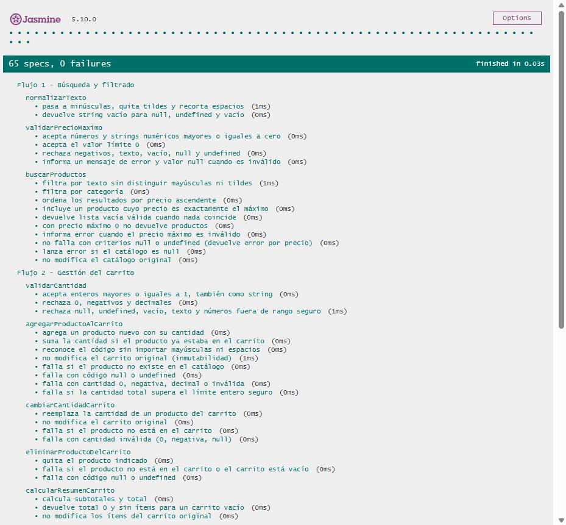
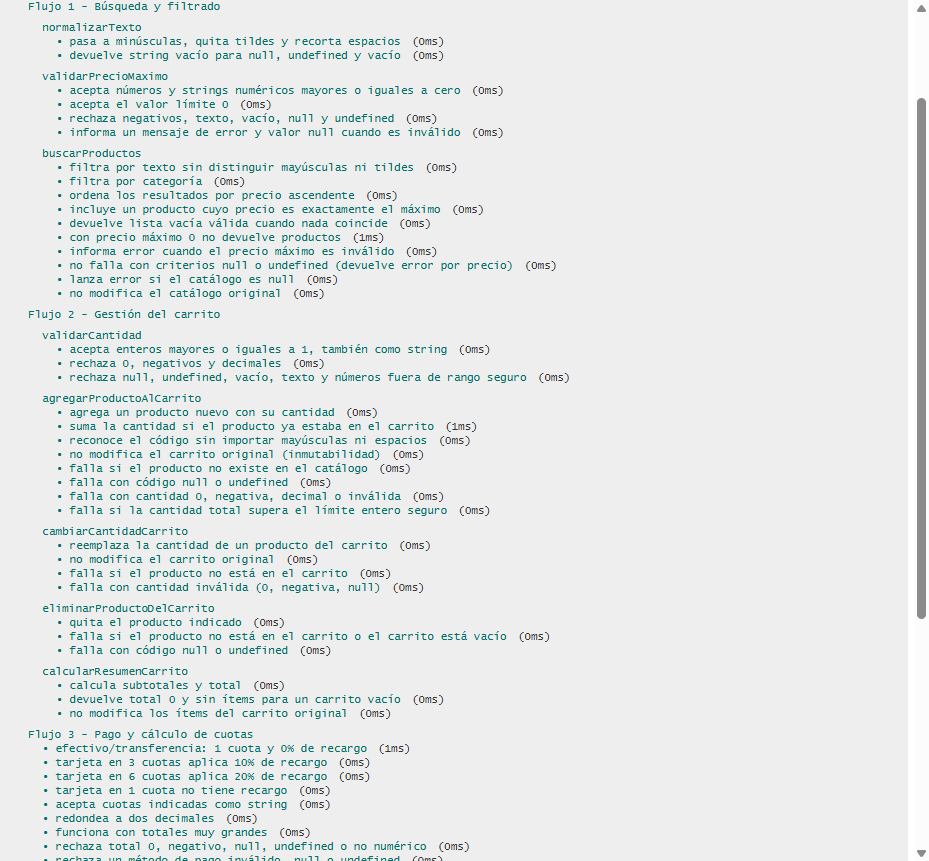
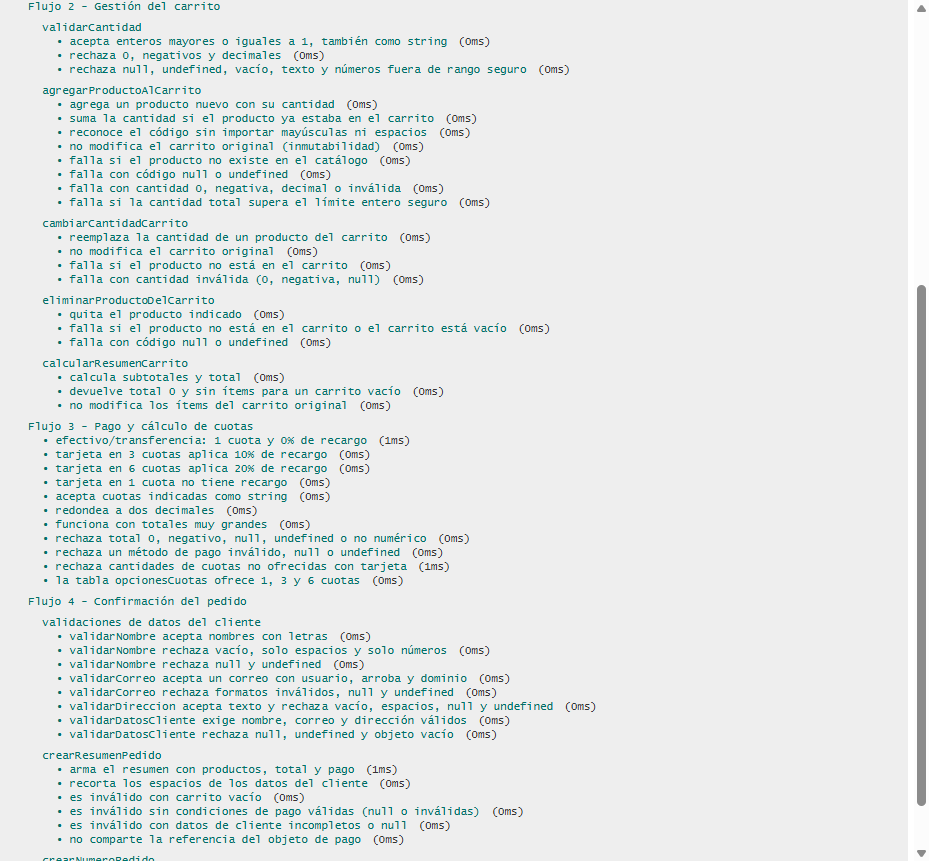
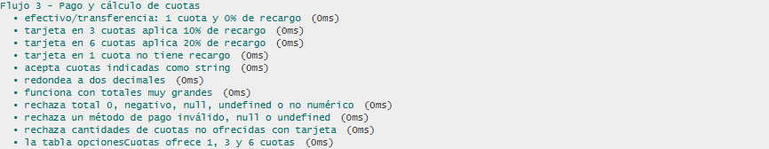
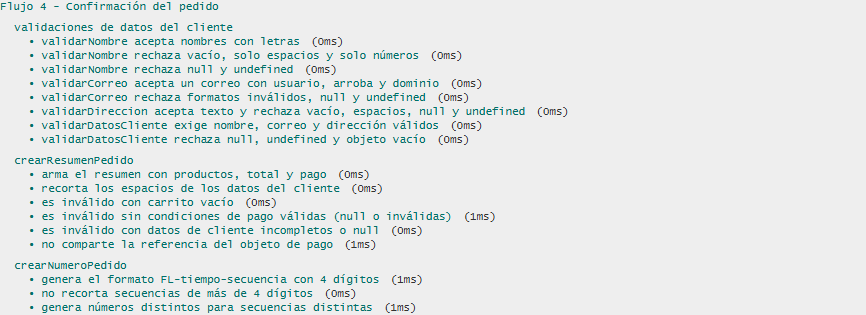

# Documentación de Testing - Suite Jasmine

Proyecto FerroLab - Actividad Obligatoria N°3 - Programación Web I
Archivo testeado: `js/script.js` | Framework: Jasmine 5.10.0 (CDN)

## Índice
1. [Ejecución de Tests](#ejecución-de-tests)
2. [Suites de Tests](#suites-de-tests)
3. [Métricas de Cobertura](#métricas-de-cobertura)
4. [Capturas de Pantalla](#capturas-de-pantalla)
5. [Issues Conocidos](#issues-conocidos)

---

## Ejecución de Tests

### Pasos para Ejecutar
1. Servir la carpeta del proyecto por HTTP desde la raíz del repo (con Node instalado):
   ```bash
   npx serve . -l 3000
   ```
   También sirve la extensión Live Preview de VS Code.
2. Abrir `js/test/test-runner.html` en el navegador:
   ```text
   http://127.0.0.1:3000/js/test/test-runner.html
   ```
   Agregando `?random=false` al final, Jasmine ejecuta las suites en orden (Flujo 1 a 4). Sin ese parámetro el orden es aleatorio y cambia el `seed` en cada corrida.
3. Los tests se ejecutan automáticamente al cargar la página.
4. Verificar resultados en la interfaz de Jasmine (la barra superior muestra el total de specs y fallos).

`test-runner.html` carga `js/script.js` (código a testear) y `js/test/script.spec.js` (tests). Requiere conexión a internet porque Jasmine se carga desde `cdnjs.cloudflare.com`.

### Interpretación de Resultados
- **Verde**: Tests pasando ✅
- **Rojo**: Tests fallando ❌
- **Amarillo**: Tests pendientes ⚠️

---

## Suites de Tests

Se testea únicamente la lógica de negocio (funciones que reciben parámetros y devuelven un resultado). Las funciones con `prompt()` o `alert()` no se testean.

### Suite 1: Flujo 1 - Búsqueda y filtrado

**Funciones testeadas:**

- `normalizarTexto()` - Pasa a minúsculas, quita tildes y recorta espacios
- `validarPrecioMaximo()` - Valida que el precio máximo sea un número ≥ 0
- `buscarProductos()` - Filtra por texto, categoría y precio máximo y ordena por precio

**Casos de prueba:**

| # | Descripción | Tipo |
|---|-------------|------|
| 1 | Pasa a minúsculas, quita tildes y recorta espacios | Happy Path |
| 2 | Devuelve string vacío para null, undefined y vacío | Validación de Errores |
| 3 | Acepta números y strings numéricos mayores o iguales a cero | Happy Path |
| 4 | Acepta el valor límite 0 | Caso Borde |
| 5 | Rechaza negativos, texto, vacío, null y undefined | Validación de Errores |
| 6 | Informa mensaje de error y valor null cuando el precio es inválido | Validación de Errores |
| 7 | Filtra por texto sin distinguir mayúsculas ni tildes | Happy Path |
| 8 | Filtra por categoría | Happy Path |
| 9 | Ordena los resultados por precio ascendente | Operaciones Arrays/Objetos |
| 10 | Incluye un producto cuyo precio es exactamente el máximo | Caso Borde |
| 11 | Devuelve lista vacía válida cuando nada coincide | Caso Borde |
| 12 | Con precio máximo 0 no devuelve productos | Caso Borde |
| 13 | Informa error cuando el precio máximo es inválido | Validación de Errores |
| 14 | No falla con criterios null o undefined (devuelve error por precio) | Validación de Errores |
| 15 | Lanza error si el catálogo es null | Validación de Errores |
| 16 | No modifica el catálogo original | Operaciones Arrays/Objetos |

**Total de la suite:** 16 tests

---

### Suite 2: Flujo 2 - Gestión del carrito

**Funciones testeadas:**

- `validarCantidad()` - Valida enteros ≥ 1
- `agregarProductoAlCarrito()` - Agrega un producto o suma su cantidad
- `cambiarCantidadCarrito()` - Reemplaza la cantidad de un producto del carrito
- `eliminarProductoDelCarrito()` - Quita un producto del carrito
- `calcularResumenCarrito()` - Calcula subtotales y total

**Casos de prueba:**

| # | Descripción | Tipo |
|---|-------------|------|
| 1 | Acepta enteros mayores o iguales a 1, también como string | Happy Path |
| 2 | Rechaza 0, negativos y decimales | Caso Borde |
| 3 | Rechaza null, undefined, vacío, texto y números fuera de rango seguro | Validación de Errores |
| 4 | Agrega un producto nuevo con su cantidad | Happy Path |
| 5 | Suma la cantidad si el producto ya estaba en el carrito | Operaciones Arrays/Objetos |
| 6 | Reconoce el código sin importar mayúsculas ni espacios | Caso Borde |
| 7 | No modifica el carrito original al agregar (inmutabilidad) | Operaciones Arrays/Objetos |
| 8 | Falla si el producto no existe en el catálogo | Validación de Errores |
| 9 | Falla con código null o undefined al agregar | Validación de Errores |
| 10 | Falla con cantidad 0, negativa, decimal o inválida al agregar | Validación de Errores |
| 11 | Falla si la cantidad total supera el límite entero seguro | Caso Borde |
| 12 | Reemplaza la cantidad de un producto del carrito | Happy Path |
| 13 | No modifica el carrito original al cambiar la cantidad | Operaciones Arrays/Objetos |
| 14 | Falla al cambiar la cantidad si el producto no está en el carrito | Validación de Errores |
| 15 | Falla al cambiar la cantidad con valor inválido (0, negativa, null) | Validación de Errores |
| 16 | Quita el producto indicado del carrito | Operaciones Arrays/Objetos |
| 17 | Falla al eliminar si el producto no está o el carrito está vacío | Validación de Errores |
| 18 | Falla al eliminar con código null o undefined | Validación de Errores |
| 19 | Calcula subtotales y total | Happy Path |
| 20 | Devuelve total 0 y sin ítems para un carrito vacío | Caso Borde |
| 21 | No modifica los ítems del carrito original al calcular el resumen | Operaciones Arrays/Objetos |

**Total de la suite:** 21 tests

---

### Suite 3: Flujo 3 - Pago y cálculo de cuotas

**Funciones testeadas:**

- `calcularCondicionesPago()` - Calcula interés, total financiado y valor de cuota según método y cuotas

**Casos de prueba:**

| # | Descripción | Tipo |
|---|-------------|------|
| 1 | Efectivo/transferencia: 1 cuota y 0 % de recargo | Happy Path |
| 2 | Tarjeta en 3 cuotas aplica 10 % de recargo | Happy Path |
| 3 | Tarjeta en 6 cuotas aplica 20 % de recargo | Happy Path |
| 4 | Tarjeta en 1 cuota no tiene recargo | Caso Borde |
| 5 | Acepta cuotas indicadas como string | Caso Borde |
| 6 | Redondea a dos decimales | Caso Borde |
| 7 | Funciona con totales muy grandes | Caso Borde |
| 8 | Rechaza total 0, negativo, null, undefined o no numérico | Validación de Errores |
| 9 | Rechaza un método de pago inválido, null o undefined | Validación de Errores |
| 10 | Rechaza cantidades de cuotas no ofrecidas con tarjeta | Validación de Errores |
| 11 | La tabla opcionesCuotas ofrece 1, 3 y 6 cuotas | Operaciones Arrays/Objetos |

**Total de la suite:** 11 tests

---

### Suite 4: Flujo 4 - Confirmación del pedido

**Funciones testeadas:**

- `validarNombre()` - Nombre no vacío ni solo numérico
- `validarCorreo()` - Correo con usuario, arroba y dominio
- `validarDireccion()` - Dirección no vacía
- `validarDatosCliente()` - Valida nombre, correo y dirección en conjunto
- `crearResumenPedido()` - Arma el resumen del pedido
- `crearNumeroPedido()` - Genera el número `FL-tiempo-secuencia`

**Casos de prueba:**

| # | Descripción | Tipo |
|---|-------------|------|
| 1 | validarNombre acepta nombres con letras | Happy Path |
| 2 | validarNombre rechaza vacío, solo espacios y solo números | Validación de Errores |
| 3 | validarNombre rechaza null y undefined | Validación de Errores |
| 4 | validarCorreo acepta un correo con usuario, arroba y dominio | Happy Path |
| 5 | validarCorreo rechaza formatos inválidos, null y undefined | Validación de Errores |
| 6 | validarDireccion acepta texto y rechaza vacío, espacios, null y undefined | Validación de Errores |
| 7 | validarDatosCliente exige nombre, correo y dirección válidos | Happy Path |
| 8 | validarDatosCliente rechaza null, undefined y objeto vacío | Validación de Errores |
| 9 | Arma el resumen con productos, total y pago | Operaciones Arrays/Objetos |
| 10 | Recorta los espacios de los datos del cliente | Caso Borde |
| 11 | Resumen inválido con carrito vacío | Validación de Errores |
| 12 | Resumen inválido sin condiciones de pago válidas | Validación de Errores |
| 13 | Resumen inválido con datos de cliente incompletos o null | Validación de Errores |
| 14 | No comparte la referencia del objeto de pago | Operaciones Arrays/Objetos |
| 15 | Genera el formato FL-tiempo-secuencia con 4 dígitos | Happy Path |
| 16 | No recorta secuencias de más de 4 dígitos | Caso Borde |
| 17 | Genera números distintos para secuencias distintas | Happy Path |

**Total de la suite:** 17 tests

---
## Métricas de Cobertura

### Resumen General
| Métrica | Valor |
|---------|-------|
| Total de Tests | 65 |
| Tests Pasando | 65 ✅ |
| Tests Fallando | 0 ❌ |
| Porcentaje de Éxito | 100% |

Resultado de la corrida con Playwright MCP: `65 specs, 0 failures`.

### Cobertura por Tipo de Test
Cada test se clasificó según su propósito principal.

| Tipo | Cantidad | Porcentaje |
|------|----------|------------|
| Happy Path | 16 | 24,6% |
| Casos Borde | 14 | 21,5% |
| Validación de Errores | 25 | 38,5% |
| Operaciones Arrays/Objetos | 10 | 15,4% |

### Análisis de Cobertura de Código
**Metodología:** Se ejecutó la misma suite (`script.spec.js`) contra `js/script.js` en Node.js con `jasmine-core` 5.10.0 y se midió la cobertura con la herramienta `c8` (cobertura de V8). Esta medición se hizo una vez, fuera del repositorio, y no forma parte de la ejecución en el navegador. Las "líneas ejecutables" excluyen líneas en blanco, comentarios y llaves de cierre.

| Función | Líneas Ejecutables | Tests | Líneas Cubiertas | Cobertura |
|---------|--------------------|-------|------------------|-----------|
| `normalizarTexto()` | 6 | 2 | 6 | 100% |
| `validarPrecioMaximo()` | 13 | 4 | 13 | 100% |
| `buscarProductos()` | 24 | 10 | 24 | 100% |
| `validarCantidad()` | 5 | 3 | 5 | 100% |
| `agregarProductoAlCarrito()` | 28 | 8 | 28 | 100% |
| `cambiarCantidadCarrito()` | 13 | 4 | 13 | 100% |
| `eliminarProductoDelCarrito()` | 6 | 3 | 6 | 100% |
| `calcularResumenCarrito()` | 7 | 3 | 7 | 100% |
| `calcularCondicionesPago()` | 28 | 11 | 28 | 100% |
| `validarNombre()` | 3 | 3 | 3 | 100% |
| `validarCorreo()` | 2 | 2 | 2 | 100% |
| `validarDireccion()` | 2 | 1 | 2 | 100% |
| `validarDatosCliente()` | 6 | 2 | 6 | 100% |
| `crearResumenPedido()` | 14 | 6 | 14 | 100% |
| `crearNumeroPedido()` | 2 | 3 | 2 | 100% |

**Cobertura de las funciones de lógica de negocio testeadas:** 100% (159/159 líneas ejecutables).
**Cobertura Total Estimada del archivo:** aproximadamente 39% (159/405 líneas ejecutables de funciones). El resto corresponde a funciones de interacción con `prompt()`/`alert()`, funciones de formato y el bloque `module.exports`, que están fuera del alcance de los tests. Cobertura de ramas de la suite: 96,55% (medida con c8).

#### Líneas NO Cubiertas
- `script.js:416-459` - `formatearMoneda`, `formatearResumenCarrito` y `formatearResumenPedido`: funciones puras de formato, sin tests en esta iteración.
- `script.js:468-790` - Funciones de interacción (`solicitarDatoValido`, `preguntarSiNo`, `ejecutar*`, `mostrarCarrito`, `actualizarCarrito`, `iniciarMenuPrincipal`): usan `prompt()` y `alert()`, fuera del alcance.
- `script.js:792-813` - Bloque `module.exports`: no se ejecuta en el navegador.
- `script.js:238` - Rama `codigo || ""` de `cambiarCantidadCarrito()` cuando el código es `null` o `undefined`: no hay un test que la ejecute.

---

## Capturas de Pantalla

### Tests Pasando

*Todos los tests ejecutándose correctamente (65 specs, 0 failures)*

### Vista Detallada de Suites

*Suite Flujo 1 - Búsqueda y filtrado*


*Suite Flujo 2 - Gestión del carrito*


*Suite Flujo 3 - Pago y cálculo de cuotas*


*Suite Flujo 4 - Confirmación del pedido*

Las capturas se tomaron con Playwright MCP sobre `test-runner.html?random=false`. No hay capturas de tests fallando porque la corrida no tuvo fallos.

---

## Issues Conocidos

No hubo tests fallando en la corrida. Se registra una observación de calidad de código detectada al revisar `js/script.js`:

### Issue #COMPLETAR: Condición inalcanzable en `buscarProductos()`
- **Severidad:** Baja
- **Suite Afectada:** `describe("buscarProductos")`
- **Test Afectado:** Ninguno (hallazgo por revisión del código, no hay un test que falle)
- **Comportamiento Esperado:** Que todas las condiciones del filtro puedan evaluarse en algún caso.
- **Comportamiento Obtenido:** La condición `precioValidado.valor === null` (línea 143) nunca es verdadera, porque si el precio es válido `valor` siempre es un número.
- **Pasos para Reproducir:**
  1. Abrir `js/script.js` y revisar `buscarProductos()`.
  2. Notar que el filtro solo continúa si `validarPrecioMaximo()` devolvió `valido: true`.
  3. En ese caso `precioValidado.valor` es un número y la comparación `=== null` no se cumple.
- **Código del Test que Falla:** No aplica (no hay un test que falle).
- **GitHub Issue:** #COMPLETAR
- **Estado:** Abierto

---

## Limitaciones del Testing

- Tests síncronos únicamente (sin Promises/async-await).
- Sin cobertura automatizada dentro del repositorio: la cobertura se midió una vez en Node con `c8`.
- Requiere conexión a internet (CDN de Jasmine).
- No incluye tests de integración con DOM ni de funciones con `prompt()`/`alert()`.
- Las funciones de formato (`formatear*`) no tienen tests.
- Los casos que el spec del Desarrollador JavaScript deja sin definir (búsqueda con texto o categoría vacíos, cancelación de los `prompt`) no están cubiertos como comportamiento especificado.
- La clasificación por tipo de test es manual y cada test se asigna a un solo tipo.

---

**Última Actualización:** 2026-10-25
**Tester/QA Engineer:** Thiago Piastrellini (@Piastrellini)
**Colaboración con:** Desarrollador JavaScript - @angelgc9107-lgtm