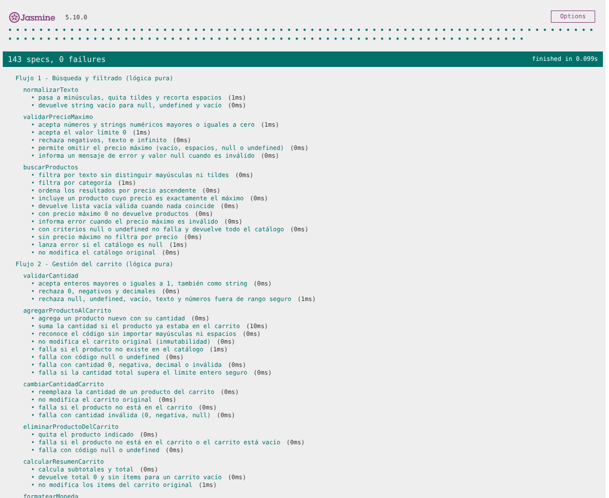
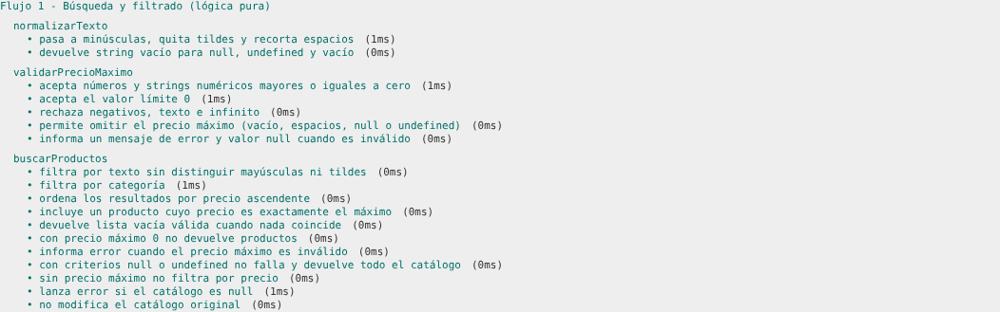
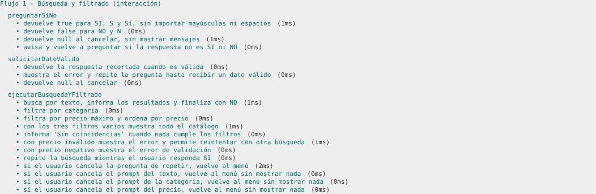
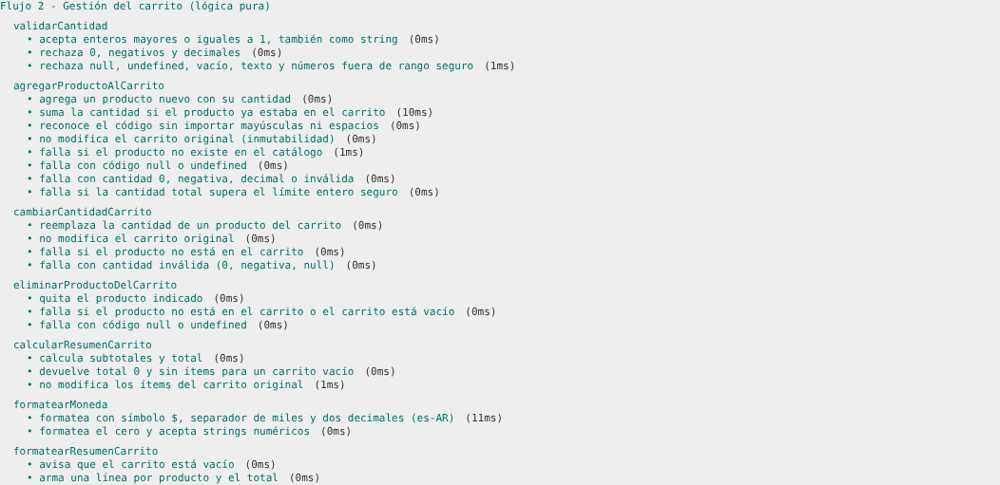
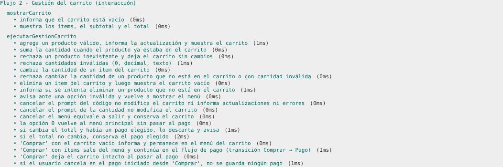
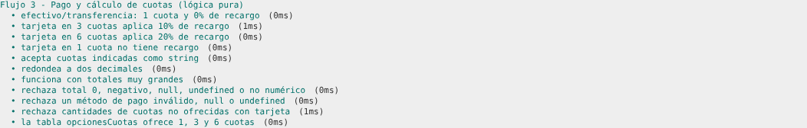
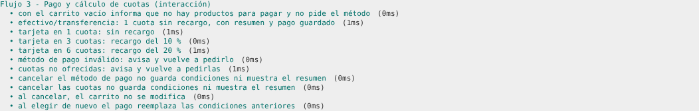
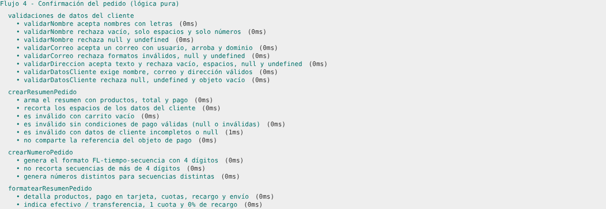
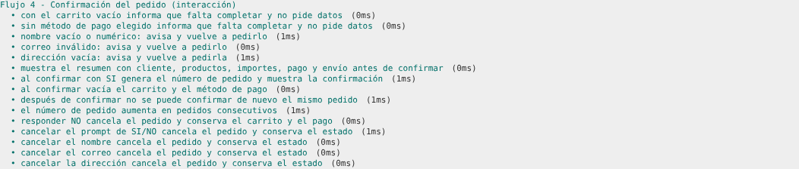
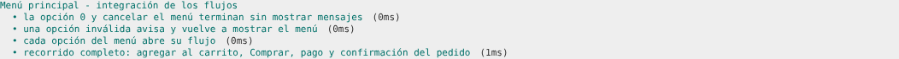

# Documentación de Testing - Suite Jasmine

Proyecto FerroLab - Actividad Obligatoria N°3 - Programación Web I
Archivo testeado: `js/script.js` | Framework: Jasmine 5.10.0 (CDN)

## Índice
1. [Ejecución de Tests](#ejecución-de-tests)
2. [Suites de Tests](#suites-de-tests)
3. [Métricas de Cobertura](#métricas-de-cobertura)
4. [Capturas de Pantalla](#capturas-de-pantalla)
5. [Issues Conocidos](#issues-conocidos)

---

## Ejecución de Tests

### Pasos para Ejecutar
1. Servir la carpeta del proyecto por HTTP desde la raíz del repo (con Node instalado):
   ```bash
   npx serve . -l 3000
   ```
   También sirve la extensión Live Preview de VS Code.
2. Abrir `js/test/test-runner.html` en el navegador:
   ```text
   http://127.0.0.1:3000/js/test/test-runner.html
   ```
   Agregando `?random=false` al final, Jasmine ejecuta las suites en orden (Flujo 1 a 4). Sin ese parámetro el orden es aleatorio y cambia el `seed` en cada corrida.
3. Los tests se ejecutan automáticamente al cargar la página.
4. Verificar resultados en la interfaz de Jasmine (la barra superior muestra el total de specs y fallos).

`test-runner.html` carga `js/script.js` (código a testear) y `js/test/script.spec.js` (tests). Requiere conexión a internet porque Jasmine se carga desde `cdnjs.cloudflare.com`.

### Interpretación de Resultados
- **Verde**: Tests pasando ✅
- **Rojo**: Tests fallando ❌
- **Amarillo**: Tests pendientes ⚠️

---

## Suites de Tests

Hay dos tipos de suites por cada flujo:

- **Lógica pura** (73 tests): funciones que reciben parámetros y devuelven un resultado.
- **Interacción** (70 tests): funciones que usan `prompt()` y `alert()` (`ejecutarBusquedaYFiltrado`, `ejecutarGestionCarrito`, `ejecutarPago`, `ejecutarConfirmacionPedido`, `solicitarDatoValido`, `preguntarSiNo`, `mostrarCarrito` e `iniciarMenuPrincipal`). Se reemplazan `prompt()` y `alert()` con espías de Jasmine (`spyOn(window, "prompt")` con `and.callFake`, y `spyOn(window, "alert")`), de modo que no se abre ningún cuadro real. Los tests verifican los argumentos y la cantidad de llamadas, el orden de interacción, los mensajes mostrados y el estado final (carrito y condiciones de pago).

### Suite 1: Flujo 1 - Búsqueda y filtrado

**Funciones testeadas:**

- `normalizarTexto()` - Pasa a minúsculas, quita tildes y recorta espacios
- `validarPrecioMaximo()` - Valida el precio máximo: número ≥ 0, u omitido (vacío, `null` o `undefined`)
- `buscarProductos()` - Filtra por texto, categoría y precio máximo (opcional) y ordena por precio

**Casos de prueba:**

| # | Descripción | Tipo |
|---|-------------|------|
| 1 | Pasa a minúsculas, quita tildes y recorta espacios | Happy Path |
| 2 | Devuelve string vacío para null, undefined y vacío | Validación de Errores |
| 3 | Acepta números y strings numéricos mayores o iguales a cero | Happy Path |
| 4 | Acepta el valor límite 0 | Caso Borde |
| 5 | Rechaza negativos, texto e infinito | Validación de Errores |
| 6 | Permite omitir el precio máximo (vacío, espacios, null o undefined) | Caso Borde |
| 7 | Informa mensaje de error y valor null cuando el precio es inválido | Validación de Errores |
| 8 | Filtra por texto sin distinguir mayúsculas ni tildes | Happy Path |
| 9 | Filtra por categoría | Happy Path |
| 10 | Ordena los resultados por precio ascendente | Operaciones Arrays/Objetos |
| 11 | Incluye un producto cuyo precio es exactamente el máximo | Caso Borde |
| 12 | Devuelve lista vacía válida cuando nada coincide | Caso Borde |
| 13 | Con precio máximo 0 no devuelve productos | Caso Borde |
| 14 | Informa error cuando el precio máximo es inválido | Validación de Errores |
| 15 | Con criterios null o undefined no falla y devuelve todo el catálogo | Caso Borde |
| 16 | Sin precio máximo no filtra por precio | Happy Path |
| 17 | Lanza error si el catálogo es null | Validación de Errores |
| 18 | No modifica el catálogo original | Operaciones Arrays/Objetos |

**Total de la suite:** 18 tests

---

### Suite 2: Flujo 2 - Gestión del carrito

**Funciones testeadas:**

- `validarCantidad()` - Valida enteros ≥ 1
- `agregarProductoAlCarrito()` - Agrega un producto o suma su cantidad
- `cambiarCantidadCarrito()` - Reemplaza la cantidad de un producto del carrito
- `eliminarProductoDelCarrito()` - Quita un producto del carrito
- `calcularResumenCarrito()` - Calcula subtotales y total
- `formatearMoneda()` - Da formato de moneda argentina (`$1.234,50`)
- `formatearResumenCarrito()` - Convierte el resumen del carrito en texto con una línea por producto y el total

**Casos de prueba:**

| # | Descripción | Tipo |
|---|-------------|------|
| 1 | Acepta enteros mayores o iguales a 1, también como string | Happy Path |
| 2 | Rechaza 0, negativos y decimales | Caso Borde |
| 3 | Rechaza null, undefined, vacío, texto y números fuera de rango seguro | Validación de Errores |
| 4 | Agrega un producto nuevo con su cantidad | Happy Path |
| 5 | Suma la cantidad si el producto ya estaba en el carrito | Operaciones Arrays/Objetos |
| 6 | Reconoce el código sin importar mayúsculas ni espacios | Caso Borde |
| 7 | No modifica el carrito original al agregar (inmutabilidad) | Operaciones Arrays/Objetos |
| 8 | Falla si el producto no existe en el catálogo | Validación de Errores |
| 9 | Falla con código null o undefined al agregar | Validación de Errores |
| 10 | Falla con cantidad 0, negativa, decimal o inválida al agregar | Validación de Errores |
| 11 | Falla si la cantidad total supera el límite entero seguro | Caso Borde |
| 12 | Reemplaza la cantidad de un producto del carrito | Happy Path |
| 13 | No modifica el carrito original al cambiar la cantidad | Operaciones Arrays/Objetos |
| 14 | Falla al cambiar la cantidad si el producto no está en el carrito | Validación de Errores |
| 15 | Falla al cambiar la cantidad con valor inválido (0, negativa, null) | Validación de Errores |
| 16 | Quita el producto indicado del carrito | Operaciones Arrays/Objetos |
| 17 | Falla al eliminar si el producto no está o el carrito está vacío | Validación de Errores |
| 18 | Falla al eliminar con código null o undefined | Validación de Errores |
| 19 | Calcula subtotales y total | Happy Path |
| 20 | Devuelve total 0 y sin ítems para un carrito vacío | Caso Borde |
| 21 | No modifica los ítems del carrito original al calcular el resumen | Operaciones Arrays/Objetos |
| 22 | Formatea con símbolo $, separador de miles y dos decimales (es-AR) | Happy Path |
| 23 | Formatea el cero y acepta strings numéricos | Caso Borde |
| 24 | Avisa que el carrito está vacío | Caso Borde |
| 25 | Arma una línea por producto y el total | Happy Path |

**Total de la suite:** 25 tests

---

### Suite 3: Flujo 3 - Pago y cálculo de cuotas

**Funciones testeadas:**

- `calcularCondicionesPago()` - Calcula interés, total financiado y valor de cuota según método y cuotas

**Casos de prueba:**

| # | Descripción | Tipo |
|---|-------------|------|
| 1 | Efectivo/transferencia: 1 cuota y 0 % de recargo | Happy Path |
| 2 | Tarjeta en 3 cuotas aplica 10 % de recargo | Happy Path |
| 3 | Tarjeta en 6 cuotas aplica 20 % de recargo | Happy Path |
| 4 | Tarjeta en 1 cuota no tiene recargo | Caso Borde |
| 5 | Acepta cuotas indicadas como string | Caso Borde |
| 6 | Redondea a dos decimales | Caso Borde |
| 7 | Funciona con totales muy grandes | Caso Borde |
| 8 | Rechaza total 0, negativo, null, undefined o no numérico | Validación de Errores |
| 9 | Rechaza un método de pago inválido, null o undefined | Validación de Errores |
| 10 | Rechaza cantidades de cuotas no ofrecidas con tarjeta | Validación de Errores |
| 11 | La tabla opcionesCuotas ofrece 1, 3 y 6 cuotas | Operaciones Arrays/Objetos |

**Total de la suite:** 11 tests

---

### Suite 4: Flujo 4 - Confirmación del pedido

**Funciones testeadas:**

- `validarNombre()` - Nombre no vacío ni solo numérico
- `validarCorreo()` - Correo con usuario, arroba y dominio
- `validarDireccion()` - Dirección no vacía
- `validarDatosCliente()` - Valida nombre, correo y dirección en conjunto
- `crearResumenPedido()` - Arma el resumen del pedido
- `crearNumeroPedido()` - Genera el número `FL-tiempo-secuencia`
- `formatearResumenPedido()` - Convierte el pedido en texto con productos, pago, cuotas, recargo y envío

**Casos de prueba:**

| # | Descripción | Tipo |
|---|-------------|------|
| 1 | validarNombre acepta nombres con letras | Happy Path |
| 2 | validarNombre rechaza vacío, solo espacios y solo números | Validación de Errores |
| 3 | validarNombre rechaza null y undefined | Validación de Errores |
| 4 | validarCorreo acepta un correo con usuario, arroba y dominio | Happy Path |
| 5 | validarCorreo rechaza formatos inválidos, null y undefined | Validación de Errores |
| 6 | validarDireccion acepta texto y rechaza vacío, espacios, null y undefined | Validación de Errores |
| 7 | validarDatosCliente exige nombre, correo y dirección válidos | Happy Path |
| 8 | validarDatosCliente rechaza null, undefined y objeto vacío | Validación de Errores |
| 9 | Arma el resumen con productos, total y pago | Operaciones Arrays/Objetos |
| 10 | Recorta los espacios de los datos del cliente | Caso Borde |
| 11 | Resumen inválido con carrito vacío | Validación de Errores |
| 12 | Resumen inválido sin condiciones de pago válidas | Validación de Errores |
| 13 | Resumen inválido con datos de cliente incompletos o null | Validación de Errores |
| 14 | No comparte la referencia del objeto de pago | Operaciones Arrays/Objetos |
| 15 | Genera el formato FL-tiempo-secuencia con 4 dígitos | Happy Path |
| 16 | No recorta secuencias de más de 4 dígitos | Caso Borde |
| 17 | Genera números distintos para secuencias distintas | Happy Path |
| 18 | Detalla productos, pago en tarjeta, cuotas, recargo y envío | Happy Path |
| 19 | Indica efectivo / transferencia, 1 cuota y 0 % de recargo | Caso Borde |

**Total de la suite:** 19 tests

### Suites de interacción (prompt/alert con espías)

Cada una cubre cancelaciones, entradas inválidas con reintento, despacho y mensajes esperados del flujo, según los diagramas de actividades.

| Suite | Tests | Qué verifica |
|-------|-------|--------------|
| Flujo 1 - Búsqueda y filtrado (interacción) | 19 | `preguntarSiNo` y `solicitarDatoValido` (SI/NO, cancelación, reintento); `ejecutarBusquedaYFiltrado`: búsqueda por texto, por categoría y por precio máximo con orden por precio, filtros vacíos, "Sin coincidencias", precio inválido con reintento, repetición con SI y cancelación en cada `prompt` |
| Flujo 2 - Gestión del carrito (interacción) | 21 | `mostrarCarrito` (vacío y con ítems); `ejecutarGestionCarrito`: agregar válido e inválido, sumar cantidades, cambiar cantidad, eliminar, opción inválida, cancelar cada entrada, salir con 0 o cancelando el menú, descarte del pago cuando cambia el total, y la opción «Comprar» (carrito vacío: informa y permanece; con ítems: sale y continúa en el pago) |
| Flujo 3 - Pago y cálculo de cuotas (interacción) | 11 | `ejecutarPago`: carrito vacío, efectivo/transferencia, tarjeta en 1, 3 y 6 cuotas con recargo, método y cuotas inválidos con reintento, cancelación en cada paso sin dejar condiciones guardadas y resumen mostrado |
| Flujo 4 - Confirmación del pedido (interacción) | 15 | `ejecutarConfirmacionPedido`: carrito vacío o sin pago, nombre/correo/dirección inválidos con reintento, resumen mostrado, número de pedido, vaciado de carrito y pago al confirmar, NO y cancelación en cada dato conservando el estado |
| Menú principal - integración de los flujos | 4 | `iniciarMenuPrincipal`: salir, opción inválida, despacho de cada opción y recorrido completo carrito → Comprar → pago → confirmación |

**Total de las suites de interacción:** 70 tests

---
## Métricas de Cobertura

### Resumen General
| Métrica | Valor |
|---------|-------|
| Total de Tests | 143 (73 de lógica pura + 70 de interacción) |
| Tests Pasando | 143 ✅ |
| Tests Fallando | 0 ❌ |
| Porcentaje de Éxito | 100% |

Resultado de la corrida en Chromium (Playwright, por script) sobre `test-runner.html?random=false`: `143 specs, 0 failures`, sin abrirse ningún cuadro de diálogo real. La misma suite también se corrió en Node con `jasmine` 5 (`143 specs, 0 failures`).

### Cobertura por Tipo de Test
Cada test de lógica pura (los 73 originales) se clasificó según su propósito principal. Los 70 tests de interacción no se clasifican por tipo: se agrupan por flujo en la tabla de suites de interacción.

| Tipo | Cantidad | Porcentaje |
|------|----------|------------|
| Happy Path | 20 | 27,4% |
| Casos Borde | 19 | 26,0% |
| Validación de Errores | 24 | 32,9% |
| Operaciones Arrays/Objetos | 10 | 13,7% |

### Análisis de Cobertura de Código
**Metodología:** Se ejecutó la suite completa (`script.spec.js`, 143 specs) contra `js/script.js` en Node.js con `jasmine` 5 (`jasmine-core` 5.10.0) y se midió la cobertura con la herramienta `c8` (cobertura de V8). `script.js` se carga como script clásico, igual que en el navegador, y `prompt()`/`alert()` se reemplazan con espías. La medición se hizo fuera del repositorio y no forma parte de la ejecución en el navegador. Las "líneas ejecutables" son las líneas con sentencias según `c8`, sin líneas en blanco ni comentarios.

**Resultado de `c8` sobre todo el archivo `js/script.js`:**

| Métrica | Valor |
|---------|-------|
| Funciones | 100 % (28/28) |
| Ramas | 96,27 % (207/215) |
| Líneas | 95,48 % (825/864) |

**Cobertura por función** (las 28 funciones tienen tests; incluye las funciones con `prompt()`/`alert()`):

| Función | Líneas Ejecutables | Líneas Cubiertas | Cobertura |
|---------|--------------------|------------------|-----------|
| `normalizarTexto()` | 7 | 7 | 100% |
| `validarPrecioMaximo()` | 19 | 19 | 100% |
| `buscarProductos()` | 35 | 35 | 100% |
| `validarCantidad()` | 8 | 8 | 100% |
| `agregarProductoAlCarrito()` | 44 | 44 | 100% |
| `cambiarCantidadCarrito()` | 22 | 22 | 100% |
| `eliminarProductoDelCarrito()` | 10 | 10 | 100% |
| `calcularResumenCarrito()` | 10 | 10 | 100% |
| `calcularCondicionesPago()` | 36 | 36 | 100% |
| `validarNombre()` | 4 | 4 | 100% |
| `validarCorreo()` | 3 | 3 | 100% |
| `validarDireccion()` | 3 | 3 | 100% |
| `validarDatosCliente()` | 8 | 8 | 100% |
| `crearResumenPedido()` | 19 | 19 | 100% |
| `crearNumeroPedido()` | 3 | 3 | 100% |
| `formatearMoneda()` | 6 | 6 | 100% |
| `formatearResumenCarrito()` | 12 | 12 | 100% |
| `formatearResumenPedido()` | 14 | 14 | 100% |
| `solicitarDatoValido()` | 12 | 12 | 100% |
| `preguntarSiNo()` | 16 | 16 | 100% |
| `ejecutarBusquedaYFiltrado()` | 36 | 36 | 100% |
| `mostrarCarrito()` | 6 | 6 | 100% |
| `actualizarCarrito()` | 17 | 17 | 100% |
| `ejecutarGestionCarrito()` | 65 | 65 | 100% |
| `ejecutarPago()` | 60 | 57 | 95% |
| `informarPedidoCancelado()` | 3 | 3 | 100% |
| `ejecutarConfirmacionPedido()` | 67 | 64 | 96% |
| `iniciarMenuPrincipal()` | 27 | 27 | 100% |

**Cobertura de las 28 funciones:** 98,95 % (566/572 líneas ejecutables).

#### Líneas NO Cubiertas
- `script.js:698-700` - En `ejecutarPago()`, la comprobación `if (!condiciones.valido)`. Es una guarda defensiva: el flujo solo llega ahí con un total mayor que cero y con un método y cuotas ya validados, por lo que `calcularCondicionesPago()` no puede devolver un error.
- `script.js:767-769` - En `ejecutarConfirmacionPedido()`, la comprobación `if (!resumen.valido)`. Es una guarda defensiva por el mismo motivo: el carrito, el pago y los datos ya se validaron antes.
- `script.js:830-831` - Arranque automático del menú (`data-iniciar-menu`): solo se ejecuta en `index.html`; `test-runner.html` no lo activa a propósito. Se comprobó a mano en Chromium que `index.html` abre el menú principal.
- `script.js:834-864` - Bloque `module.exports`: se carga como script clásico, así que no se ejecuta; existe para poder usar el archivo desde Node.
- Ramas no cubiertas (8 de 215): las condiciones del arranque automático y de `module.exports` (líneas 828-833), las dos guardas defensivas (líneas 697 y 766) y la rama `codigo || ""` de `cambiarCantidadCarrito()` (línea 237) cuando el código es `null` o `undefined`, que ningún test ejecuta.

---

## Capturas de Pantalla

### Tests Pasando

*Todos los tests ejecutándose correctamente (143 specs, 0 failures)*

### Vista Detallada de Suites

*Suite Flujo 1 - Búsqueda y filtrado (lógica pura)*


*Suite Flujo 1 - Búsqueda y filtrado (interacción)*


*Suite Flujo 2 - Gestión del carrito (lógica pura)*


*Suite Flujo 2 - Gestión del carrito (interacción, incluye la transición Comprar → Pago)*


*Suite Flujo 3 - Pago y cálculo de cuotas (lógica pura)*


*Suite Flujo 3 - Pago y cálculo de cuotas (interacción)*


*Suite Flujo 4 - Confirmación del pedido (lógica pura)*


*Suite Flujo 4 - Confirmación del pedido (interacción)*


*Suite Menú principal - integración de los flujos*

Las capturas se tomaron en Chromium con Playwright (por script) sobre `test-runner.html?random=false`. No hay capturas de tests fallando porque la corrida final no tuvo fallos; la evidencia de tests que fallan está en el Issue #127.

---

## Issues Conocidos

No hubo tests fallando en la corrida final. Se registra un bug detectado por revisión del código, ya resuelto, y se documenta con pasos de reproducción y con el test que falla contra la versión anterior.

### Issue #127: Omitir el precio máximo devolvía error y la condición `valor === null` era inalcanzable
- **Severidad:** Baja
- **Suite Afectada:** `describe("buscarProductos")` y `describe("validarPrecioMaximo")`, en "Flujo 1 - Búsqueda y filtrado (lógica pura)"
- **Tests Afectados:** `validarPrecioMaximo › permite omitir el precio máximo (vacío, espacios, null o undefined)`, `buscarProductos › sin precio máximo no filtra por precio` y `buscarProductos › con criterios null o undefined no falla y devuelve todo el catálogo`
- **Comportamiento Esperado:** Que un precio máximo vacío, `null` o `undefined` signifique "no filtrar por precio" (regla acordada con el Desarrollador JavaScript y reflejada en los diagramas de actividades) y que todas las condiciones del filtro puedan evaluarse en algún caso.
- **Comportamiento Obtenido (versión anterior, commit `95d2d5f`):** `validarPrecioMaximo()` trataba el valor vacío como inválido (`valido: false`), por lo que `buscarProductos()` devolvía el error "El precio maximo debe ser un numero mayor o igual a cero." y una lista vacía. Además, la condición `precioValidado.valor === null` de `buscarProductos()` nunca era verdadera, porque si el precio era válido `valor` siempre era un número.
- **Pasos para Reproducir (contra `js/script.js` del commit `95d2d5f`):**
  1. Abrir `js/test/test-runner.html` apuntando a esa versión de `js/script.js`, o cargarla en Node.
  2. Ejecutar `buscarProductos(catalogoPrueba, { texto: "", categoria: "", precioMaximo: "" })`.
  3. Resultado obtenido: `{ valido: false, error: "El precio maximo debe ser un numero mayor o igual a cero.", resultados: [] }`. Resultado esperado: `valido: true` y los 3 productos de `catalogoPrueba`, ordenados por precio.
- **Código del Test que Falla** (contra la versión anterior):
  ```javascript
  it("sin precio máximo no filtra por precio", function () {
      var r = buscarProductos(catalogoPrueba, { texto: "", categoria: "", precioMaximo: "" });
      expect(r.valido).toBeTruthy();
      expect(r.resultados.map(function (p) { return p.codigo; })).toEqual(["C-003", "A-001", "B-002"]);
  });
  ```
  Resultado contra la versión anterior: `Expected false to be truthy.` y `Expected $.length = 0 to equal 3.` Los otros dos tests afectados también fallan contra esa versión; se comprobó ejecutando la suite contra el `script.js` del commit `95d2d5f`.
- **GitHub Issue:** [#127](https://github.com/angelgc9107-lgtm/ProyectoFerreteria_GRP05/issues/127)
- **Estado:** Resuelto. El Desarrollador JavaScript modificó `validarPrecioMaximo()` para permitir omitir el precio máximo (devuelve `valido: true` y `valor: null`), de modo que la condición ahora es alcanzable. Con `script.js` actual los tres tests pasan.

---

## Limitaciones del Testing

- Tests síncronos únicamente (sin Promises/async-await).
- Sin cobertura automatizada dentro del repositorio: la cobertura se midió en Node con `c8`, fuera del repo.
- Requiere conexión a internet (CDN de Jasmine).
- No hay tests de integración con el DOM; las funciones con `prompt()`/`alert()` se testean con espías, no con cuadros de diálogo reales.
- Quedan sin cubrir las dos guardas defensivas de `ejecutarPago()` y `ejecutarConfirmacionPedido()`, el arranque automático de `index.html` y el bloque `module.exports` (ver "Líneas NO Cubiertas").
- Los casos que el spec del Desarrollador JavaScript deja sin definir (búsqueda con texto o categoría vacíos, cancelación de los `prompt`) se cubren según las reglas acordadas en los diagramas de actividades.
- La clasificación por tipo de test es manual y solo cubre los 73 tests de lógica pura.

---

**Última Actualización:** 2026-11-05 (correcciones de la revisión del profesor)
**Tester/QA Engineer:** Thiago Piastrellini (@Piastrellini)
**Colaboración con:** Desarrollador JavaScript - @angelgc9107-lgtm