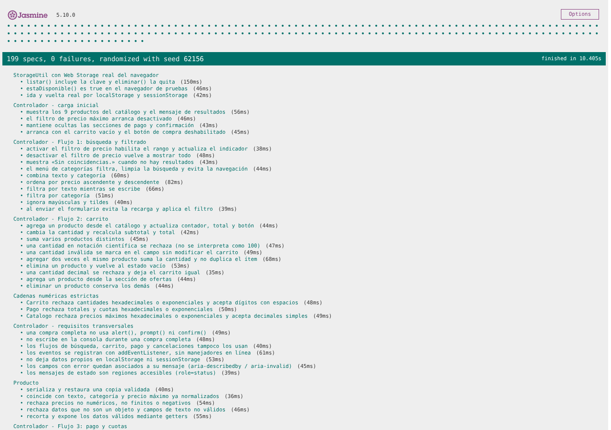
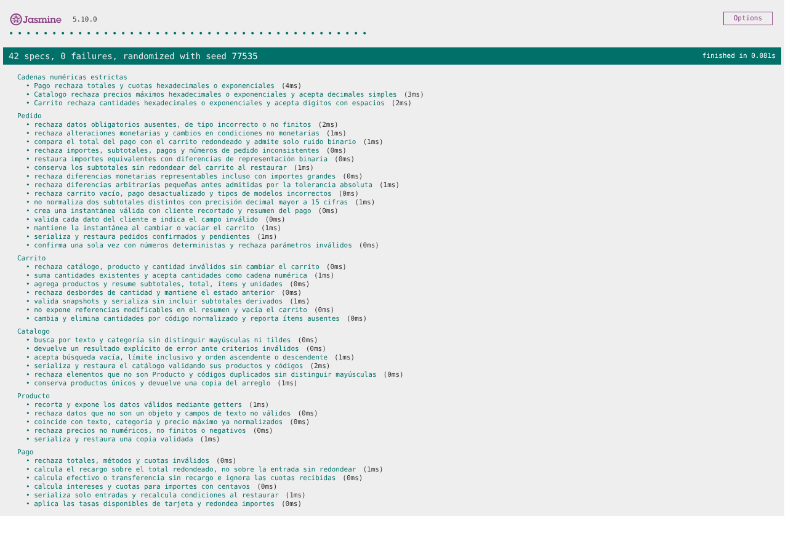
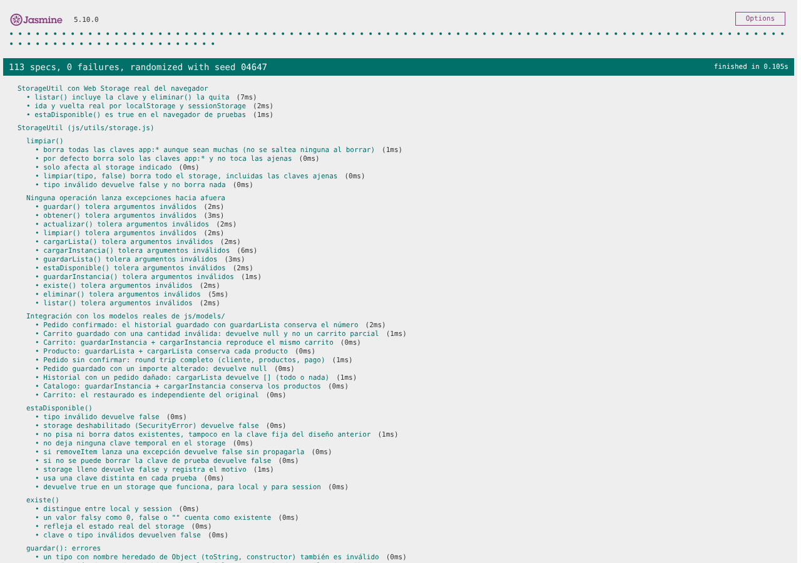

# Documentación de Testing - Suite Jasmine

Proyecto FerroLab - Actividad Obligatoria N°4 - Programación Web I
Módulos testeados: `js/models/*.js`, `js/utils/storage.js` y `js/script.js` | Framework: Jasmine 5.10.0 (CDN)

## Índice
1. [Estructura de la suite](#estructura-de-la-suite)
2. [Ejecución de Tests](#ejecución-de-tests)
3. [Suites de Tests](#suites-de-tests)
4. [Métricas de Cobertura](#métricas-de-cobertura)
5. [Capturas de Pantalla](#capturas-de-pantalla)
6. [Hallazgos e Issues](#hallazgos-e-issues)
7. [Limitaciones del Testing](#limitaciones-del-testing)
8. [Historial: tercera entrega](#historial-tercera-entrega)

---

## Estructura de la suite

En la tercera entrega `js/script.js` tenía la lógica y usaba `prompt()`/`alert()`. En la cuarta entrega se separó en tres capas y hay un archivo spec por cada una:

| Módulo | Qué contiene | Spec | Specs |
|---|---|---|---|
| `js/models/` (`Producto`, `Catalogo`, `Carrito`, `Pago`, `Pedido`) | Lógica de negocio con clases, sin DOM ni Storage | `js/test/models.spec.js` | 42 |
| `js/utils/storage.js` (`StorageUtil`) | Capa de abstracción de `localStorage`/`sessionStorage` | `js/test/storage.spec.js` | 113 |
| `js/script.js` | Controlador: eventos y DOM | `js/test/script.spec.js` | 53 |
| | | **Total** | **208** |

`js/test/test-runner.html` carga los tres specs como módulos ES. `js/test/models-test-runner.html` es el runner independiente que armó el Desarrollador JS POO para sus modelos y se conserva.

## Ejecución de Tests

### Pasos para Ejecutar
1. Servir el proyecto por HTTP **desde la raíz del repo**. Los specs usan módulos ES, que el navegador bloquea al abrir el archivo con doble clic (`file://`):
   ```bash
   python -m http.server 8000
   ```
   También sirven `npx serve .` o la extensión Live Preview de VS Code.
2. Abrir el runner:
   ```text
   http://localhost:8000/js/test/test-runner.html
   ```
3. Los tests se ejecutan al cargar la página. La barra superior de Jasmine muestra el total de specs y los fallos.
4. Para correr una sola suite se filtra por nombre con el parámetro `spec`: `?spec=StorageUtil`, `?spec=Controlador`, `?spec=Pedido`. Con `?random=false` el orden es fijo.

Requiere conexión a internet: Jasmine se carga desde `cdnjs.cloudflare.com` y `index.html` (que `script.spec.js` abre en un iframe) carga Bootstrap desde `cdn.jsdelivr.net`.

### Cómo funciona cada spec
- **`models.spec.js`** importa las clases (`import { Carrito } from "../models/Carrito.js"`) y las prueba de forma aislada.
- **`storage.spec.js`** importa `StorageUtil` y reemplaza `localStorage`/`sessionStorage` por un `Storage` simulado en memoria (`StorageFalso`), para forzar errores (cuota llena, `SecurityError`) sin tocar el almacenamiento real. Un bloque usa los modelos reales de `js/models/` (`Carrito`, `Catalogo`, `Producto`, `Pedido`) para comprobar los round trips con `toJSON()` / `fromJSON()`. El último bloque usa el Web Storage real del navegador y borra sus propias claves al terminar.
- **`script.spec.js`**: `script.js` ya no exporta funciones, solo registra eventos sobre `index.html`. Por eso, para cada test se abre una copia nueva de `index.html` en un `<iframe>` del mismo origen, se disparan eventos reales (`click`, `input`, `change`, `submit`) y se comprueba el DOM resultante. Cada copia empieza con el carrito, el pago y el pedido en blanco. Antes de cada test se reemplazan `alert`, `prompt`, `confirm`, `console.log` y `console.error` del iframe por espías.

---

## Suites de Tests

### `models.spec.js` (42 specs)

| Suite | Specs | Qué se prueba |
|---|---|---|
| `Producto` | 5 | Constructor, getters, `coincide()` por texto, categoría y precio; validaciones |
| `Catalogo` | 6 | `buscar()` con filtros y orden, copias independientes, códigos duplicados, errores |
| `Carrito` | 7 | `agregar`, `cambiarCantidad`, `eliminar`, `vaciar`, `resumir()`, desbordes, estado intacto ante errores |
| `Pago` | 6 | Efectivo/transferencia, tarjeta en 1/3/6 cuotas (0/10/20 %), redondeo, entradas inválidas |
| `Pedido` | 15 | Validación de cliente, coherencia con el pago, `confirmar()` determinista, `toJSON()`/`fromJSON()` |
| `Cadenas numéricas estrictas` | 3 | `"0x10"`, `"1e2"` y `"1e3"` se rechazan en `Carrito`, `Catalogo` y `Pago`; se aceptan dígitos con espacios |

### `storage.spec.js` (113 specs)

| Suite | Specs | Qué se prueba |
|---|---|---|
| Nombres de clave (`CLAVES`) | 3 | Convención `app:<dominio>:<dato>` |
| `guardar()` y `obtener()` | 9 | Ida y vuelta en `localStorage` y `sessionStorage`, valores `null`, anidados, clave inexistente |
| `guardar()`: errores | 15 | Cuota llena, valor no serializable, referencia circular, clave o tipo inválidos |
| Datos corruptos | 4 | JSON inválido: devuelve `null` y registra el error sin lanzar |
| `actualizar()` | 6 | Actualiza claves existentes; no crea las inexistentes |
| `eliminar()` | 6 | Elimina; es idempotente |
| `listar()` | 7 | Claves con prefijo, ordenadas; sin coincidencias |
| `limpiar()` | 5 | Borra solo `app:*`; `limpiar(tipo, false)` borra todo |
| `existe()` | 4 | Refleja el estado real |
| `estaDisponible()` | 9 | Storage deshabilitado o inaccesible |
| Storage inaccesible (`SecurityError`) | 3 | Ninguna operación lanza |
| Storage no disponible en el entorno | 1 | Entorno sin Web Storage |
| `guardarInstancia()` y `cargarInstancia()` | 8 | Contrato genérico con una clase auxiliar `Modelo` (`toJSON()` / `fromJSON()`) |
| `guardarLista()` y `cargarLista()` | 9 | Contrato genérico con `Modelo`: listas, lista vacía, datos que ya no cumplen las reglas |
| Integración con los modelos reales de `js/models/` | 9 | Round trip de `Carrito`, `Catalogo`, `Producto` y `Pedido` (sin confirmar y confirmado); datos alterados (cantidad negativa, importe modificado, correo inválido) devuelven `null` o `[]`, sin objetos parciales |
| Ninguna operación lanza excepciones hacia afuera | 12 | Se verifica para cada operación |
| Web Storage real del navegador | 3 | Ciclo completo sin dejar claves |

### `script.spec.js` (53 specs)

| Suite | Specs | Qué se prueba |
|---|---|---|
| Carga inicial | 4 | 9 productos visibles, carrito vacío, botón deshabilitado, pago y confirmación ocultos |
| Flujo 1: búsqueda y filtrado | 10 | Texto, tildes y mayúsculas, «Sin coincidencias.», envío del formulario (`preventDefault`), categoría, orden asc/desc, rango de precio, menú de categorías |
| Flujo 2: carrito | 10 | Agregar desde catálogo y ofertas, sumar cantidades, cambiar cantidad, cantidad inválida (`0`, `1.5`, `1e2`), eliminar |
| Flujo 3: pago y cuotas | 11 | Indicador de carga, efectivo, tarjeta en 3 y 6 cuotas con importes, método faltante, un cambio del carrito descarta el pago, cancelar pago |
| Flujo 4: confirmación del pedido | 11 | Validación en tiempo real (nombre, correo con `ñ`, dirección), resumen previo, confirmar (`FL-<ms>-0001`), segunda compra (`0002`), cancelar pedido |
| Requisitos transversales | 7 | Sin `alert`/`prompt`/`confirm`, sin `console.log`/`error`, sin datos en Web Storage, eventos sin manejadores en línea, regiones `role="status"`, `aria-invalid` y `aria-describedby` |

---

## Métricas de Cobertura

Corrida completa de `test-runner.html`: **208 specs, 0 failures**.

Cobertura de **líneas ejecutables**, medida con la cobertura de código de V8 (Chromium, vía Playwright) durante esa misma corrida. No cuentan líneas en blanco, comentarios ni llaves de cierre. Es cobertura de líneas: no mide ramas.

| Archivo | Líneas ejecutables | Cubiertas | Cobertura |
|---|---|---|---|
| `js/models/Producto.js` | 44 | 44 | 100,0 % |
| `js/models/Catalogo.js` | 46 | 46 | 100,0 % |
| `js/models/Carrito.js` | 92 | 87 | 94,6 % |
| `js/models/Pago.js` | 47 | 46 | 97,9 % |
| `js/models/Pedido.js` | 110 | 110 | 100,0 % |
| `js/utils/storage.js` | 283 | 267 | 94,3 % |
| `js/script.js` | 611 | 562 | 92,0 % |
| **Total** | **1233** | **1162** | **94,2 %** |

Las líneas sin cubrir son sobre todo guardas defensivas que ningún test puede alcanzar (por ejemplo, `throw error` para errores que no son `TypeError`/`RangeError`, y el control de elementos obligatorios ausentes al cargar `script.js`).

### Cómo reproducir la medición

La tabla sale del script `js/test/herramientas/cobertura-v8.js`, que está en el repositorio. No es parte de la aplicación ni de los tests: solo mide.

```bash
# desde la raíz del repo, con Node 18 o superior
npm install --no-save playwright
npx playwright install chromium
node js/test/herramientas/cobertura-v8.js
```

El script levanta un servidor HTTP temporal sobre el repo, abre `js/test/test-runner.html` en Chromium, toma la cobertura de V8 mientras corre la suite completa y, al terminar, imprime el resultado de Jasmine y la tabla de arriba en Markdown. Termina con código 1 si algún spec falla. Necesita internet (Jasmine y Bootstrap vienen de CDN). El resultado es el mismo en corridas sucesivas; si cambian los tests o el código, cambia la tabla.

---

## Capturas de Pantalla

Una captura por suite y una de la corrida completa, tomadas con Playwright (Chromium) sobre el runner:


*Runner completo: 208 specs, 0 failures*


*`models.spec.js`: 42 specs, 0 failures*


*`storage.spec.js`: 113 specs, 0 failures*


*`script.spec.js`: 53 specs, 0 failures*

No hay capturas de tests fallando porque la corrida final no tuvo fallos. Para comprobar que los specs detectan errores se hizo una prueba de mutación manual: se quitó `preventDefault()` del envío de búsqueda, se cambió el contador del carrito para que cuente unidades en vez de ítems y se cambió el recargo de 3 cuotas de 10 % a 15 %. Esos tres cambios hicieron fallar tres specs de `script.spec.js`.

---

## Hallazgos e Issues

En la corrida final no hay tests fallando contra `develop`. Durante la revisión se registró lo siguiente:

- **`script.js` todavía no usa `StorageUtil`.** El plan de testing preveía probar que «el carrito persiste vía storage». Como la persistencia no está conectada en la página, ese caso no se pudo escribir y `script.spec.js` comprueba lo contrario: que una compra completa no modifica `localStorage` ni `sessionStorage` (compara el contenido antes y después, así que no depende de claves previas del navegador). Se da seguimiento con una issue asignada al Desarrollador JS Eventos + DOM. Cuando se conecte la persistencia hay que sumar la prueba: agregar productos, recargar la página y comprobar que el carrito se restaura, con storage aislado. La integración figura como pendiente en `spec-dev-storage.md` y `spec-dev-poo.md`.
- **Cadenas numéricas (`"0x10"`, `"1e2"`).** Detectado en la revisión de la PR #150 y corregido en la misma PR. El caso queda cubierto en `models.spec.js` y, desde la interfaz, en `script.spec.js` (cantidad `1e2`).
- **Correo con caracteres no ASCII (`ñandú@correo.com`).** Detectado en la revisión de la PR #156 y corregido por el Desarrollador de Eventos + DOM. Queda cubierto en `script.spec.js`.

Los hallazgos de las PRs #150 y #156 se corrigieron en esas PRs; la falta de persistencia queda como seguimiento en la issue mencionada.

---

## Limitaciones del Testing

- `script.spec.js` prueba la página real en un iframe, por lo que es más lento que los otros dos (cada test carga `index.html`; la suite completa tarda unos 12 segundos) y depende de los CDN de Bootstrap.
- El cierre del carrito (`offcanvas`) de Bootstrap se simula con el evento `hidden.bs.offcanvas`; no se prueba la animación real.
- Los desplazamientos (`scrollIntoView`) no se verifican.
- La cobertura es por líneas, con V8; no mide ramas. El script que la mide está en `js/test/herramientas/` y requiere instalar Playwright aparte (no se agrega como dependencia del proyecto).
- No hay tests de integración de la página con persistencia, porque `script.js` aún no usa `StorageUtil` (ver Hallazgos). Sí hay round trips de `StorageUtil` con los modelos reales, fuera de la página.
- El mapa de Google de `index.html` no se carga ni se prueba.

---

## Historial: tercera entrega

La suite de la tercera entrega (143 tests sobre funciones con `prompt()` y `alert()`) quedó obsoleta al reemplazarse esa lógica por clases, storage y eventos. Sus capturas (`capturas/captura-flujo-*.png`) se conservan solo como referencia histórica. El bug documentado en esa etapa fue:

### Issue #127: Omitir el precio máximo devolvía error y la condición `valor === null` era inalcanzable
- **Severidad:** Baja
- **Suite Afectada:** `describe("buscarProductos")` y `describe("validarPrecioMaximo")`, en "Flujo 1 - Búsqueda y filtrado (lógica pura)"
- **Tests Afectados:** `validarPrecioMaximo › permite omitir el precio máximo (vacío, espacios, null o undefined)`, `buscarProductos › sin precio máximo no filtra por precio` y `buscarProductos › con criterios null o undefined no falla y devuelve todo el catálogo`
- **Comportamiento Esperado:** Que un precio máximo vacío, `null` o `undefined` signifique "no filtrar por precio" (regla acordada con el Desarrollador JavaScript y reflejada en los diagramas de actividades) y que todas las condiciones del filtro puedan evaluarse en algún caso.
- **Comportamiento Obtenido (versión anterior, commit `95d2d5f`):** `validarPrecioMaximo()` trataba el valor vacío como inválido (`valido: false`), por lo que `buscarProductos()` devolvía el error "El precio maximo debe ser un numero mayor o igual a cero." y una lista vacía. Además, la condición `precioValidado.valor === null` de `buscarProductos()` nunca era verdadera, porque si el precio era válido `valor` siempre era un número.
- **Pasos para Reproducir (contra `js/script.js` del commit `95d2d5f`):**
  1. Abrir `js/test/test-runner.html` apuntando a esa versión de `js/script.js`, o cargarla en Node.
  2. Ejecutar `buscarProductos(catalogoPrueba, { texto: "", categoria: "", precioMaximo: "" })`.
  3. Resultado obtenido: `{ valido: false, error: "El precio maximo debe ser un numero mayor o igual a cero.", resultados: [] }`. Resultado esperado: `valido: true` y los 3 productos de `catalogoPrueba`, ordenados por precio.
- **Código del Test que Falla** (contra la versión anterior):
  ```javascript
  it("sin precio máximo no filtra por precio", function () {
      var r = buscarProductos(catalogoPrueba, { texto: "", categoria: "", precioMaximo: "" });
      expect(r.valido).toBeTruthy();
      expect(r.resultados.map(function (p) { return p.codigo; })).toEqual(["C-003", "A-001", "B-002"]);
  });
  ```
  Resultado contra la versión anterior: `Expected false to be truthy.` y `Expected $.length = 0 to equal 3.` Los otros dos tests afectados también fallan contra esa versión; se comprobó ejecutando la suite contra el `script.js` del commit `95d2d5f`.
- **GitHub Issue:** [#127](https://github.com/angelgc9107-lgtm/ProyectoFerreteria_GRP05/issues/127)
- **Estado:** Resuelto. El Desarrollador JavaScript modificó `validarPrecioMaximo()` para permitir omitir el precio máximo (devuelve `valido: true` y `valor: null`), de modo que la condición ahora es alcanzable. Con `script.js` actual los tres tests pasan.

---

**Última Actualización:** 2026-11-22 (cuarta entrega)
**Tester/QA Engineer:** Alan Diaz (@alandox1)
